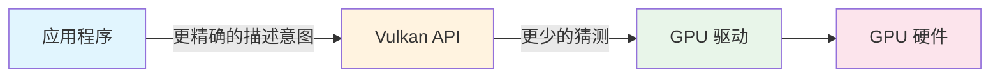
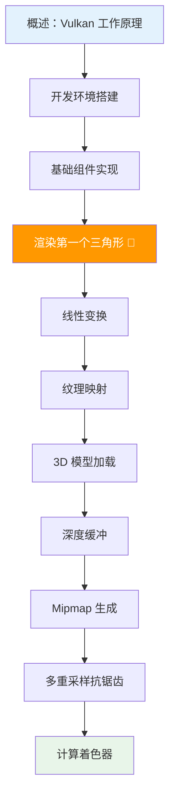

# Vulkan 教程 —— 介绍

## 关于本教程

本教程将教你使用 [Vulkan](https://www.khronos.org/vulkan/) 图形与计算 API 的基础知识。Vulkan 是由 [Khronos 组织](https://www.khronos.org/)（OpenGL 的制定者）推出的新一代图形 API，它提供了对现代显卡更好的抽象层。与 [OpenGL](https://en.wikipedia.org/wiki/OpenGL) 和 [Direct3D](https://en.wikipedia.org/wiki/Direct3D) 等现有 API 相比，这套新接口允许你更好地描述应用程序的意图，从而带来更好的性能和更少的驱动行为意外。



Vulkan 的设计理念与 [Direct3D 12](https://en.wikipedia.org/wiki/Direct3D#Direct3D_12) 和 [Metal](https://en.wikipedia.org/wiki/Metal_(API)) 相似，但 Vulkan 拥有**完全跨平台**的优势——你可以同时为 Windows、Linux 和 Android 开发。

> ⚠️ **重要提醒**：Vulkan 的代价是你需要使用一个**显著更冗长**的 API。与图形 API 相关的每一个细节都需要由你的应用程序从头设置，包括初始帧缓冲区的创建和缓冲区、纹理图像等对象的内存管理。图形驱动会做**更少的"自动处理"**，这意味着你需要在应用程序中做更多工作来确保行为正确。

## Vulkan 适合谁？

| 适合 | 不太适合 |
|------|---------|
| 对高性能计算机图形充满热情的程序员 | 更关注游戏开发而非底层图形的开发者 |
| 愿意投入精力深入学习 GPU 工作原理的人 | 希望快速出成果、不想处理底层细节的人 |
| 需要极致性能控制的专业图形开发者 | 初学图形编程的新手（建议先学 OpenGL） |

> 💡 **建议**：如果你更关注游戏开发，可以考虑使用 [Unreal Engine](https://en.wikipedia.org/wiki/Unreal_Engine#Unreal_Engine_4) 或 [Unity](https://en.wikipedia.org/wiki/Unity_(game_engine))，它们内部可以使用 Vulkan 而向你暴露更高层的 API。

## 前置要求

学习本教程之前，你需要具备：

- ✅ 一块兼容 Vulkan 的显卡和驱动程序
  - [NVIDIA 驱动](https://developer.nvidia.com/vulkan-driver)
  - [AMD 驱动](http://www.amd.com/en-us/innovations/software-technologies/technologies-gaming/vulkan)
  - [Intel 驱动](https://software.intel.com/en-us/blogs/2016/03/14/new-intel-vulkan-beta-1540204404-graphics-driver-for-windows-78110-1540)
  - [Apple Silicon (M1)](https://www.phoronix.com/scan.php?page=news_item&px=Apple-Silicon-Vulkan-MoltenVK)
- ✅ C++ 使用经验（熟悉 RAII、初始化列表）
- ✅ 支持 C++17 的编译器（Visual Studio 2017+、GCC 7+ 或 Clang 5+）
- ✅ 一定的 3D 计算机图形学基础

> ⚠️ **注意**：本教程**不会**假设你了解 OpenGL 或 Direct3D 概念，但要求你知道 3D 计算机图形学的基础知识。例如，本教程不会解释透视投影背后的数学原理。

**推荐的图形学学习资源**：
- 📖 [在线图形学教程](https://paroj.github.io/gltut/) —— 计算机图形学概念的绝佳入门
- 📖 [一周学会光线追踪](https://github.com/RayTracing/raytracing.github.io)
- 📖 [基于物理的渲染](http://www.pbr-book.org/)
- 🎮 开源引擎中 Vulkan 的实际应用：[Quake](https://github.com/Novum/vkQuake) 和 [DOOM 3](https://github.com/DustinHLand/vkDOOM3)

## 关于编程语言

本教程使用 C++ 编写，利用类和 RAII 来组织逻辑和资源生命周期。我们将使用原始 C API 来与 Vulkan 交互，以获得对底层 API 的直接体验。

> 💡 **C++ 用户提示**：如果你偏好 C++ 风格的封装，可以考虑使用 [Vulkan-Hpp](https://github.com/KhronosGroup/Vulkan-Hpp) 绑定，它对一些底层操作进行了抽象封装，有助于防止某些类型的错误。

## 教程结构



每一章大致按照以下结构组织：

1. **引入新概念**及其目的
2. **使用相关 API** 将其集成到程序中
3. **将部分功能抽象**为辅助函数

> 📌 **重要**：虽然每一章都是前一章的后续，但也可以作为独立文章阅读。所有 Vulkan 函数和类型都链接到了规范文档，你可以点击它们了解更多。

## 关于代码

每一章末尾都会提供到该章节为止的完整代码清单。如果你对代码结构有疑问，或者遇到 bug 想要对比，可以参考这些代码。所有代码文件都在多个厂商的显卡上进行了测试，以验证正确性。

> ⚠️ **易错点**：
> - Vulkan 非常新，最佳实践尚未真正建立起来
> - 代码必须严格遵循 API 要求，任何遗漏都可能导致崩溃
> - 建议始终开启验证层（validation layers）来帮助发现问题

## 学习路径总览

```
第1阶段：基础设置（较多步骤，但每步简单）
├── 创建实例 → 验证层 → 物理设备 → 逻辑设备
├── 窗口表面 → 交换链 → 图像视图
└── 图形管线 → 渲染通道 → 命令缓冲

第2阶段：渲染三角形 🎉
└── 首次在屏幕上看到图形输出！

第3阶段：增强功能
├── 顶点缓冲 → 索引缓冲
├── Uniform 缓冲 → 描述符
├── 纹理映射
└── 深度缓冲 → 模型加载 → Mipmap → 多重采样
```

> 💡 **鼓励**：虽然到第一个三角形的步骤很多，但一旦你看到了那个"无聊"的三角形，绘制带有完整纹理的 3D 模型并不需要太多额外工作，后续的每一步都会更有成就感！

准备好探索高性能图形 API 的未来了吗？[让我们开始吧！](01_总览.md)
