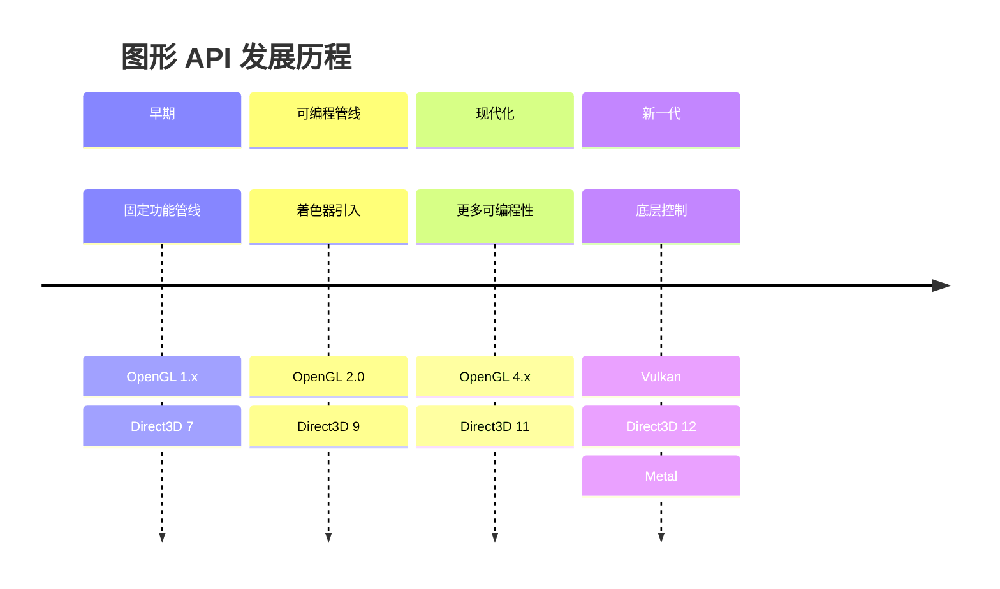
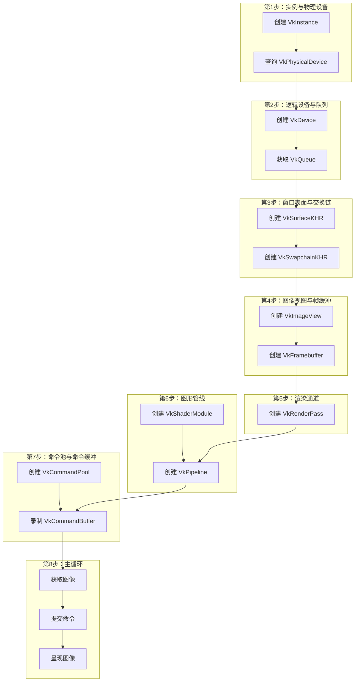
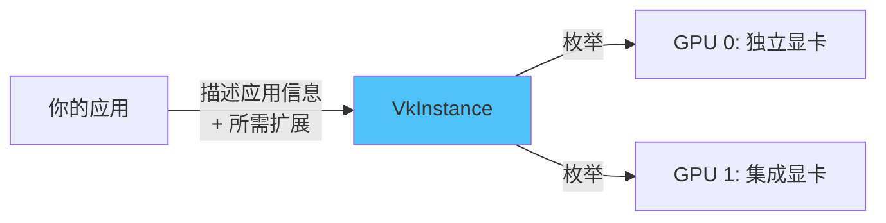
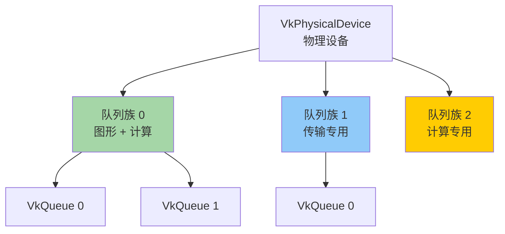
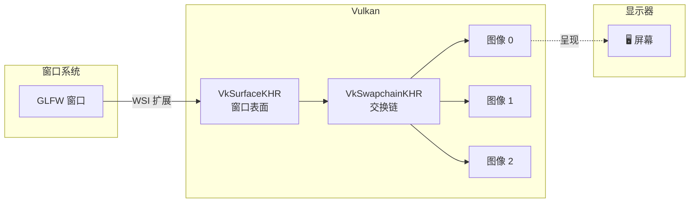
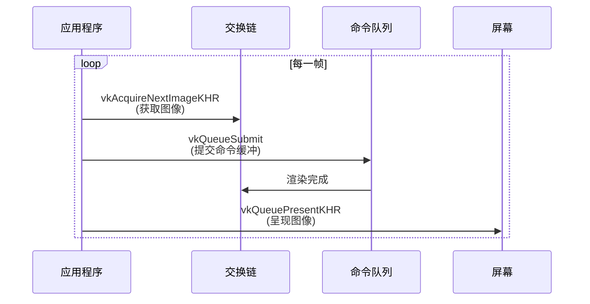
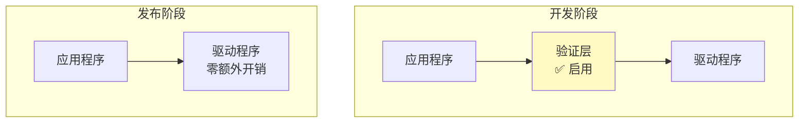
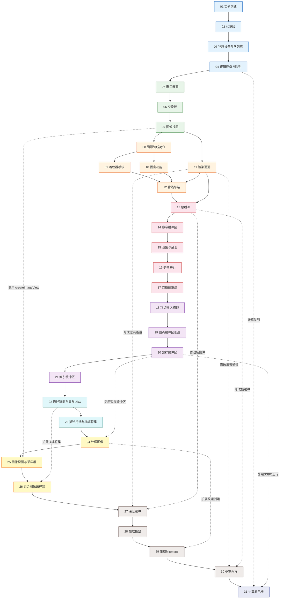
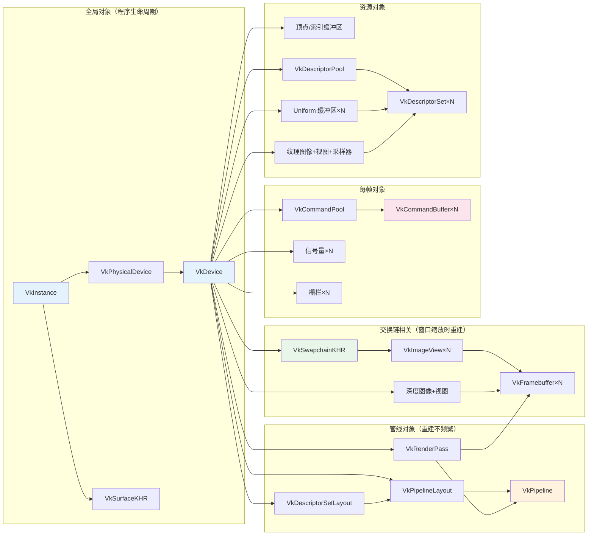

# Vulkan 教程 —— 总览

本章将介绍 Vulkan 的基本概念以及渲染第一个三角形所需的所有步骤。这将为你提供一个全景图，使后续各章节的内容在整体中有据可依。

## Vulkan 的起源



### 为什么需要 Vulkan？

过去的图形 API（如 OpenGL）设计于图形硬件主要使用**固定功能**的时代。随着显卡架构的成熟，它们提供了越来越多的可编程功能，但这些新功能必须以某种方式集成到现有 API 中。

> ⚠️ **旧 API 的核心问题**：
> 1. **驱动猜测**：驱动需要大量猜测程序员的意图来映射到现代架构
> 2. **不一致性**：不同厂商对着色器语法等的接受程度不同
> 3. **有限的多线程**：CPU 端可能成为瓶颈
> 4. **移动设备**：无法充分利用分块渲染（Tiled Rendering）等移动 GPU 特性

**Vulkan 如何解决这些问题：**

| 问题 | Vulkan 的解决方案 |
|------|-----------------|
| 驱动开销大 | 更冗长的 API 让程序员清晰表达意图，减少驱动猜测 |
| 多线程瓶颈 | 允许多线程并行创建和提交命令 |
| 着色器编译不一致 | 使用标准化字节码格式（SPIR-V），单一编译器 |
| 图形/计算分离 | 将图形和计算功能统一到单一 API |

## 绘制三角形的完整步骤

下面是在 Vulkan 中渲染一个三角形所需的所有步骤概览。**不要被步骤的多寡吓到**——每一个步骤都简单易懂。



### 第 1 步：实例与物理设备选择



Vulkan 应用程序通过创建 `VkInstance` 来初始化 Vulkan 库。实例是**应用程序与 Vulkan 库之间的连接**。创建实例时需要描述你的应用程序信息以及你将使用的 API 扩展。

创建实例后，你可以查询支持 Vulkan 的硬件，并选择一个或多个 `VkPhysicalDevice` 进行操作。你可以查询 VRAM 大小和设备能力等属性来选择合适的设备。

### 第 2 步：逻辑设备与队列族

选择合适的硬件设备后，你需要创建 `VkDevice`（逻辑设备），更具体地描述你将使用哪些 `VkPhysicalDeviceFeatures`（如多视口渲染、64 位浮点等），以及你想使用哪些**队列族**。



> 📌 **关键概念**：
> - Vulkan 中几乎所有操作（绘制命令、内存操作等）都通过提交到 `VkQueue` 来异步执行
> - 队列从**队列族**（Queue Family）中分配
> - 每个队列族仅支持特定的操作子集（图形、计算、传输等）
> - 可能存在不同的队列族分别用于图形、计算和内存传输操作

### 第 3 步：窗口表面与交换链



除非你只关心离屏渲染，否则你需要创建一个窗口来呈现渲染结果。这需要两个组件：

1. **窗口表面** (`VkSurfaceKHR`)：跨平台的窗口抽象
2. **交换链** (`VkSwapchainKHR`)：等待呈现到屏幕的图像队列

> ⚠️ **易错点**：`VK_KHR_surface` 和 `VK_KHR_swapchain` 都是 **扩展**（注意 `KHR` 后缀），不是核心 API 的一部分。Vulkan API 本身完全平台无关，需要通过 WSI（窗口系统集成）扩展与窗口管理器交互。

**交换链常见的呈现模式：**

| 模式 | 描述 | 特点 |
|------|------|------|
| `IMMEDIATE` | 立即传输 | 可能撕裂 |
| `FIFO` | 先入先出队列 | 类似垂直同步，**保证可用** |
| `FIFO_RELAXED` | 放松版 FIFO | 应用延迟时可能撕裂 |
| `MAILBOX` | 邮箱模式 | 三重缓冲，低延迟无撕裂 |

### 第 4 步：图像视图与帧缓冲

要绘制从交换链获取的图像，需要将其包装为 `VkImageView` 和 `VkFramebuffer`：
- **VkImageView**：引用图像的特定部分
- **VkFramebuffer**：引用用作颜色、深度和模板目标的图像视图

### 第 5 步：渲染通道

**渲染通道**（Render Pass）描述渲染操作期间使用的图像类型、使用方式以及内容处理方式。

```
渲染通道描述：
┌─────────────────────────────┐
│ 颜色附件：SRGB 格式           │
│ 加载操作：清除为纯色           │
│ 存储操作：保存渲染结果         │
│ 初始布局：未定义               │
│ 最终布局：呈现就绪             │
└─────────────────────────────┘
```

### 第 6 步：图形管线


> ⚠️ **与 OpenGL 的关键区别**：
> - Vulkan 中的图形管线**几乎完全不可变**
> - 如果想切换着色器或修改顶点布局，必须**完全重新创建**管线
> - 需要提前为所有不同组合创建多个 `VkPipeline` 对象
> - **好处**：驱动可以更好地优化，运行时性能更可预测

### 第 7 步：命令池与命令缓冲

绘制操作需要先录制到 `VkCommandBuffer` 中，然后再提交到队列。

```
命令缓冲录制流程：
┌─────────────────────────────┐
│ 1. 开始渲染通道               │
│ 2. 绑定图形管线               │
│ 3. 绘制 3 个顶点             │
│ 4. 结束渲染通道               │
└─────────────────────────────┘
```

### 第 8 步：主循环



> ⚠️ **同步问题（最常见的错误来源之一）**：
> - 队列操作是**异步**执行的
> - 必须使用**信号量**（Semaphore）确保正确的执行顺序
> - 绘制命令的执行必须等待图像获取完成
> - 图像呈现必须等待渲染完成

### 完整步骤总结

```
绘制第一个三角形的完整清单：
✅ 创建 VkInstance
✅ 选择 VkPhysicalDevice
✅ 创建 VkDevice 和 VkQueue
✅ 创建窗口、窗口表面和交换链
✅ 将交换链图像包装为 VkImageView
✅ 创建描述渲染目标和用途的渲染通道
✅ 为渲染通道创建帧缓冲
✅ 设置图形管线
✅ 为每个交换链图像分配和录制命令缓冲
✅ 通过获取图像、提交命令、返回图像来绘制帧
```

## API 概念

### 编码规范

所有 Vulkan 函数、枚举和结构体都定义在 `vulkan.h` 头文件中，包含在 [Vulkan SDK](https://lunarg.com/vulkan-sdk/) 中。

| 元素类型 | 命名规范 | 示例 |
|---------|---------|------|
| 函数 | 小写 `vk` 前缀 | `vkCreateInstance` |
| 类型（枚举/结构体） | `Vk` 前缀 | `VkInstance`、`VkResult` |
| 枚举值 | `VK_` 前缀 | `VK_SUCCESS` |

**对象创建的通用模式：**

```c++
// 1. 填充创建信息结构体
VkXXXCreateInfo createInfo{};
createInfo.sType = VK_STRUCTURE_TYPE_XXX_CREATE_INFO; // 必须设置正确的类型！
createInfo.pNext = nullptr;                            // 扩展结构体链
createInfo.foo = ...;
createInfo.bar = ...;

// 2. 调用创建函数
VkXXX object;
if (vkCreateXXX(&createInfo, nullptr, &object) != VK_SUCCESS) {
    // 错误处理
}
```

> ⚠️ **常见错误**：
> 1. **忘记设置 `sType`**：每个结构体都必须正确设置其 `sType` 成员
> 2. **忘记初始化结构体**：使用 `{}` 值初始化来将所有成员清零
> 3. **忽略返回值**：几乎所有函数都返回 `VkResult`，必须检查

### 验证层

Vulkan 默认只包含非常有限的错误检查和调试能力，因为它是为高性能和低驱动开销设计的。



**验证层的常见功能：**
- ✅ 检查参数值是否符合规范
- ✅ 跟踪对象的创建和销毁以发现资源泄漏
- ✅ 通过跟踪调用来源线程来检查线程安全
- ✅ 将每个调用及其参数记录到标准输出
- ✅ 追踪 Vulkan 调用用于性能分析和重放

> 💡 **关键优势**：由于 Vulkan 对每个操作都非常显式，加上验证层非常全面，实际上与 OpenGL 和 Direct3D 相比，**更容易找出屏幕变黑的原因**！

---

## 📐 教程全局架构图——章节之间的关系

下图展示了本教程所有章节之间的**数据依赖和知识依赖**关系。理解这张图是学习 Vulkan 最重要的第一步。



> 📌 **如何看这张图**：
> - **实线箭头** = 严格的学习顺序依赖（必须先学前者）
> - **虚线箭头** = 代码复用/修改关系（后续章节会回过头修改之前的代码）
> - 同色节点属于同一学习阶段
> - 注意很多后期章节会**回溯修改**早期的渲染通道、帧缓冲等代码

### Vulkan 对象生命周期全景

下图展示了教程中所有 Vulkan 对象的**创建顺序和引用关系**：



---

只差最后一步，我们就可以开始编写代码了——那就是[搭建开发环境](02_开发环境.md)。
