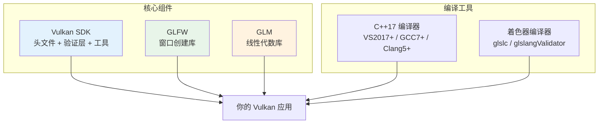
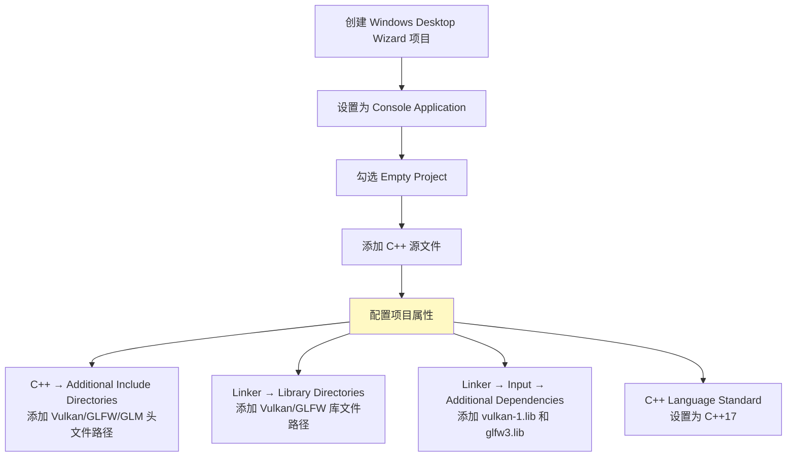

# Vulkan 教程 —— 开发环境搭建

本章将指导你搭建 Vulkan 开发环境并安装一些有用的库。我们将主要介绍 Windows 环境（Visual Studio）和 Linux 环境的配置。

## 需要安装的组件总览



## Windows 环境搭建

### 1. Vulkan SDK 安装

SDK 是开发 Vulkan 应用最重要的组件，包括：

| 组件 | 说明 |
|------|------|
| 头文件 | `vulkan.h` 等 Vulkan API 定义 |
| 验证层 | 标准调试验证层 |
| 调试工具 | 诊断和性能分析工具 |
| 函数加载器 | 运行时查找驱动中的函数（类似 OpenGL 的 GLEW） |
| glslc/glslangValidator | GLSL 着色器编译为 SPIR-V 字节码 |

**安装步骤：**

1. 从 [LunarG 官网](https://vulkan.lunarg.com/) 下载 SDK
2. 运行安装程序，**记住安装路径**
3. 验证安装：进入 SDK 安装目录的 `Bin` 文件夹，运行 `vkcube.exe`

> ⚠️ **验证失败？** 如果看到错误信息：
> - 确保显卡驱动已更新到最新版本
> - 确认驱动包含 Vulkan 运行时
> - 确认显卡支持 Vulkan

### 2. GLFW 安装

Vulkan 本身是平台无关的 API，不包含创建窗口的工具。我们使用 [GLFW](http://www.glfw.org/) 来创建窗口。

**安装步骤：**
1. 从 [GLFW 官网](http://www.glfw.org/download.html) 下载最新版本
2. 选择 64 位二进制文件
3. 解压到方便的位置（如 Visual Studio 文档目录下的 `Libraries`）

> ⚠️ **32 位注意**：如果选择 32 位模式编译，确保链接 Vulkan SDK 中 `Lib32` 目录而非 `Lib`。

### 3. GLM 安装

Vulkan **不包含**线性代数库（不像 DirectX 12），所以需要单独安装 [GLM](http://glm.g-truc.net/)。

GLM 是**纯头文件库**，只需下载并放到方便的位置即可。

### 4. Visual Studio 项目配置



> ⚠️ **易错点清单**：
> 1. **确保选择 "All Configurations"** —— 大部分设置同时适用于 Debug 和 Release
> 2. **确保编译为 64 位** —— 检查构建模式是否为 x64
> 3. **包含路径和库路径不要搞混** —— Include 是头文件，Library 是 .lib 文件
> 4. **链接器输入中需要显式写库名** —— `vulkan-1.lib` 和 `glfw3.lib`

**测试代码：**

```c++
#define GLFW_INCLUDE_VULKAN      // 让 GLFW 自动包含 Vulkan 头文件
#include <GLFW/glfw3.h>

#define GLM_FORCE_RADIANS        // 强制使用弧度制
#define GLM_FORCE_DEPTH_ZERO_TO_ONE  // 深度范围 [0, 1]（Vulkan 标准，OpenGL 是 [-1, 1]）
#include <glm/vec4.hpp>
#include <glm/mat4x4.hpp>

#include <iostream>

int main() {
    glfwInit();

    glfwWindowHint(GLFW_CLIENT_API, GLFW_NO_API);  // 不创建 OpenGL 上下文！
    GLFWwindow* window = glfwCreateWindow(800, 600, "Vulkan window", nullptr, nullptr);

    // 查询支持的扩展数量
    uint32_t extensionCount = 0;
    vkEnumerateInstanceExtensionProperties(nullptr, &extensionCount, nullptr);
    std::cout << extensionCount << " extensions supported\n";

    // 测试 GLM 工作正常
    glm::mat4 matrix;
    glm::vec4 vec;
    auto test = matrix * vec;

    // 事件循环
    while(!glfwWindowShouldClose(window)) {
        glfwPollEvents();
    }

    glfwDestroyWindow(window);
    glfwTerminate();

    return 0;
}
```

> 💡 **重要宏定义解释**：
> 
> | 宏 | 作用 | 为什么需要 |
> |---|------|-----------|
> | `GLFW_INCLUDE_VULKAN` | 让 GLFW 包含 vulkan.h | 避免手动包含，确保顺序正确 |
> | `GLM_FORCE_RADIANS` | 强制弧度制 | 避免角度/弧度混淆的 bug |
> | `GLM_FORCE_DEPTH_ZERO_TO_ONE` | 深度范围 [0,1] | **Vulkan 与 OpenGL 不同！** OpenGL 是 [-1,1] |
> | `GLFW_CLIENT_API, GLFW_NO_API` | 不创建 OpenGL 上下文 | Vulkan 不需要 OpenGL 上下文 |

运行成功后，你应该看到一个标题为 "Vulkan window" 的窗口，控制台显示非零的扩展数量。

## Linux 环境搭建

### 1. Vulkan 软件包

**Ubuntu / Debian：**
```bash
sudo apt install vulkan-tools        # 命令行工具（vulkaninfo, vkcube）
sudo apt install libvulkan-dev       # Vulkan 加载器
sudo apt install vulkan-validationlayers-dev spirv-tools  # 验证层
```

**Fedora：**
```bash
sudo dnf install vulkan-tools
sudo dnf install vulkan-loader-devel
sudo dnf install mesa-vulkan-devel vulkan-validation-layers-devel
```

**Arch Linux：**
```bash
sudo pacman -S vulkan-devel          # 包含所有上述工具
```

安装后运行 `vkcube` 验证是否正常工作。

### 2. 窗口系统依赖

可能需要额外安装：
```bash
# Ubuntu/Debian
sudo apt install libxxf86vm-dev libxi-dev

# Fedora
sudo dnf install libXxf86vm-devel libXi-devel
```

### 3. GLFW 和 GLM

```bash
# Ubuntu/Debian
sudo apt install libglfw3-dev libglm-dev

# Fedora
sudo dnf install glfw-devel glm-devel

# Arch Linux
sudo pacman -S glfw-wayland glm      # X11 用户使用 glfw-x11
```

### 4. 着色器编译器

```bash
# Ubuntu - 下载 Google 的预编译二进制
# 从 https://github.com/google/shaderc/blob/main/downloads.md 下载
# 复制 glslc 到 /usr/local/bin

# Fedora
sudo dnf install glslc

# Arch Linux
sudo pacman -S shaderc
```

测试：运行 `glslc` 应该提示 `no input files`。

### 5. Makefile 项目

```makefile
CFLAGS = -std=c++17 -O2
LDFLAGS = -lglfw -lvulkan -ldl -lpthread -lX11 -lXxf86vm -lXrandr -lXi

VulkanTest: main.cpp
	g++ $(CFLAGS) -o VulkanTest main.cpp $(LDFLAGS)

.PHONY: test clean

test: VulkanTest
	./VulkanTest

clean:
	rm -f VulkanTest
```

> ⚠️ **Makefile 注意事项**：
> - **必须使用 Tab 缩进**，不能使用空格！这是新手最常犯的错误
> - `-O2` 开发时可以去掉以加快编译，**发布时务必加回来**
> - `LDFLAGS` 中的库顺序可能影响链接

## macOS 环境搭建

macOS 没有原生 Vulkan 支持，通过 [MoltenVK](https://moltengl.com/) 将 Vulkan API 调用翻译为 Apple Metal 框架。

```bash
brew install glfw glm
```

> ⚠️ **macOS 特有问题**：
> - 从 Vulkan SDK 1.3.216 开始，`VK_KHR_PORTABILITY_subset` 扩展是**强制性的**
> - 如果遇到 `VK_ERROR_INCOMPATIBLE_DRIVER` 错误，需要在实例创建时添加：
>   ```c++
>   createInfo.flags |= VK_INSTANCE_CREATE_ENUMERATE_PORTABILITY_BIT_KHR;
>   // 并添加 VK_KHR_PORTABILITY_ENUMERATION_EXTENSION_NAME 到扩展列表
>   ```

## 环境搭建完成检查清单

```
✅ Vulkan SDK 已安装且 vkcube 运行正常
✅ GLFW 库已安装/下载
✅ GLM 库已安装/下载
✅ 着色器编译器（glslc）可用
✅ 编译器支持 C++17
✅ 测试程序编译运行成功
✅ 控制台显示非零扩展数量
✅ 窗口正常显示和关闭
```

环境搭建完成！现在让我们开始[编写真正的 Vulkan 代码](03_绘制三角形/00_基础设置/00_基础代码.md)！
