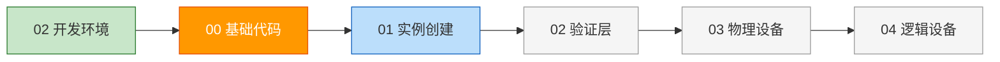
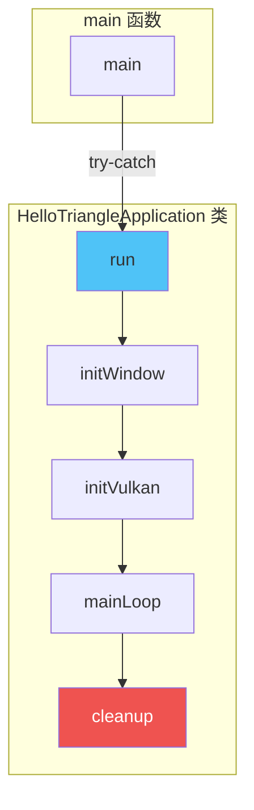
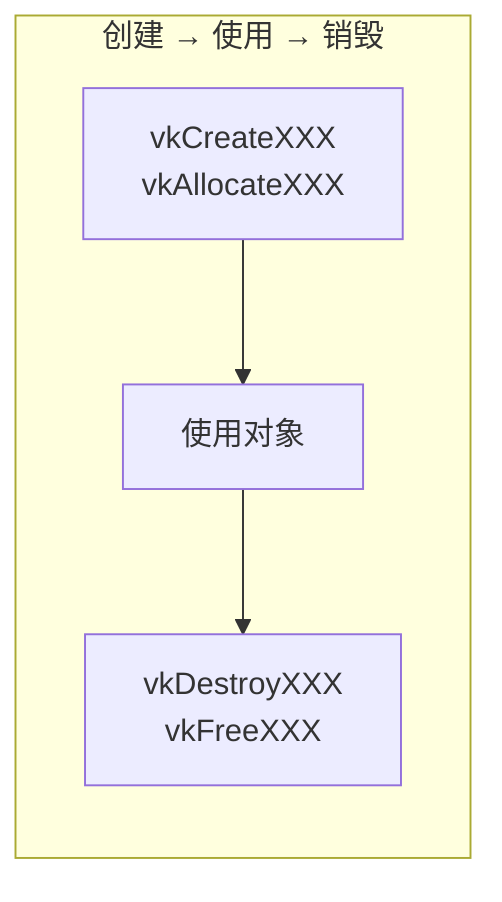
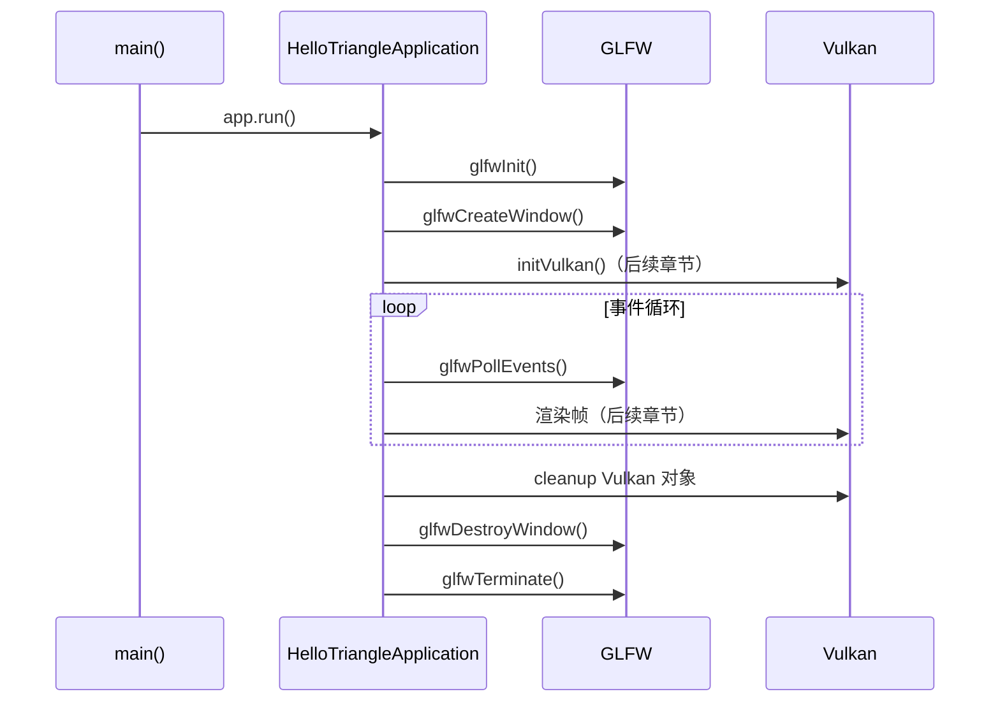

# 基础代码结构

## 📍 本章在教程中的位置



> 📌 **本章目标**：搭建程序骨架（GLFW 窗口 + 类结构 + 主循环），后续所有章节都在此基础上扩展 `initVulkan()` 函数。
>
> **前置依赖**：[开发环境](../../02_开发环境.md)（Vulkan SDK + GLFW + GLM 已安装）
>
> **本章产出 → 被后续使用**：
> - `HelloTriangleApplication` 类 → 所有后续章节的代码都添加到这个类中
> - `initVulkan()` 空函数 → 每章依次在此添加初始化调用
> - `cleanup()` 空函数 → 每章在此添加销毁调用（**逆序**）
> - GLFW 窗口 → [窗口表面](../01_呈现/00_窗口表面.md)需要它来创建 `VkSurfaceKHR`

## 程序总体结构

在上一章中，你已经创建了一个配置正确的 Vulkan 项目并通过示例代码进行了测试。本章我们将从零开始，构建 Vulkan 应用程序的基本骨架。

### 核心架构



```c++
#include <vulkan/vulkan.h>

#include <iostream>
#include <stdexcept>
#include <cstdlib>

class HelloTriangleApplication {
public:
    void run() {
        initVulkan();
        mainLoop();
        cleanup();
    }

private:
    void initVulkan() {
        // 在这里初始化所有 Vulkan 对象
    }

    void mainLoop() {
        // 渲染循环
    }

    void cleanup() {
        // 释放所有资源
    }
};

int main() {
    HelloTriangleApplication app;

    try {
        app.run();
    } catch (const std::exception& e) {
        std::cerr << e.what() << std::endl;
        return EXIT_FAILURE;
    }

    return EXIT_SUCCESS;
}
```

> 📌 **架构要点**：
> - Vulkan 对象存储为**私有类成员**
> - 每个对象的初始化函数从 `initVulkan` 中调用
> - 致命错误通过 `std::runtime_error` 异常抛出
> - 使用 `std::exception` 捕获所有标准异常类型

> ⚠️ **易错点**：后续每一章都会在 `initVulkan` 中添加新函数，在类中添加新成员，并在 `cleanup` 中释放资源。**忘记释放资源是最常见的错误之一**！

## 资源管理



Vulkan 中的资源管理规则非常明确：

| 操作 | 函数模式 | 说明 |
|------|---------|------|
| 直接创建 | `vkCreateXXX` | 如 `vkCreateInstance` |
| 通过其他对象分配 | `vkAllocateXXX` | 如 `vkAllocateCommandBuffers` |
| 销毁 | `vkDestroyXXX` | 如 `vkDestroyInstance` |
| 释放 | `vkFreeXXX` | 如 `vkFreeCommandBuffers` |

> ⚠️ **重要**：所有这些函数都有一个共同的可选参数 `pAllocator`（自定义内存分配器），本教程中始终传 `nullptr`。

> 💡 **高级技巧**：学完教程后，你可以用 C++ 的 RAII 模式（`std::unique_ptr`/`std::shared_ptr` + 自定义删除器）来自动管理 Vulkan 对象。但学习阶段建议手动管理，以理解 API 的工作原理。

## 集成 GLFW

### 替换头文件

将 `#include <vulkan/vulkan.h>` 替换为：

```c++
#define GLFW_INCLUDE_VULKAN
#include <GLFW/glfw3.h>
```

> 📌 **为什么？** `GLFW_INCLUDE_VULKAN` 宏让 GLFW 自动包含 Vulkan 头文件，确保包含顺序正确。

### 初始化窗口

```c++
const uint32_t WIDTH = 800;   // 窗口宽度常量
const uint32_t HEIGHT = 600;  // 窗口高度常量

class HelloTriangleApplication {
public:
    void run() {
        initWindow();    // ← 新增：窗口初始化必须在 Vulkan 之前！
        initVulkan();
        mainLoop();
        cleanup();
    }

private:
    GLFWwindow* window;  // GLFW 窗口句柄

    void initWindow() {
        glfwInit();                                        // 初始化 GLFW
        glfwWindowHint(GLFW_CLIENT_API, GLFW_NO_API);     // 不创建 OpenGL 上下文！
        glfwWindowHint(GLFW_RESIZABLE, GLFW_FALSE);       // 暂时禁止窗口调整大小
        window = glfwCreateWindow(WIDTH, HEIGHT, "Vulkan", nullptr, nullptr);
    }
};
```

> ⚠️ **常见错误**：
> 1. **忘记 `GLFW_NO_API`**：GLFW 默认创建 OpenGL 上下文，Vulkan 不需要！
> 2. **窗口大小使用硬编码**：应该用常量，后面会多次引用
> 3. **忘记调用 `glfwInit()`**：必须在所有 GLFW 函数之前调用

### 事件循环与清理

```c++
void mainLoop() {
    while (!glfwWindowShouldClose(window)) {
        glfwPollEvents();  // 处理窗口事件（关闭、移动等）
    }
}

void cleanup() {
    glfwDestroyWindow(window);  // 销毁窗口
    glfwTerminate();            // 终止 GLFW
}
```

### 完整流程



运行程序后，你应该看到一个标题为 "Vulkan" 的窗口。现在我们有了 Vulkan 应用的骨架，让我们开始[创建第一个 Vulkan 对象](01_实例创建.md)！

[C++ 代码](/code/00_base_code.cpp)
