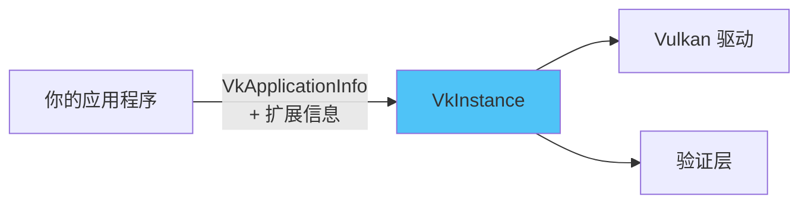

# 创建 Vulkan 实例（VkInstance）

## 什么是实例？

`VkInstance` 是**应用程序与 Vulkan 库之间的连接**。创建实例时需要向驱动提供关于你的应用程序的信息。



## 创建实例的完整步骤

### 步骤 1：添加成员变量和函数

```c++
// 在 initVulkan 中调用
void initVulkan() {
    createInstance();
}

// 类成员变量
private:
    VkInstance instance;
```

### 步骤 2：填充应用信息

```c++
void createInstance() {
    // 应用信息（技术上可选，但推荐提供）
    VkApplicationInfo appInfo{};   // ← 注意 {} 初始化！
    appInfo.sType = VK_STRUCTURE_TYPE_APPLICATION_INFO;  // 必须设置正确的类型
    appInfo.pApplicationName = "Hello Triangle";
    appInfo.applicationVersion = VK_MAKE_VERSION(1, 0, 0);
    appInfo.pEngineName = "No Engine";
    appInfo.engineVersion = VK_MAKE_VERSION(1, 0, 0);
    appInfo.apiVersion = VK_API_VERSION_1_0;             // 使用的 Vulkan API 版本
}
```

> ⚠️ **关于 `sType`**：
> - Vulkan 中**几乎所有结构体**都有 `sType` 成员
> - 必须设置为对应的 `VK_STRUCTURE_TYPE_XXX` 常量
> - **忘记设置或设置错误是非常常见的 bug**，可能导致崩溃或未定义行为
> - `pNext` 成员用于扩展链，本教程中始终为 `nullptr`

### 步骤 3：填充实例创建信息

```c++
    VkInstanceCreateInfo createInfo{};
    createInfo.sType = VK_STRUCTURE_TYPE_INSTANCE_CREATE_INFO;
    createInfo.pApplicationInfo = &appInfo;

    // 获取 GLFW 所需的扩展
    uint32_t glfwExtensionCount = 0;
    const char** glfwExtensions;
    glfwExtensions = glfwGetRequiredInstanceExtensions(&glfwExtensionCount);

    createInfo.enabledExtensionCount = glfwExtensionCount;
    createInfo.ppEnabledExtensionNames = glfwExtensions;

    // 验证层（下一章详细介绍）
    createInfo.enabledLayerCount = 0;
```

> 📌 **为什么需要 GLFW 扩展？**
> Vulkan 是平台无关的 API，不知道如何与窗口系统交互。GLFW 告诉我们需要哪些扩展才能在窗口中显示渲染结果。

### 步骤 4：创建实例

```c++
    if (vkCreateInstance(&createInfo, nullptr, &instance) != VK_SUCCESS) {
        throw std::runtime_error("failed to create instance!");
    }
```

**`vkCreateInstance` 参数模式（几乎所有 Vulkan 创建函数都遵循此模式）：**

```
参数 1：指向创建信息结构体的指针  ← 描述要创建什么
参数 2：自定义分配器回调指针      ← 本教程始终为 nullptr
参数 3：指向存储句柄的变量指针    ← 输出：新对象的句柄
返回值：VkResult                  ← VK_SUCCESS 或错误码
```

## macOS 特殊处理

> ⚠️ **macOS 用户注意**：从 Vulkan SDK 1.3.216 开始，可能会遇到 `VK_ERROR_INCOMPATIBLE_DRIVER` 错误。需要添加：

```c++
// 收集所需扩展
std::vector<const char*> requiredExtensions;
for(uint32_t i = 0; i < glfwExtensionCount; i++) {
    requiredExtensions.emplace_back(glfwExtensions[i]);
}
// macOS 特殊扩展
requiredExtensions.emplace_back(VK_KHR_PORTABILITY_ENUMERATION_EXTENSION_NAME);

createInfo.flags |= VK_INSTANCE_CREATE_ENUMERATE_PORTABILITY_BIT_KHR;
createInfo.enabledExtensionCount = (uint32_t) requiredExtensions.size();
createInfo.ppEnabledExtensionNames = requiredExtensions.data();
```

## 检查扩展支持

你可以在创建实例之前查询可用的扩展：

```c++
// 1. 查询扩展数量
uint32_t extensionCount = 0;
vkEnumerateInstanceExtensionProperties(nullptr, &extensionCount, nullptr);

// 2. 分配数组
std::vector<VkExtensionProperties> extensions(extensionCount);

// 3. 查询详细信息
vkEnumerateInstanceExtensionProperties(nullptr, &extensionCount, extensions.data());

// 4. 列出所有扩展
std::cout << "可用扩展:\n";
for (const auto& extension : extensions) {
    std::cout << '\t' << extension.extensionName << '\n';
}
```

> 📌 **Vulkan 枚举模式（牢记！后面会反复使用）**：
> ```
> 第一次调用：传 nullptr 获取数量
> 分配容器
> 第二次调用：传容器指针获取数据
> ```
> 这种"两次调用"模式在 Vulkan 中非常常见，几乎所有枚举函数都使用这种模式。

## 清理实例

```c++
void cleanup() {
    vkDestroyInstance(instance, nullptr);  // 销毁 Vulkan 实例

    glfwDestroyWindow(window);
    glfwTerminate();
}
```

> ⚠️ **销毁顺序非常重要！**
> ```
> 正确顺序（后创建的先销毁）：
> 1. 销毁所有 Vulkan 子对象
> 2. 销毁 VkInstance        ← 必须最后销毁
> 3. 销毁 GLFW 窗口
> 4. 终止 GLFW
> ```

## 本章知识点总结

```
✅ VkInstance 是 Vulkan 的入口点
✅ VkApplicationInfo 提供应用信息（可选但推荐）
✅ VkInstanceCreateInfo 指定扩展和验证层
✅ 使用 {} 初始化所有结构体
✅ 始终检查 VkResult 返回值
✅ 遵循"两次调用"枚举模式
✅ 销毁顺序与创建顺序相反
```

在继续更复杂的步骤之前，是时候来看看我们的调试利器——[验证层](02_验证层.md)了。

[C++ 代码](/code/01_instance_creation.cpp)
