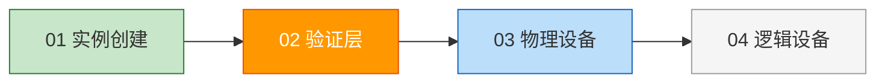
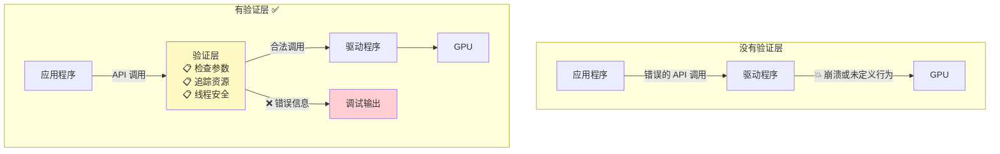

# 验证层（Validation Layers）

## 📍 本章在教程中的位置



> 📌 **依赖关系**：
> - **前置**：[实例创建](01_实例创建.md) — 验证层在创建实例时作为层（layer）启用
> - **产出**：`VkDebugUtilsMessengerEXT` → 开发期间自动捕获所有 Vulkan 错误
> - **影响范围**：验证层贯穿整个教程——后续每一章的代码错误都会被它捕获
> - **与 [FAQ](../../90_FAQ.md) 的关系**：FAQ 中大量调试技巧都依赖验证层输出

## 什么是验证层？

Vulkan API 的设计理念是**最小化驱动开销**，因此默认情况下 API 中的错误检查非常有限。即使是将枚举值设置错误或向必需参数传递空指针这样简单的错误，通常也不会被显式处理——而是直接崩溃或产生未定义行为。



**验证层的主要功能：**

| 功能 | 说明 |
|------|------|
| 参数检查 | 检测参数值是否违反规范 |
| 资源追踪 | 跟踪对象创建/销毁，发现内存泄漏 |
| 线程安全 | 追踪调用来源线程 |
| 调用日志 | 记录每个调用及其参数 |
| 性能分析 | 追踪 Vulkan 调用用于剖析和重放 |

> 💡 **最佳实践**：
> - **开发时启用**验证层以捕获错误
> - **发布时禁用**以获得零额外开销
> - 这是两全其美的方案！

## 启用验证层

### 配置变量

```c++
const std::vector<const char*> validationLayers = {
    "VK_LAYER_KHRONOS_validation"  // 标准验证层，包含所有常用检查
};

// 根据编译模式自动决定是否启用
#ifdef NDEBUG
    const bool enableValidationLayers = false;  // Release 模式：禁用
#else
    const bool enableValidationLayers = true;   // Debug 模式：启用
#endif
```

> 📌 **`NDEBUG` 宏**：这是 C++ 标准宏，在非调试模式下定义。大多数 IDE 在 Release 配置中会自动定义它。

### 检查可用性

```c++
bool checkValidationLayerSupport() {
    // 1. 查询可用层数量
    uint32_t layerCount;
    vkEnumerateInstanceLayerProperties(&layerCount, nullptr);

    // 2. 获取所有可用层
    std::vector<VkLayerProperties> availableLayers(layerCount);
    vkEnumerateInstanceLayerProperties(&layerCount, availableLayers.data());

    // 3. 检查我们需要的每个层是否都可用
    for (const char* layerName : validationLayers) {
        bool layerFound = false;

        for (const auto& layerProperties : availableLayers) {
            if (strcmp(layerName, layerProperties.layerName) == 0) {
                layerFound = true;
                break;
            }
        }

        if (!layerFound) {
            return false;  // 有一个层不可用就返回 false
        }
    }

    return true;
}
```

> ⚠️ **需要 `#include <cstring>`** 才能使用 `strcmp`。

### 在实例创建中使用

```c++
void createInstance() {
    // 首先检查验证层是否可用
    if (enableValidationLayers && !checkValidationLayerSupport()) {
        throw std::runtime_error("validation layers requested, but not available!");
    }

    // ... appInfo 设置 ...

    // 设置验证层
    if (enableValidationLayers) {
        createInfo.enabledLayerCount = static_cast<uint32_t>(validationLayers.size());
        createInfo.ppEnabledLayerNames = validationLayers.data();
    } else {
        createInfo.enabledLayerCount = 0;
    }
}
```

## 调试回调函数

验证层默认将消息输出到标准输出。我们可以设置**自定义回调函数**来处理这些消息。

### 获取所需扩展

```c++
std::vector<const char*> getRequiredExtensions() {
    uint32_t glfwExtensionCount = 0;
    const char** glfwExtensions;
    glfwExtensions = glfwGetRequiredInstanceExtensions(&glfwExtensionCount);

    std::vector<const char*> extensions(glfwExtensions, glfwExtensions + glfwExtensionCount);

    if (enableValidationLayers) {
        extensions.push_back(VK_EXT_DEBUG_UTILS_EXTENSION_NAME);  // 调试扩展
    }

    return extensions;
}
```

### 回调函数

```c++
static VKAPI_ATTR VkBool32 VKAPI_CALL debugCallback(
    VkDebugUtilsMessageSeverityFlagBitsEXT messageSeverity,    // 严重程度
    VkDebugUtilsMessageTypeFlagsEXT messageType,               // 消息类型
    const VkDebugUtilsMessengerCallbackDataEXT* pCallbackData, // 消息详情
    void* pUserData) {                                          // 用户数据

    std::cerr << "验证层: " << pCallbackData->pMessage << std::endl;

    return VK_FALSE;  // 始终返回 VK_FALSE
}
```

**消息严重程度（从低到高）：**

```
┌──────────────────────────────────────────────────────┐
│ VERBOSE  ← 诊断信息                                   │
│ INFO     ← 资源创建等信息性消息                         │
│ WARNING  ← 不一定是错误，但很可能是 bug ⚠️              │
│ ERROR    ← 无效行为，可能导致崩溃 ❌                    │
└──────────────────────────────────────────────────────┘

💡 过滤技巧：
if (messageSeverity >= VK_DEBUG_UTILS_MESSAGE_SEVERITY_WARNING_BIT_EXT) {
    // 只处理 WARNING 及以上级别
}
```

**消息类型：**

| 类型 | 含义 |
|------|------|
| `GENERAL` | 与规范或性能无关的事件 |
| `VALIDATION` | 违反规范或可能的错误 |
| `PERFORMANCE` | Vulkan 的非最优使用 |

> ⚠️ **回调函数必须返回 `VK_FALSE`**！返回 `VK_TRUE` 会中止触发消息的 Vulkan 调用，这通常只用于测试验证层本身。

### 创建和销毁调试信使

由于 `vkCreateDebugUtilsMessengerEXT` 是**扩展函数**，不会自动加载，需要手动查找地址：

```c++
// 代理创建函数
VkResult CreateDebugUtilsMessengerEXT(VkInstance instance, 
    const VkDebugUtilsMessengerCreateInfoEXT* pCreateInfo, 
    const VkAllocationCallbacks* pAllocator, 
    VkDebugUtilsMessengerEXT* pDebugMessenger) {
    
    auto func = (PFN_vkCreateDebugUtilsMessengerEXT) 
        vkGetInstanceProcAddr(instance, "vkCreateDebugUtilsMessengerEXT");
    if (func != nullptr) {
        return func(instance, pCreateInfo, pAllocator, pDebugMessenger);
    } else {
        return VK_ERROR_EXTENSION_NOT_PRESENT;
    }
}

// 代理销毁函数
void DestroyDebugUtilsMessengerEXT(VkInstance instance, 
    VkDebugUtilsMessengerEXT debugMessenger, 
    const VkAllocationCallbacks* pAllocator) {
    
    auto func = (PFN_vkDestroyDebugUtilsMessengerEXT) 
        vkGetInstanceProcAddr(instance, "vkDestroyDebugUtilsMessengerEXT");
    if (func != nullptr) {
        func(instance, debugMessenger, pAllocator);
    }
}
```

> ⚠️ **这些函数必须定义在类外部**或作为静态类函数！

### 设置调试信使

```c++
VkDebugUtilsMessengerEXT debugMessenger;  // 类成员

void setupDebugMessenger() {
    if (!enableValidationLayers) return;

    VkDebugUtilsMessengerCreateInfoEXT createInfo{};
    createInfo.sType = VK_STRUCTURE_TYPE_DEBUG_UTILS_MESSENGER_CREATE_INFO_EXT;
    createInfo.messageSeverity = 
        VK_DEBUG_UTILS_MESSAGE_SEVERITY_VERBOSE_BIT_EXT |
        VK_DEBUG_UTILS_MESSAGE_SEVERITY_WARNING_BIT_EXT |
        VK_DEBUG_UTILS_MESSAGE_SEVERITY_ERROR_BIT_EXT;
    createInfo.messageType = 
        VK_DEBUG_UTILS_MESSAGE_TYPE_GENERAL_BIT_EXT |
        VK_DEBUG_UTILS_MESSAGE_TYPE_VALIDATION_BIT_EXT |
        VK_DEBUG_UTILS_MESSAGE_TYPE_PERFORMANCE_BIT_EXT;
    createInfo.pfnUserCallback = debugCallback;
    createInfo.pUserData = nullptr;

    if (CreateDebugUtilsMessengerEXT(instance, &createInfo, nullptr, &debugMessenger) != VK_SUCCESS) {
        throw std::runtime_error("failed to set up debug messenger!");
    }
}
```

### 调试实例的创建和销毁

`vkCreateDebugUtilsMessengerEXT` 需要有效的实例才能调用，但我们也想调试实例创建本身。解决方案是通过 `pNext` 扩展链传递一个额外的调试信使：

```c++
void createInstance() {
    // ... 之前的代码 ...
    
    VkDebugUtilsMessengerCreateInfoEXT debugCreateInfo{};
    if (enableValidationLayers) {
        createInfo.enabledLayerCount = static_cast<uint32_t>(validationLayers.size());
        createInfo.ppEnabledLayerNames = validationLayers.data();
        
        populateDebugMessengerCreateInfo(debugCreateInfo);
        createInfo.pNext = (VkDebugUtilsMessengerCreateInfoEXT*) &debugCreateInfo;
    } else {
        createInfo.enabledLayerCount = 0;
        createInfo.pNext = nullptr;
    }
    // ...
}
```

> ⚠️ **关键细节**：`debugCreateInfo` 变量必须放在 `if` 语句**外部**，确保在 `vkCreateInstance` 调用时它仍然有效（不被提前销毁）！

### 清理顺序

```c++
void cleanup() {
    if (enableValidationLayers) {
        DestroyDebugUtilsMessengerEXT(instance, debugMessenger, nullptr);
    }
    vkDestroyInstance(instance, nullptr);  // 实例必须最后销毁
    glfwDestroyWindow(window);
    glfwTerminate();
}
```

```
销毁顺序：
1. DebugMessenger  ← 依赖 Instance
2. Instance
3. GLFW Window
4. GLFW
```

## 测试验证层

故意制造一个错误来验证验证层是否正常工作——比如临时删除 `DestroyDebugUtilsMessengerEXT` 调用。程序退出时应该看到类似这样的消息：

```
验证层: Validation Error: [ VUID-vkDestroyInstance-instance-00629 ] 
Object 0: handle = 0x..., type = VK_OBJECT_TYPE_DEBUG_UTILS_MESSENGER_EXT; 
| MessageID = 0x... | OBJ ERROR : For VkInstance 0x..., 
VkDebugUtilsMessengerEXT 0x... has not been destroyed.
```

> 💡 **如果看不到任何消息**：检查 Vulkan SDK 安装是否正确。

## 本章知识点总结

```
✅ 验证层是 Vulkan 的错误检查机制
✅ 开发时启用，发布时禁用
✅ VK_LAYER_KHRONOS_validation 包含所有标准检查
✅ 通过 NDEBUG 宏自动切换
✅ 调试回调通过扩展函数创建（需要手动加载）
✅ 使用 pNext 链可以调试实例创建/销毁
✅ 销毁顺序必须正确（依赖关系的反序）
```

现在是时候来看看[系统中的 Vulkan 设备](03_物理设备与队列族.md)了。

[C++ 代码](/code/02_validation_layers.cpp)
