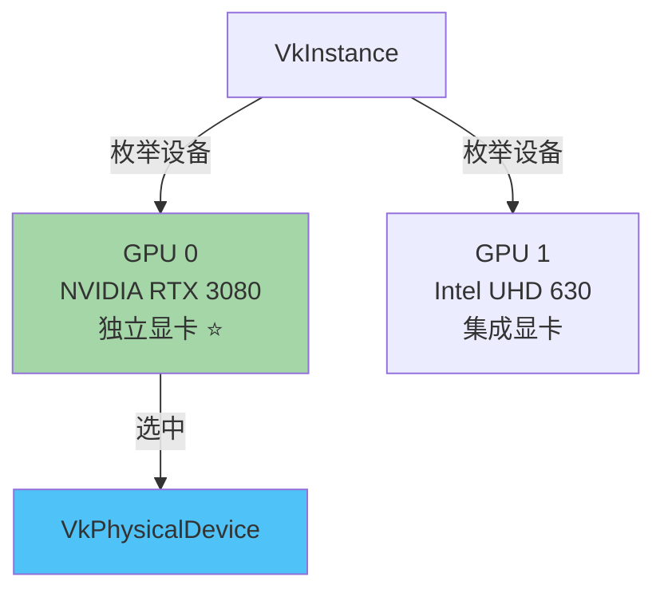
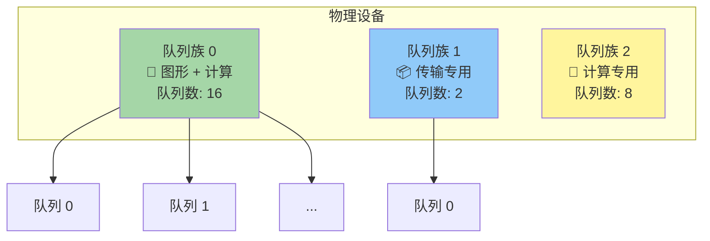
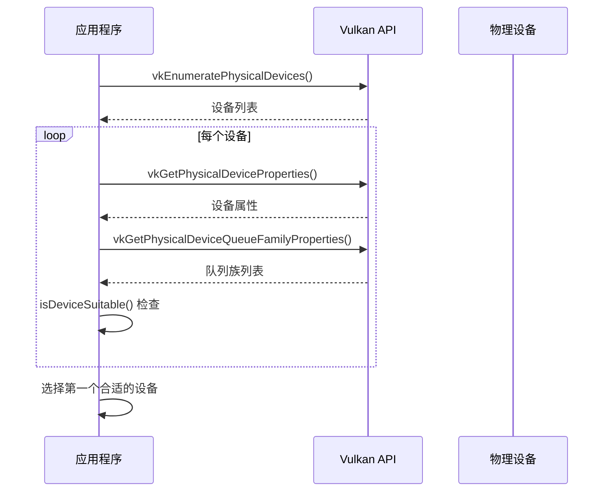

# 物理设备与队列族

## 📍 本章在教程中的位置


> 📌 **依赖关系**：
> - **前置**：[实例创建](01_实例创建.md) — 通过 `VkInstance` 枚举物理设备
> - **产出**：
>   - `VkPhysicalDevice` → [逻辑设备](04_逻辑设备与队列.md) 基于它创建 `VkDevice`
>   - `QueueFamilyIndices` → 后续多个章节需要队列族索引：
>     - [窗口表面](../01_呈现/00_窗口表面.md)：添加呈现队列族查询
>     - [交换链](../01_呈现/01_交换链.md)：共享模式依赖队列族
>     - [计算着色器](../../11_计算着色器.md)：添加计算队列族查询
> - **设备特性查询** → [纹理采样器](../../06_纹理映射/01_图像视图与采样器.md)（各向异性过滤支持）、[多重采样](../../10_多重采样.md)（最大采样数）

## 选择物理设备

初始化 `VkInstance` 后，我们需要在系统中查找并选择一个支持所需功能的显卡。



```c++
void initVulkan() {
    createInstance();
    setupDebugMessenger();
    pickPhysicalDevice();     // ← 新增
}

VkPhysicalDevice physicalDevice = VK_NULL_HANDLE;  // 类成员

void pickPhysicalDevice() {
    // 1. 查询设备数量
    uint32_t deviceCount = 0;
    vkEnumeratePhysicalDevices(instance, &deviceCount, nullptr);

    if (deviceCount == 0) {
        throw std::runtime_error("failed to find GPUs with Vulkan support!");
    }

    // 2. 获取所有设备
    std::vector<VkPhysicalDevice> devices(deviceCount);
    vkEnumeratePhysicalDevices(instance, &deviceCount, devices.data());

    // 3. 选择合适的设备
    for (const auto& device : devices) {
        if (isDeviceSuitable(device)) {
            physicalDevice = device;
            break;
        }
    }

    if (physicalDevice == VK_NULL_HANDLE) {
        throw std::runtime_error("failed to find a suitable GPU!");
    }
}
```

> 📌 **重要**：`VkPhysicalDevice` 会在 `VkInstance` 销毁时**隐式销毁**，不需要在 `cleanup` 中手动处理。

## 设备适用性检查

### 查询设备属性和功能

```c++
bool isDeviceSuitable(VkPhysicalDevice device) {
    // 基本属性：名称、类型、支持的 Vulkan 版本
    VkPhysicalDeviceProperties deviceProperties;
    vkGetPhysicalDeviceProperties(device, &deviceProperties);

    // 可选功能：纹理压缩、64位浮点、多视口渲染等
    VkPhysicalDeviceFeatures deviceFeatures;
    vkGetPhysicalDeviceFeatures(device, &deviceFeatures);

    // 示例：只接受支持几何着色器的独立显卡
    return deviceProperties.deviceType == VK_PHYSICAL_DEVICE_TYPE_DISCRETE_GPU &&
           deviceFeatures.geometryShader;
}
```

**设备类型：**

| 类型 | 说明 |
|------|------|
| `VK_PHYSICAL_DEVICE_TYPE_DISCRETE_GPU` | 独立显卡（性能最佳） |
| `VK_PHYSICAL_DEVICE_TYPE_INTEGRATED_GPU` | 集成显卡 |
| `VK_PHYSICAL_DEVICE_TYPE_VIRTUAL_GPU` | 虚拟 GPU |
| `VK_PHYSICAL_DEVICE_TYPE_CPU` | CPU 软件模拟 |

### 设备评分方案（高级）

```c++
// 给每个设备打分，选择最高分的
int rateDeviceSuitability(VkPhysicalDevice device) {
    int score = 0;
    
    VkPhysicalDeviceProperties deviceProperties;
    VkPhysicalDeviceFeatures deviceFeatures;
    vkGetPhysicalDeviceProperties(device, &deviceProperties);
    vkGetPhysicalDeviceFeatures(device, &deviceFeatures);

    // 独立显卡大幅加分
    if (deviceProperties.deviceType == VK_PHYSICAL_DEVICE_TYPE_DISCRETE_GPU) {
        score += 1000;
    }

    // 最大纹理尺寸影响图形质量
    score += deviceProperties.limits.maxImageDimension2D;

    // 没有几何着色器则不可用
    if (!deviceFeatures.geometryShader) {
        return 0;
    }

    return score;
}
```

> 💡 对于本教程，我们暂时接受任何支持 Vulkan 的 GPU，后面会逐步添加更多检查条件。

## 队列族（Queue Families）

### 概念理解



> 📌 **核心概念**：
> - Vulkan 中的**所有操作**（绘制、内存传输等）都需要提交到队列
> - 队列从**队列族**中分配
> - 每个队列族只支持**特定类型**的命令
> - 我们需要找到支持**图形命令**的队列族（`VK_QUEUE_GRAPHICS_BIT`）

### 使用 std::optional 追踪队列族索引

```c++
#include <optional>

struct QueueFamilyIndices {
    std::optional<uint32_t> graphicsFamily;  // 图形队列族索引

    bool isComplete() {
        return graphicsFamily.has_value();
    }
};
```

> ⚠️ **为什么用 `std::optional`？**
> - 任何 `uint32_t` 值都可能是有效的队列族索引（包括 0）
> - 无法用"魔法值"表示"未找到"
> - `std::optional` 优雅地解决了这个问题：
>   ```c++
>   std::optional<uint32_t> graphicsFamily;
>   graphicsFamily.has_value();  // → false（未赋值）
>   graphicsFamily = 0;
>   graphicsFamily.has_value();  // → true（已赋值，值为 0）
>   ```
> - 这是 **C++17** 特性，确保编译器支持

### 查找队列族

```c++
QueueFamilyIndices findQueueFamilies(VkPhysicalDevice device) {
    QueueFamilyIndices indices;

    // 查询队列族数量
    uint32_t queueFamilyCount = 0;
    vkGetPhysicalDeviceQueueFamilyProperties(device, &queueFamilyCount, nullptr);

    // 获取所有队列族属性
    std::vector<VkQueueFamilyProperties> queueFamilies(queueFamilyCount);
    vkGetPhysicalDeviceQueueFamilyProperties(device, &queueFamilyCount, queueFamilies.data());

    // 寻找支持图形命令的队列族
    int i = 0;
    for (const auto& queueFamily : queueFamilies) {
        if (queueFamily.queueFlags & VK_QUEUE_GRAPHICS_BIT) {
            indices.graphicsFamily = i;
        }

        if (indices.isComplete()) {
            break;  // 找到所有需要的队列族，提前退出
        }

        i++;
    }

    return indices;
}
```

**`VkQueueFamilyProperties` 中的队列标志：**

| 标志 | 支持的操作 |
|------|-----------|
| `VK_QUEUE_GRAPHICS_BIT` | 图形操作（绘制） |
| `VK_QUEUE_COMPUTE_BIT` | 计算操作 |
| `VK_QUEUE_TRANSFER_BIT` | 内存传输操作 |
| `VK_QUEUE_SPARSE_BINDING_BIT` | 稀疏内存绑定 |

### 更新设备适用性检查

```c++
bool isDeviceSuitable(VkPhysicalDevice device) {
    QueueFamilyIndices indices = findQueueFamilies(device);
    return indices.isComplete();  // 必须找到图形队列族
}
```

> ⚠️ **易错点**：
> 1. **使用位运算 `&` 而非 `==`** 检查队列标志——一个队列族可能同时支持多种操作
> 2. **不要假设队列族索引为 0**——不同硬件的队列族顺序不同
> 3. **总是检查 `isComplete()`**——确保所有需要的队列族都已找到

## 本章完整流程



在下一节中，我们将使用选中的物理设备来创建[逻辑设备](04_逻辑设备与队列.md)。

[C++ 代码](/code/03_physical_device_selection.cpp)
