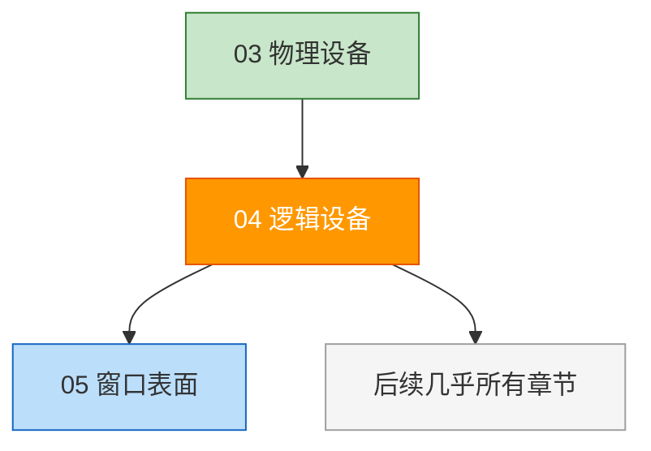
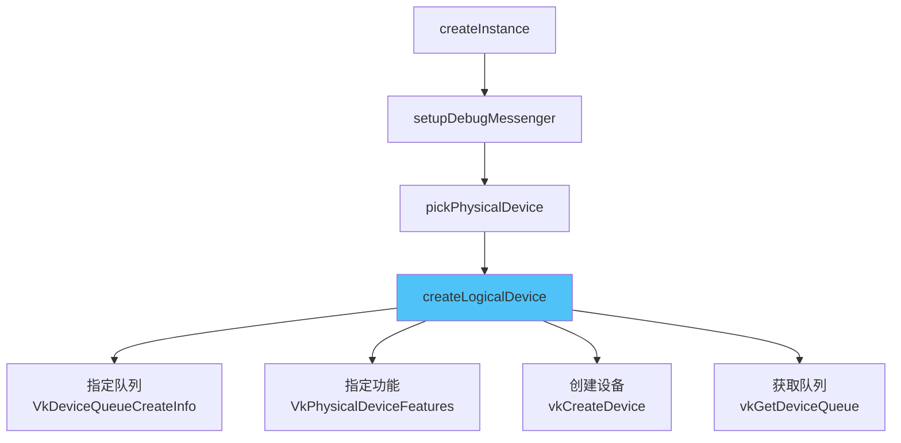

# 逻辑设备与队列

## 📍 本章在教程中的位置



> 📌 **依赖关系**：
> - **前置**：[物理设备](03_物理设备与队列族.md) — 基于它创建逻辑设备
> - **产出**：`VkDevice` + `VkQueue` — **这是整个教程最核心的对象**
>   - `VkDevice` → 创建几乎所有其他 Vulkan 对象（管线、缓冲区、图像等）
>   - `VkQueue (graphicsQueue)` → [渲染与呈现](../03_绘制/02_渲染与呈现.md)提交绘制命令
>   - `VkQueue (presentQueue)` → [窗口表面](../01_呈现/00_窗口表面.md)章节添加
>   - `VkQueue (computeQueue)` → [计算着色器](../../11_计算着色器.md)章节添加
> - **后续回溯修改本章的时机**：
>   - 添加窗口表面后 → 请求呈现队列
>   - 添加纹理后 → 启用 `samplerAnisotropy` 特性
>   - 添加计算着色器后 → 请求计算队列

## 概念

选择物理设备后，需要创建**逻辑设备**（`VkDevice`）来与之交互。逻辑设备是我们与 GPU 交互的**主要接口**。


> 📌 你甚至可以从同一个物理设备创建**多个逻辑设备**（用于不同需求）。

## 创建逻辑设备

```c++
VkDevice device;  // 类成员

void initVulkan() {
    createInstance();
    setupDebugMessenger();
    pickPhysicalDevice();
    createLogicalDevice();    // ← 新增
}
```

### 步骤 1：指定要创建的队列

```c++
void createLogicalDevice() {
    QueueFamilyIndices indices = findQueueFamilies(physicalDevice);

    VkDeviceQueueCreateInfo queueCreateInfo{};
    queueCreateInfo.sType = VK_STRUCTURE_TYPE_DEVICE_QUEUE_CREATE_INFO;
    queueCreateInfo.queueFamilyIndex = indices.graphicsFamily.value();
    queueCreateInfo.queueCount = 1;  // 只需要一个队列

    // 队列优先级（0.0 ~ 1.0），即使只有一个队列也必须设置！
    float queuePriority = 1.0f;
    queueCreateInfo.pQueuePriorities = &queuePriority;
}
```

> ⚠️ **易错点**：
> - `pQueuePriorities` **必须设置**，即使只有一个队列
> - 优先级是 `float` 类型，范围 [0.0, 1.0]
> - 多数驱动只允许每个队列族创建少量队列

### 步骤 2：指定设备功能

```c++
VkPhysicalDeviceFeatures deviceFeatures{};  // 全部设为 VK_FALSE
// 后续章节会按需启用功能
```

### 步骤 3：创建逻辑设备

```c++
VkDeviceCreateInfo createInfo{};
createInfo.sType = VK_STRUCTURE_TYPE_DEVICE_CREATE_INFO;

// 队列信息
createInfo.pQueueCreateInfos = &queueCreateInfo;
createInfo.queueCreateInfoCount = 1;

// 设备功能
createInfo.pEnabledFeatures = &deviceFeatures;

// 设备扩展（暂不需要）
createInfo.enabledExtensionCount = 0;

// 验证层（兼容旧版实现）
if (enableValidationLayers) {
    createInfo.enabledLayerCount = static_cast<uint32_t>(validationLayers.size());
    createInfo.ppEnabledLayerNames = validationLayers.data();
} else {
    createInfo.enabledLayerCount = 0;
}

// 创建！
if (vkCreateDevice(physicalDevice, &createInfo, nullptr, &device) != VK_SUCCESS) {
    throw std::runtime_error("failed to create logical device!");
}
```

> 📌 **关于设备级验证层**：
> - 现代 Vulkan 实现已**弃用**设备级验证层
> - 但为了兼容旧版实现，最好仍然设置
> - 设置为与实例级相同的验证层即可

### 步骤 4：获取队列句柄

```c++
VkQueue graphicsQueue;  // 类成员

// 队列随逻辑设备自动创建，获取句柄即可
vkGetDeviceQueue(device, indices.graphicsFamily.value(), 0, &graphicsQueue);
//                       ↑ 队列族索引                    ↑ 队列索引（第 0 个）
```

> 📌 队列在设备销毁时**自动清理**，不需要手动销毁。

## 🔴 常见错误与易错参数

### 错误 1：请求不支持的设备特性

```c++
// ❌ 未检查物理设备是否支持，就启用了特性
VkPhysicalDeviceFeatures deviceFeatures{};
deviceFeatures.samplerAnisotropy = VK_TRUE;  // 如果设备不支持 → vkCreateDevice 失败！

// ✅ 先查询再启用
VkPhysicalDeviceFeatures supportedFeatures;
vkGetPhysicalDeviceFeatures(physicalDevice, &supportedFeatures);
if (supportedFeatures.samplerAnisotropy) {
    deviceFeatures.samplerAnisotropy = VK_TRUE;
}
```

**后续章节会用到的特性**：

| 特性 | 需要时机 | 不启用的后果 |
|------|----------|-------------|
| `samplerAnisotropy` | 纹理映射章节 | 创建采样器时崩溃 |
| `fillModeNonSolid` | 线框渲染 | `VK_POLYGON_MODE_LINE` 无效 |
| `wideLines` | 线宽 > 1.0 | `lineWidth` 只能为 1.0 |
| `sampleRateShading` | MSAA 质量增强 | Sample Shading 不可用 |

### 错误 2：忘记设置 `pQueuePriorities`

```c++
// ❌ 指针为 nullptr → 访问空指针崩溃
queueCreateInfo.queueCount = 1;
queueCreateInfo.pQueuePriorities = nullptr;  // 崩溃！

// ✅ 必须提供，即使只有一个队列
float priority = 1.0f;
queueCreateInfo.pQueuePriorities = &priority;
```

### 错误 3：多个队列族使用相同索引

当图形队列族和呈现队列族相同时（大多数 GPU），不能创建两个相同索引的 `VkDeviceQueueCreateInfo`：

```c++
// ❌ 如果 graphicsFamily == presentFamily，两个 CreateInfo 索引相同
// 验证层报错：VUID-VkDeviceCreateInfo-queueFamilyIndex-02802

// ✅ 使用 std::set 去重
std::set<uint32_t> uniqueQueueFamilies = {
    indices.graphicsFamily.value(),
    indices.presentFamily.value()
};

std::vector<VkDeviceQueueCreateInfo> queueCreateInfos;
for (uint32_t queueFamily : uniqueQueueFamilies) {
    VkDeviceQueueCreateInfo queueCreateInfo{};
    queueCreateInfo.sType = VK_STRUCTURE_TYPE_DEVICE_QUEUE_CREATE_INFO;
    queueCreateInfo.queueFamilyIndex = queueFamily;
    queueCreateInfo.queueCount = 1;
    queueCreateInfo.pQueuePriorities = &queuePriority;
    queueCreateInfos.push_back(queueCreateInfo);
}

createInfo.queueCreateInfoCount = static_cast<uint32_t>(queueCreateInfos.size());
createInfo.pQueueCreateInfos = queueCreateInfos.data();
```

### 错误 4：设备限制（Device Limits）

```c++
// 查询设备限制——某些操作有硬件上限
VkPhysicalDeviceProperties deviceProperties;
vkGetPhysicalDeviceProperties(physicalDevice, &deviceProperties);

// 关键限制值：
// maxMemoryAllocationCount = 4096  ← 内存分配次数上限！
// maxBoundDescriptorSets = 4       ← 同时绑定的描述符集数
// maxImageDimension2D = 16384      ← 最大纹理尺寸
// maxFramebufferWidth/Height       ← 最大帧缓冲尺寸
// maxSamplerAnisotropy = 16        ← 最大各向异性级别
```

> ⚠️ `maxMemoryAllocationCount` 通常只有 **4096**。实际应用中不要每个缓冲区单独 `vkAllocateMemory`！

## 清理

```c++
void cleanup() {
    vkDestroyDevice(device, nullptr);  // 销毁逻辑设备
    // ...注意：逻辑设备不依赖实例，所以不传 instance
}
```

## 完整初始化流程



有了逻辑设备和队列句柄，我们现在可以开始使用显卡了！接下来的几章将设置向窗口系统呈现结果所需的资源。

[C++ 代码](/code/04_logical_device.cpp)
