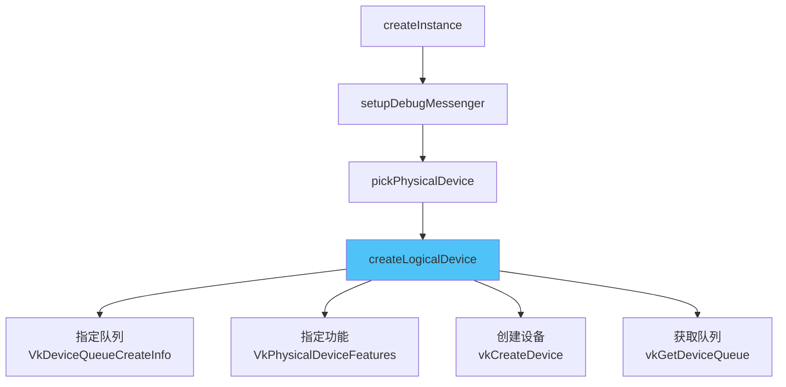

# 逻辑设备与队列

## 概念

选择物理设备后，需要创建**逻辑设备**（`VkDevice`）来与之交互。逻辑设备是我们与 GPU 交互的**主要接口**。


> 📌 你甚至可以从同一个物理设备创建**多个逻辑设备**（用于不同需求）。

## 创建逻辑设备

```c++
VkDevice device;  // 类成员

void initVulkan() {
    createInstance();
    setupDebugMessenger();
    pickPhysicalDevice();
    createLogicalDevice();    // ← 新增
}
```

### 步骤 1：指定要创建的队列

```c++
void createLogicalDevice() {
    QueueFamilyIndices indices = findQueueFamilies(physicalDevice);

    VkDeviceQueueCreateInfo queueCreateInfo{};
    queueCreateInfo.sType = VK_STRUCTURE_TYPE_DEVICE_QUEUE_CREATE_INFO;
    queueCreateInfo.queueFamilyIndex = indices.graphicsFamily.value();
    queueCreateInfo.queueCount = 1;  // 只需要一个队列

    // 队列优先级（0.0 ~ 1.0），即使只有一个队列也必须设置！
    float queuePriority = 1.0f;
    queueCreateInfo.pQueuePriorities = &queuePriority;
}
```

> ⚠️ **易错点**：
> - `pQueuePriorities` **必须设置**，即使只有一个队列
> - 优先级是 `float` 类型，范围 [0.0, 1.0]
> - 多数驱动只允许每个队列族创建少量队列

### 步骤 2：指定设备功能

```c++
VkPhysicalDeviceFeatures deviceFeatures{};  // 全部设为 VK_FALSE
// 后续章节会按需启用功能
```

### 步骤 3：创建逻辑设备

```c++
VkDeviceCreateInfo createInfo{};
createInfo.sType = VK_STRUCTURE_TYPE_DEVICE_CREATE_INFO;

// 队列信息
createInfo.pQueueCreateInfos = &queueCreateInfo;
createInfo.queueCreateInfoCount = 1;

// 设备功能
createInfo.pEnabledFeatures = &deviceFeatures;

// 设备扩展（暂不需要）
createInfo.enabledExtensionCount = 0;

// 验证层（兼容旧版实现）
if (enableValidationLayers) {
    createInfo.enabledLayerCount = static_cast<uint32_t>(validationLayers.size());
    createInfo.ppEnabledLayerNames = validationLayers.data();
} else {
    createInfo.enabledLayerCount = 0;
}

// 创建！
if (vkCreateDevice(physicalDevice, &createInfo, nullptr, &device) != VK_SUCCESS) {
    throw std::runtime_error("failed to create logical device!");
}
```

> 📌 **关于设备级验证层**：
> - 现代 Vulkan 实现已**弃用**设备级验证层
> - 但为了兼容旧版实现，最好仍然设置
> - 设置为与实例级相同的验证层即可

### 步骤 4：获取队列句柄

```c++
VkQueue graphicsQueue;  // 类成员

// 队列随逻辑设备自动创建，获取句柄即可
vkGetDeviceQueue(device, indices.graphicsFamily.value(), 0, &graphicsQueue);
//                       ↑ 队列族索引                    ↑ 队列索引（第 0 个）
```

> 📌 队列在设备销毁时**自动清理**，不需要手动销毁。

## 清理

```c++
void cleanup() {
    vkDestroyDevice(device, nullptr);  // 销毁逻辑设备
    // ...注意：逻辑设备不依赖实例，所以不传 instance
}
```

## 完整初始化流程



有了逻辑设备和队列句柄，我们现在可以开始使用显卡了！接下来的几章将设置向窗口系统呈现结果所需的资源。

[C++ 代码](/code/04_logical_device.cpp)
