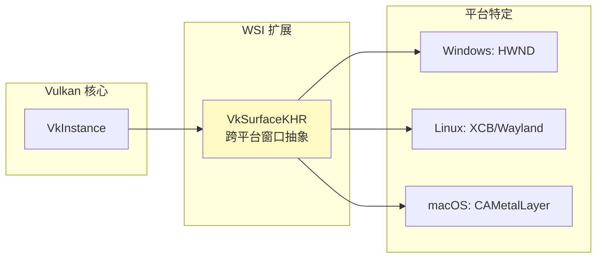
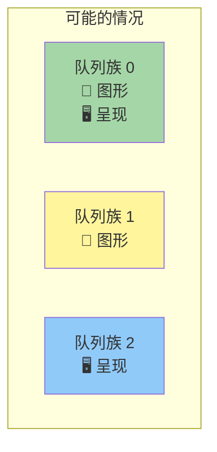

# 窗口表面（Window Surface）

## 为什么需要窗口表面？

Vulkan 是平台无关的 API，不能直接与窗口系统交互。需要使用 **WSI（窗口系统集成）扩展** 建立 Vulkan 与窗口系统之间的连接。



> 📌 **KHR 后缀** 表示这是 Khronos 扩展。`VK_KHR_surface` 是实例级扩展，已包含在 `glfwGetRequiredInstanceExtensions` 返回的列表中。

## 创建窗口表面

### 使用 GLFW 创建（推荐）

```c++
VkSurfaceKHR surface;  // 类成员

void initVulkan() {
    createInstance();
    setupDebugMessenger();
    createSurface();          // ← 在物理设备选择之前！
    pickPhysicalDevice();
    createLogicalDevice();
}

void createSurface() {
    if (glfwCreateWindowSurface(instance, window, nullptr, &surface) != VK_SUCCESS) {
        throw std::runtime_error("failed to create window surface!");
    }
}
```

> ⚠️ **创建顺序很重要**：表面必须在 `pickPhysicalDevice` **之前**创建，因为它会影响物理设备的选择（设备需要支持向该表面呈现）。

### 平台特定实现（了解即可）

GLFW 内部替我们做了平台特定的工作。以 Windows 为例：

```c++
// Windows 平台的底层实现（GLFW 内部做了这些）
VkWin32SurfaceCreateInfoKHR createInfo{};
createInfo.sType = VK_STRUCTURE_TYPE_WIN32_SURFACE_CREATE_INFO_KHR;
createInfo.hwnd = glfwGetWin32Window(window);     // 窗口句柄
createInfo.hinstance = GetModuleHandle(nullptr);    // 进程句柄

vkCreateWin32SurfaceKHR(instance, &createInfo, nullptr, &surface);
```

## 查询呈现支持

### 为什么需要额外检查？

支持图形操作的队列族**不一定**支持向我们的窗口表面呈现图像！



### 更新 QueueFamilyIndices

```c++
struct QueueFamilyIndices {
    std::optional<uint32_t> graphicsFamily;
    std::optional<uint32_t> presentFamily;    // ← 新增呈现队列族

    bool isComplete() {
        return graphicsFamily.has_value() && presentFamily.has_value();
    }
};
```

### 查找呈现队列族

```c++
// 在 findQueueFamilies 的循环中添加：
VkBool32 presentSupport = false;
vkGetPhysicalDeviceSurfaceSupportKHR(device, i, surface, &presentSupport);

if (presentSupport) {
    indices.presentFamily = i;
}
```

> 💡 图形队列族和呈现队列族**通常是同一个**，但我们按照分离的方式处理以确保通用性。

## 创建呈现队列

```c++
VkQueue presentQueue;  // 类成员

// 需要为多个队列族创建 VkDeviceQueueCreateInfo
#include <set>

QueueFamilyIndices indices = findQueueFamilies(physicalDevice);

std::vector<VkDeviceQueueCreateInfo> queueCreateInfos;
std::set<uint32_t> uniqueQueueFamilies = {
    indices.graphicsFamily.value(), 
    indices.presentFamily.value()
};

float queuePriority = 1.0f;
for (uint32_t queueFamily : uniqueQueueFamilies) {
    VkDeviceQueueCreateInfo queueCreateInfo{};
    queueCreateInfo.sType = VK_STRUCTURE_TYPE_DEVICE_QUEUE_CREATE_INFO;
    queueCreateInfo.queueFamilyIndex = queueFamily;
    queueCreateInfo.queueCount = 1;
    queueCreateInfo.pQueuePriorities = &queuePriority;
    queueCreateInfos.push_back(queueCreateInfo);
}

// 更新 VkDeviceCreateInfo
createInfo.queueCreateInfoCount = static_cast<uint32_t>(queueCreateInfos.size());
createInfo.pQueueCreateInfos = queueCreateInfos.data();
```

> ⚠️ **使用 `std::set` 去重**：如果图形和呈现是同一个队列族（常见情况），`set` 确保我们只传递一次索引。

获取呈现队列句柄：

```c++
vkGetDeviceQueue(device, indices.presentFamily.value(), 0, &presentQueue);
```

## 清理

```c++
void cleanup() {
    // ...
    vkDestroySurfaceKHR(instance, surface, nullptr);  // 在实例销毁之前！
    vkDestroyInstance(instance, nullptr);
    // ...
}
```

> ⚠️ **表面必须在实例销毁之前销毁！**

## 当前初始化流程

```
createInstance()
  └→ setupDebugMessenger()
      └→ createSurface()           ← 新增
          └→ pickPhysicalDevice()  ← 现在会检查呈现支持
              └→ createLogicalDevice() ← 现在会创建呈现队列
```

下一章我们将了解交换链，以及它如何让我们将图像呈现到表面。

[C++ 代码](/code/05_window_surface.cpp)
