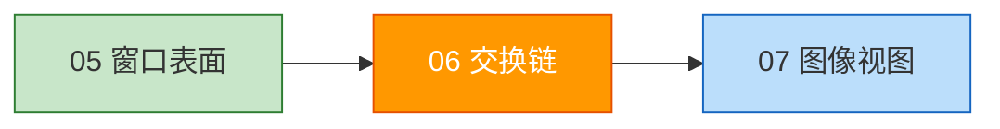
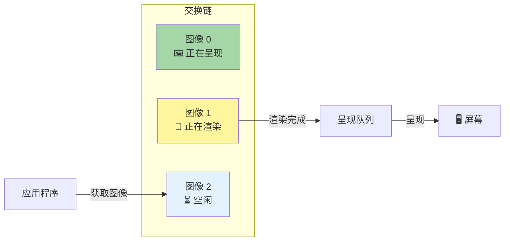
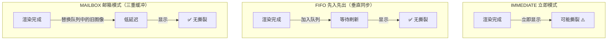

# 交换链（Swap Chain）

## 📍 本章在教程中的位置



> 📌 **依赖与影响**：
> - **前置**：
>   - [逻辑设备](../00_基础设置/04_逻辑设备与队列.md)：需要 `VkDevice` 创建交换链
>   - [窗口表面](00_窗口表面.md)：交换链必须绑定到表面
> - **产出**：`VkSwapchainKHR` + `VkImage[]` + 格式/尺寸信息 →
>   - [图像视图](02_图像视图.md)：包装交换链图像
>   - [帧缓冲](../03_绘制/00_帧缓冲.md)：帧缓冲尺寸 = 交换链尺寸
>   - [渲染通道](../02_图形管线基础/03_渲染通道.md)：颜色附件格式 = 交换链格式
>   - [渲染与呈现](../03_绘制/02_渲染与呈现.md)：`vkAcquireNextImageKHR` 从交换链获取图像
>   - [交换链重建](../04_交换链重建.md)：窗口缩放时重建交换链

## 什么是交换链？

Vulkan 没有"默认帧缓冲"的概念。交换链本质上是一个**等待呈现到屏幕的图像队列**。



## 检查交换链支持

交换链是**设备扩展**（`VK_KHR_swapchain`），需要显式检查和启用。

```c++
const std::vector<const char*> deviceExtensions = {
    VK_KHR_SWAPCHAIN_EXTENSION_NAME  // "VK_KHR_swapchain"
};

bool checkDeviceExtensionSupport(VkPhysicalDevice device) {
    uint32_t extensionCount;
    vkEnumerateDeviceExtensionProperties(device, nullptr, &extensionCount, nullptr);

    std::vector<VkExtensionProperties> availableExtensions(extensionCount);
    vkEnumerateDeviceExtensionProperties(device, nullptr, &extensionCount, availableExtensions.data());

    std::set<std::string> requiredExtensions(deviceExtensions.begin(), deviceExtensions.end());
    for (const auto& extension : availableExtensions) {
        requiredExtensions.erase(extension.extensionName);
    }
    return requiredExtensions.empty();
}
```

## 查询交换链详情

需要查询三类属性：

```c++
struct SwapChainSupportDetails {
    VkSurfaceCapabilitiesKHR capabilities;       // 基本表面能力
    std::vector<VkSurfaceFormatKHR> formats;     // 表面格式
    std::vector<VkPresentModeKHR> presentModes;  // 呈现模式
};

SwapChainSupportDetails querySwapChainSupport(VkPhysicalDevice device) {
    SwapChainSupportDetails details;

    // 1. 基本能力
    vkGetPhysicalDeviceSurfaceCapabilitiesKHR(device, surface, &details.capabilities);

    // 2. 表面格式
    uint32_t formatCount;
    vkGetPhysicalDeviceSurfaceFormatsKHR(device, surface, &formatCount, nullptr);
    if (formatCount != 0) {
        details.formats.resize(formatCount);
        vkGetPhysicalDeviceSurfaceFormatsKHR(device, surface, &formatCount, details.formats.data());
    }

    // 3. 呈现模式
    uint32_t presentModeCount;
    vkGetPhysicalDeviceSurfacePresentModesKHR(device, surface, &presentModeCount, nullptr);
    if (presentModeCount != 0) {
        details.presentModes.resize(presentModeCount);
        vkGetPhysicalDeviceSurfacePresentModesKHR(device, surface, &presentModeCount, details.presentModes.data());
    }

    return details;
}
```

## 选择最佳设置

### 1. 表面格式（颜色深度）

```c++
VkSurfaceFormatKHR chooseSwapSurfaceFormat(
    const std::vector<VkSurfaceFormatKHR>& availableFormats) {
    
    for (const auto& availableFormat : availableFormats) {
        // 首选：SRGB 颜色空间 + B8G8R8A8 格式
        if (availableFormat.format == VK_FORMAT_B8G8R8A8_SRGB && 
            availableFormat.colorSpace == VK_COLOR_SPACE_SRGB_NONLINEAR_KHR) {
            return availableFormat;
        }
    }
    return availableFormats[0];  // 退而求其次：使用第一个可用格式
}
```

> 📌 **为什么选 SRGB？**
> - SRGB 颜色空间产生更准确的感知颜色
> - 是图像和纹理的标准颜色空间
> - `B8G8R8A8` 表示每通道 8 位，总共 32 位/像素

### 2. 呈现模式（关键设置！）



| 模式 | 撕裂 | 延迟 | 能耗 | 可用性 |
|------|------|------|------|--------|
| `IMMEDIATE` | 有 | 最低 | 高 | 不保证 |
| `FIFO` | 无 | 较高 | 低 | **保证可用** ✅ |
| `FIFO_RELAXED` | 可能 | 中等 | 低 | 不保证 |
| `MAILBOX` | 无 | 低 | 高 | 不保证 |

```c++
VkPresentModeKHR chooseSwapPresentMode(
    const std::vector<VkPresentModeKHR>& availablePresentModes) {
    
    // 首选 MAILBOX（三重缓冲，低延迟无撕裂）
    for (const auto& availablePresentMode : availablePresentModes) {
        if (availablePresentMode == VK_PRESENT_MODE_MAILBOX_KHR) {
            return availablePresentMode;
        }
    }
    // 退而求其次：FIFO（保证可用）
    return VK_PRESENT_MODE_FIFO_KHR;
}
```

### 3. 交换范围（分辨率）

```c++
VkExtent2D chooseSwapExtent(const VkSurfaceCapabilitiesKHR& capabilities) {
    if (capabilities.currentExtent.width != std::numeric_limits<uint32_t>::max()) {
        return capabilities.currentExtent;  // 窗口管理器已确定分辨率
    } else {
        // 高 DPI 显示器需要特殊处理
        int width, height;
        glfwGetFramebufferSize(window, &width, &height);  // 获取像素分辨率

        VkExtent2D actualExtent = {
            static_cast<uint32_t>(width),
            static_cast<uint32_t>(height)
        };

        // 限制在支持的范围内
        actualExtent.width = std::clamp(actualExtent.width, 
            capabilities.minImageExtent.width, capabilities.maxImageExtent.width);
        actualExtent.height = std::clamp(actualExtent.height, 
            capabilities.minImageExtent.height, capabilities.maxImageExtent.height);

        return actualExtent;
    }
}
```

> ⚠️ **高 DPI 显示器注意**：
> - 屏幕坐标 ≠ 像素！（如 Retina 显示器）
> - **必须使用 `glfwGetFramebufferSize`** 获取像素分辨率
> - 不能直接使用 `WIDTH` / `HEIGHT` 常量
> - 需要 `#include <cstdint>`、`#include <limits>`、`#include <algorithm>`

## 创建交换链

```c++
VkSwapchainKHR swapChain;                    // 交换链句柄
std::vector<VkImage> swapChainImages;         // 交换链图像
VkFormat swapChainImageFormat;                // 图像格式
VkExtent2D swapChainExtent;                   // 图像分辨率

void createSwapChain() {
    SwapChainSupportDetails swapChainSupport = querySwapChainSupport(physicalDevice);
    VkSurfaceFormatKHR surfaceFormat = chooseSwapSurfaceFormat(swapChainSupport.formats);
    VkPresentModeKHR presentMode = chooseSwapPresentMode(swapChainSupport.presentModes);
    VkExtent2D extent = chooseSwapExtent(swapChainSupport.capabilities);

    // 图像数量：最少 + 1（避免等待驱动内部操作）
    uint32_t imageCount = swapChainSupport.capabilities.minImageCount + 1;
    // 但不超过最大值（0 表示无上限）
    if (swapChainSupport.capabilities.maxImageCount > 0 && 
        imageCount > swapChainSupport.capabilities.maxImageCount) {
        imageCount = swapChainSupport.capabilities.maxImageCount;
    }

    VkSwapchainCreateInfoKHR createInfo{};
    createInfo.sType = VK_STRUCTURE_TYPE_SWAPCHAIN_CREATE_INFO_KHR;
    createInfo.surface = surface;
    createInfo.minImageCount = imageCount;
    createInfo.imageFormat = surfaceFormat.format;
    createInfo.imageColorSpace = surfaceFormat.colorSpace;
    createInfo.imageExtent = extent;
    createInfo.imageArrayLayers = 1;  // 非立体3D应用始终为 1
    createInfo.imageUsage = VK_IMAGE_USAGE_COLOR_ATTACHMENT_BIT;  // 直接渲染

    // 处理图形和呈现队列族不同的情况
    QueueFamilyIndices indices = findQueueFamilies(physicalDevice);
    uint32_t queueFamilyIndices[] = {indices.graphicsFamily.value(), indices.presentFamily.value()};

    if (indices.graphicsFamily != indices.presentFamily) {
        createInfo.imageSharingMode = VK_SHARING_MODE_CONCURRENT;  // 共享模式
        createInfo.queueFamilyIndexCount = 2;
        createInfo.pQueueFamilyIndices = queueFamilyIndices;
    } else {
        createInfo.imageSharingMode = VK_SHARING_MODE_EXCLUSIVE;   // 独占模式（性能更好）
    }

    createInfo.preTransform = swapChainSupport.capabilities.currentTransform;
    createInfo.compositeAlpha = VK_COMPOSITE_ALPHA_OPAQUE_BIT_KHR;
    createInfo.presentMode = presentMode;
    createInfo.clipped = VK_TRUE;        // 不关心被遮挡的像素
    createInfo.oldSwapchain = VK_NULL_HANDLE;  // 后续章节处理重建

    if (vkCreateSwapchainKHR(device, &createInfo, nullptr, &swapChain) != VK_SUCCESS) {
        throw std::runtime_error("failed to create swap chain!");
    }

    // 获取交换链图像句柄
    vkGetSwapchainImagesKHR(device, swapChain, &imageCount, nullptr);
    swapChainImages.resize(imageCount);
    vkGetSwapchainImagesKHR(device, swapChain, &imageCount, swapChainImages.data());

    // 保存格式和分辨率供后续使用
    swapChainImageFormat = surfaceFormat.format;
    swapChainExtent = extent;
}
```

> ⚠️ **图像共享模式重点**：
> 
> | 模式 | 说明 | 何时使用 |
> |------|------|---------|
> | `EXCLUSIVE` | 独占，需显式转移所有权 | 图形=呈现队列族（性能更好） |
> | `CONCURRENT` | 共享，无需转移所有权 | 图形≠呈现队列族 |

> ⚠️ **常见问题**：
> 1. 如果 `vkCreateSwapchainKHR` 出现访问违规，检查 Steam 覆盖层
> 2. 忘记 `createInfo.imageExtent = extent` 会被验证层捕获
> 3. `imageCount` 可能与请求的不同——实现可以创建更多图像

## 清理

```c++
void cleanup() {
    vkDestroySwapchainKHR(device, swapChain, nullptr);  // 在设备销毁之前
    // ... 交换链图像会自动随交换链销毁
}
```

接下来我们将设置图像视图，以便将这些图像用作渲染目标。

[C++ 代码](/code/06_swap_chain_creation.cpp)
