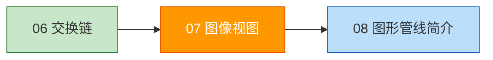
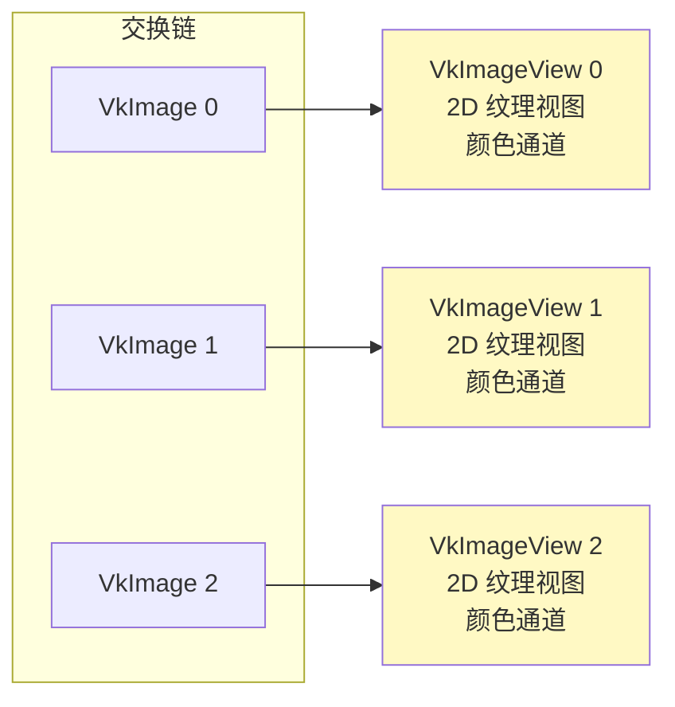
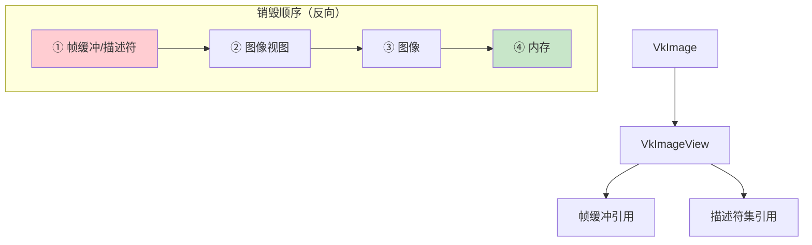

# 图像视图（Image Views）

## 📍 本章在教程中的位置



> 📌 **依赖与影响**：
> - **前置**：[交换链](01_交换链.md) — 提供 `VkImage[]` 和格式
> - **产出**：`VkImageView[]` →
>   - [帧缓冲](../03_绘制/00_帧缓冲.md)：每个帧缓冲引用一个图像视图
>   - [多重采样](../../10_多重采样.md)：作为 resolve 目标
> - **代码复用**：`createImageView()` 函数在后续章节被大量复用：
>
> ```mermaid
> graph TD
>     CV[createImageView函数<br>本章创建]:::current
>     CV --> T[纹理图像视图]:::future
>     CV --> D[深度图像视图]:::future
>     CV --> M[MSAA颜色图像视图]:::future
>     CV --> S[交换链图像视图]:::done
>     classDef current fill:#ff9800,color:#fff
>     classDef future fill:#f5f5f5,stroke:#9e9e9e
>     classDef done fill:#c8e6c9
> ```

## 概念

要在渲染管线中使用任何 `VkImage`，都必须创建 `VkImageView` 对象。图像视图描述了**如何访问图像**以及**访问图像的哪个部分**。



## 创建图像视图

```c++
std::vector<VkImageView> swapChainImageViews;  // 类成员

void initVulkan() {
    // ... 之前的初始化 ...
    createSwapChain();
    createImageViews();    // ← 新增
}

void createImageViews() {
    swapChainImageViews.resize(swapChainImages.size());

    for (size_t i = 0; i < swapChainImages.size(); i++) {
        VkImageViewCreateInfo createInfo{};
        createInfo.sType = VK_STRUCTURE_TYPE_IMAGE_VIEW_CREATE_INFO;
        createInfo.image = swapChainImages[i];

        // 视图类型：2D 纹理
        createInfo.viewType = VK_IMAGE_VIEW_TYPE_2D;
        createInfo.format = swapChainImageFormat;

        // 颜色通道映射（保持默认）
        createInfo.components.r = VK_COMPONENT_SWIZZLE_IDENTITY;
        createInfo.components.g = VK_COMPONENT_SWIZZLE_IDENTITY;
        createInfo.components.b = VK_COMPONENT_SWIZZLE_IDENTITY;
        createInfo.components.a = VK_COMPONENT_SWIZZLE_IDENTITY;

        // 子资源范围：颜色目标，无 Mipmap，单层
        createInfo.subresourceRange.aspectMask = VK_IMAGE_ASPECT_COLOR_BIT;
        createInfo.subresourceRange.baseMipLevel = 0;
        createInfo.subresourceRange.levelCount = 1;
        createInfo.subresourceRange.baseArrayLayer = 0;
        createInfo.subresourceRange.layerCount = 1;

        if (vkCreateImageView(device, &createInfo, nullptr, &swapChainImageViews[i]) != VK_SUCCESS) {
            throw std::runtime_error("failed to create image views!");
        }
    }
}
```

**关键参数说明：**

| 参数 | 说明 |
|------|------|
| `viewType` | 图像类型（1D/2D/3D/CubeMap） |
| `format` | 像素格式（应与交换链匹配） |
| `components` | 颜色通道重映射（通常保持默认） |
| `subresourceRange.aspectMask` | 图像用途（颜色/深度/模板） |
| `subresourceRange.levelCount` | Mipmap 级别数 |
| `subresourceRange.layerCount` | 层数（VR 立体渲染用多层） |

> ⚠️ **与 VkImage 的区别**：
> - `VkImage`：交换链自动创建和销毁
> - `VkImageView`：**我们显式创建**，必须**手动销毁**

---

## 🔴 常见错误与参数详解

### 错误 1：`format` 与图像不匹配

```c++
// ❌ 交换链格式是 B8G8R8A8_SRGB，但视图用了 R8G8B8A8_UNORM
createInfo.format = VK_FORMAT_R8G8B8A8_UNORM;  // 格式不匹配！
// 验证层报错：VUID-VkImageViewCreateInfo-image-01762

// ✅ 必须与创建图像时的格式一致
createInfo.format = swapChainImageFormat;
```

> ⚠️ 少数情况下格式可以不同（同一兼容组内），但初学者应**始终保持一致**。

### 错误 2：`aspectMask` 用途混淆

```c++
// 颜色图像 → VK_IMAGE_ASPECT_COLOR_BIT
// 深度图像 → VK_IMAGE_ASPECT_DEPTH_BIT
// 模板图像 → VK_IMAGE_ASPECT_STENCIL_BIT
// 深度+模板图像 → VK_IMAGE_ASPECT_DEPTH_BIT（只看深度部分）

// ❌ 对深度图像使用了颜色 aspect
createInfo.subresourceRange.aspectMask = VK_IMAGE_ASPECT_COLOR_BIT;  // 深度图像不行！
// 验证层报错：VUID-VkImageViewCreateInfo-subResourceRange-01020

// ✅ 后续深度缓冲章节中的正确用法
createInfo.subresourceRange.aspectMask = VK_IMAGE_ASPECT_DEPTH_BIT;
```

| 图像用途 | `aspectMask` |
|----------|-------------|
| 交换链颜色附件 | `COLOR_BIT` |
| 纹理图像 | `COLOR_BIT` |
| 深度附件 | `DEPTH_BIT` |
| 深度+模板附件 | `DEPTH_BIT`（或 `DEPTH_BIT \| STENCIL_BIT`） |

### 错误 3：`viewType` 与图像维度不匹配

```c++
// ❌ 图像是 2D 的，但视图类型设成了 3D
createInfo.viewType = VK_IMAGE_VIEW_TYPE_3D;  // 2D 图像不能用 3D 视图

// ✅ 常用 viewType 对照表
```

| `viewType` | 图像要求 | 使用场景 |
|------------|---------|---------|
| `1D` | 1D 图像 | 查找表（LUT） |
| `2D` | 2D 图像 | 最常用：纹理、渲染目标 |
| `3D` | 3D 图像 | 体积数据 |
| `CUBE` | 2D, 6 层 | 天空盒、环境映射 |
| `2D_ARRAY` | 2D, 多层 | 纹理数组、VR 立体渲染 |

### 错误 4：`components` swizzle 导致颜色异常

```c++
// 保持默认（IDENTITY）是最安全的
createInfo.components.r = VK_COMPONENT_SWIZZLE_IDENTITY;  // R → R
createInfo.components.g = VK_COMPONENT_SWIZZLE_IDENTITY;  // G → G
createInfo.components.b = VK_COMPONENT_SWIZZLE_IDENTITY;  // B → B
createInfo.components.a = VK_COMPONENT_SWIZZLE_IDENTITY;  // A → A

// 实际用途示例：将单通道灰度纹理广播到 RGB
// createInfo.components.r = VK_COMPONENT_SWIZZLE_R;
// createInfo.components.g = VK_COMPONENT_SWIZZLE_R;  // G 也读 R 通道
// createInfo.components.b = VK_COMPONENT_SWIZZLE_R;  // B 也读 R 通道
```

### 错误 5：图像视图的生命周期管理

```c++
// ❌ 图像视图还在被帧缓冲引用，就销毁了图像
vkDestroyImage(device, textureImage, nullptr);
// 之后使用引用了 textureImageView 的描述符集 → 未定义行为！

// ✅ 正确销毁顺序：
// 1. 停止使用（vkDeviceWaitIdle 或栅栏等待）
// 2. 销毁帧缓冲/描述符引用
// 3. 销毁图像视图
// 4. 销毁图像
// 5. 释放内存
```



### Mipmap 和数组层参数

```c++
// 基础情况：单级、单层
createInfo.subresourceRange.baseMipLevel = 0;   // 起始 mipmap 级别
createInfo.subresourceRange.levelCount = 1;     // mipmap 级别数
createInfo.subresourceRange.baseArrayLayer = 0; // 起始数组层
createInfo.subresourceRange.layerCount = 1;     // 数组层数

// ⚠️ levelCount 设为 VK_REMAINING_MIP_LEVELS 可以自动覆盖所有级别
// ⚠️ layerCount 设为 VK_REMAINING_ARRAY_LAYERS 可以自动覆盖所有层
```

## 清理

```c++
void cleanup() {
    for (auto imageView : swapChainImageViews) {
        vkDestroyImageView(device, imageView, nullptr);  // 手动销毁每个视图
    }
    vkDestroySwapchainKHR(device, swapChain, nullptr);
    // ...
}
```

图像视图足以将图像用作纹理，但要用作渲染目标还需要**帧缓冲**。不过在此之前，我们先要设置[图形管线](../02_图形管线基础/00_图形管线简介.md)。

[C++ 代码](/code/07_image_views.cpp)
