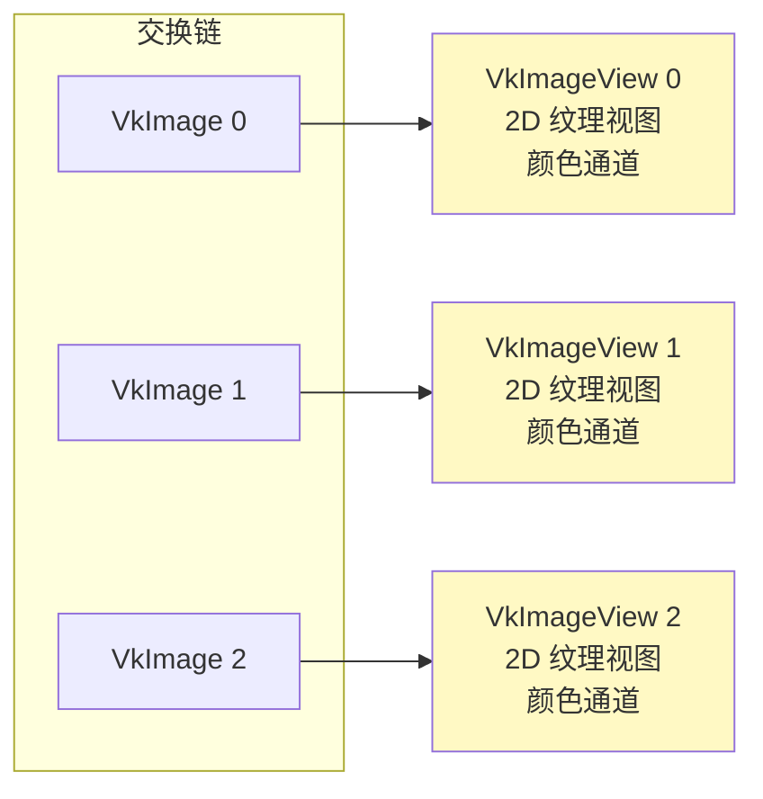

# 图像视图（Image Views）

## 概念

要在渲染管线中使用任何 `VkImage`，都必须创建 `VkImageView` 对象。图像视图描述了**如何访问图像**以及**访问图像的哪个部分**。



## 创建图像视图

```c++
std::vector<VkImageView> swapChainImageViews;  // 类成员

void initVulkan() {
    // ... 之前的初始化 ...
    createSwapChain();
    createImageViews();    // ← 新增
}

void createImageViews() {
    swapChainImageViews.resize(swapChainImages.size());

    for (size_t i = 0; i < swapChainImages.size(); i++) {
        VkImageViewCreateInfo createInfo{};
        createInfo.sType = VK_STRUCTURE_TYPE_IMAGE_VIEW_CREATE_INFO;
        createInfo.image = swapChainImages[i];

        // 视图类型：2D 纹理
        createInfo.viewType = VK_IMAGE_VIEW_TYPE_2D;
        createInfo.format = swapChainImageFormat;

        // 颜色通道映射（保持默认）
        createInfo.components.r = VK_COMPONENT_SWIZZLE_IDENTITY;
        createInfo.components.g = VK_COMPONENT_SWIZZLE_IDENTITY;
        createInfo.components.b = VK_COMPONENT_SWIZZLE_IDENTITY;
        createInfo.components.a = VK_COMPONENT_SWIZZLE_IDENTITY;

        // 子资源范围：颜色目标，无 Mipmap，单层
        createInfo.subresourceRange.aspectMask = VK_IMAGE_ASPECT_COLOR_BIT;
        createInfo.subresourceRange.baseMipLevel = 0;
        createInfo.subresourceRange.levelCount = 1;
        createInfo.subresourceRange.baseArrayLayer = 0;
        createInfo.subresourceRange.layerCount = 1;

        if (vkCreateImageView(device, &createInfo, nullptr, &swapChainImageViews[i]) != VK_SUCCESS) {
            throw std::runtime_error("failed to create image views!");
        }
    }
}
```

**关键参数说明：**

| 参数 | 说明 |
|------|------|
| `viewType` | 图像类型（1D/2D/3D/CubeMap） |
| `format` | 像素格式（应与交换链匹配） |
| `components` | 颜色通道重映射（通常保持默认） |
| `subresourceRange.aspectMask` | 图像用途（颜色/深度/模板） |
| `subresourceRange.levelCount` | Mipmap 级别数 |
| `subresourceRange.layerCount` | 层数（VR 立体渲染用多层） |

> ⚠️ **与 VkImage 的区别**：
> - `VkImage`：交换链自动创建和销毁
> - `VkImageView`：**我们显式创建**，必须**手动销毁**

## 清理

```c++
void cleanup() {
    for (auto imageView : swapChainImageViews) {
        vkDestroyImageView(device, imageView, nullptr);  // 手动销毁每个视图
    }
    vkDestroySwapchainKHR(device, swapChain, nullptr);
    // ...
}
```

图像视图足以将图像用作纹理，但要用作渲染目标还需要**帧缓冲**。不过在此之前，我们先要设置[图形管线](../02_图形管线基础/00_图形管线简介.md)。

[C++ 代码](/code/07_image_views.cpp)
