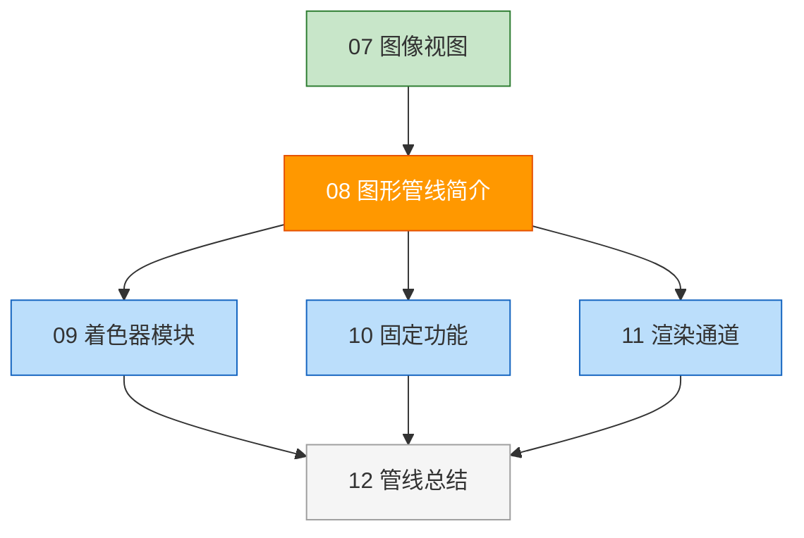

# 图形管线简介

## 📍 本章在教程中的位置



> 📌 **依赖与影响**：
> - **前置**：[图像视图](../01_呈现/02_图像视图.md) — 交换链图像的格式决定渲染通道配置
> - **本章是图形管线的“总纲”**，接下来 3 节分别讲解管线的三大组件
> - **管线对象** (`VkPipeline`) 在后续章节中的变化：
>
> | 章节 | 修改管线的内容 |
> |------|---------------|
> | [顶点输入描述](../../04_顶点缓冲区/00_顶点输入描述.md) | 修改顶点输入状态 |
> | [描述符集布局](../../05_Uniform缓冲区/00_描述符集布局与缓冲区.md) | 修改管线布局 |
> | [深度缓冲](../../07_深度缓冲.md) | 启用深度测试 |
> | [多重采样](../../10_多重采样.md) | 修改 MSAA 采样数 |

## 管线概览

图形管线是将网格的顶点和纹理一直处理到渲染目标中像素的**操作序列**。


### 各阶段详解

| 阶段 | 类型 | 功能 |
|------|------|------|
| **输入装配** | 固定功能 | 从缓冲区收集原始顶点数据，可使用索引缓冲 |
| **顶点着色器** | 可编程 | 对每个顶点施加变换（模型空间→屏幕空间），传递逐顶点数据 |
| **曲面细分** | 可编程（可选） | 基于规则细分几何体，提高网格质量 |
| **几何着色器** | 可编程（可选） | 对每个图元操作，可丢弃或生成新图元（性能一般，不常用） |
| **光栅化** | 固定功能 | 将图元离散化为片段（像素），进行深度测试和裁剪 |
| **片段着色器** | 可编程 | 确定每个片段写入帧缓冲的颜色和深度值 |
| **颜色混合** | 固定功能 | 混合映射到同一像素的不同片段（如透明度混合） |

> ⚠️ **与 OpenGL/Direct3D 的关键区别**：
> - Vulkan 的图形管线**几乎完全不可变**（immutable）
> - 切换着色器或改变顶点布局 → 必须**完全重新创建管线**
> - 需要为所有不同组合**提前创建** `VkPipeline` 对象
> - **没有默认状态**——所有状态必须显式设置
> - **好处**：等同于预编译 vs 即时编译，驱动有更多优化机会

---

## 🔴 管线创建常见错误与深度理解

### 错误 1：每帧创建管线（性能灾难）

```c++
// ❌ 绝对不要这样做！管线创建极其昂贵（可能花费数毫秒）
void drawFrame() {
    createGraphicsPipeline();  // 每帧重建 → GPU 驱动重新编译着色器
    // ...
}

// ✅ 正确做法：初始化时创建所有需要的管线，运行时切换
void initVulkan() {
    createPipelineWireframe();   // 线框模式
    createPipelineSolid();       // 实心模式
    createPipelineTransparent(); // 半透明模式
}
```

> 📌 **管线缓存（Pipeline Cache）**可以加速跨运行的管线创建：
> ```c++
> VkPipelineCacheCreateInfo cacheInfo{};
> cacheInfo.sType = VK_STRUCTURE_TYPE_PIPELINE_CACHE_CREATE_INFO;
> vkCreatePipelineCache(device, &cacheInfo, nullptr, &pipelineCache);
> 
> // 创建管线时传入缓存
> vkCreateGraphicsPipelines(device, pipelineCache, 1, &pipelineInfo, nullptr, &pipeline);
> 
> // 程序退出时保存缓存到文件，下次启动时加载
> size_t cacheSize;
> vkGetPipelineCacheData(device, pipelineCache, &cacheSize, nullptr);
> std::vector<char> cacheData(cacheSize);
> vkGetPipelineCacheData(device, pipelineCache, &cacheSize, cacheData.data());
> // 写入文件 ...
> ```

### 错误 2：漏设任何一个必需状态（崩溃/黑屏）

Vulkan **没有默认值**。以下每个状态都必须显式创建并传入：

```c++
// ❌ 忘记设置其中任何一个 → 未定义行为
VkGraphicsPipelineCreateInfo pipelineInfo{};
pipelineInfo.pVertexInputState   = &vertexInputInfo;    // 忘记 → 崩溃
pipelineInfo.pInputAssemblyState = &inputAssembly;      // 忘记 → 崩溃
pipelineInfo.pViewportState      = &viewportState;      // 忘记 → 崩溃
pipelineInfo.pRasterizationState = &rasterizer;         // 忘记 → 崩溃
pipelineInfo.pMultisampleState   = &multisampling;      // 忘记 → 崩溃
pipelineInfo.pColorBlendState    = &colorBlending;      // 忘记 → 崩溃
pipelineInfo.layout              = pipelineLayout;      // 忘记 → 崩溃
pipelineInfo.renderPass          = renderPass;          // 忘记 → 崩溃
// pDepthStencilState 和 pDynamicState 可以为 nullptr（某些条件下）
```

**必需 vs 可选状态参考表：**

| 状态 | 是否必需 | 常见默认意图 |
|------|----------|-------------|
| `pVertexInputState` | ✅ 必需 | 定义顶点布局 |
| `pInputAssemblyState` | ✅ 必需 | 三角形列表 `TRIANGLE_LIST` |
| `pViewportState` | ✅ 必需 | 视口和裁剪矩形 |
| `pRasterizationState` | ✅ 必需 | 填充模式、剔除模式 |
| `pMultisampleState` | ✅ 必需 | 即使不用 MSAA 也要设为 1x |
| `pColorBlendState` | ✅ 必需 | 颜色混合方式 |
| `pDepthStencilState` | ⚠️ 有深度附件时必需 | 深度测试开关 |
| `pDynamicState` | 可选 | 动态视口/裁剪等 |
| `pTessellationState` | 仅曲面细分时 | 控制点数 |

### 错误 3：管线布局与着色器不匹配

```c++
// ❌ 着色器使用了 binding 0 的 UBO，但管线布局没有包含对应的描述符集布局
pipelineLayoutInfo.setLayoutCount = 0;  // 应该是 1
// 验证层报错：VUID-VkGraphicsPipelineCreateInfo-layout-00756

// ✅ 管线布局必须包含着色器中所有使用的描述符集布局
pipelineLayoutInfo.setLayoutCount = 1;
pipelineLayoutInfo.pSetLayouts = &descriptorSetLayout;
```

### 错误 4：忘记在管线中传入 `renderPass`

```c++
// ❌ 设置为 VK_NULL_HANDLE 或漏掉
pipelineInfo.renderPass = VK_NULL_HANDLE;  // → VK_ERROR_INITIALIZATION_FAILED
pipelineInfo.subpass = 0;                   // 使用渲染通道的第几个子通道

// ✅ 必须指定有效的渲染通道
pipelineInfo.renderPass = renderPass;
pipelineInfo.subpass = 0;
```

## 管线派生（Pipeline Derivatives）

当需要多个相似管线时，可使用派生减少创建开销：

```c++
// 基础管线
pipelineInfo.flags = VK_PIPELINE_CREATE_ALLOW_DERIVATIVES_BIT;
vkCreateGraphicsPipelines(device, cache, 1, &pipelineInfo, nullptr, &basePipeline);

// 派生管线（只修改不同的部分）
pipelineInfo.flags = VK_PIPELINE_CREATE_DERIVATIVE_BIT;
pipelineInfo.basePipelineHandle = basePipeline;  // 从基础管线派生
pipelineInfo.basePipelineIndex = -1;
// 修改 rasterizer.polygonMode = VK_POLYGON_MODE_LINE 等
vkCreateGraphicsPipelines(device, cache, 1, &pipelineInfo, nullptr, &wireframePipeline);
```

> 💡 管线派生是否真正加速取决于驱动实现。现代驱动通常通过管线缓存获得更好效果。

## 动态状态（减少管线数量）

```c++
// 将视口和裁剪矩形设为动态状态——避免窗口缩放时重建管线
std::vector<VkDynamicState> dynamicStates = {
    VK_DYNAMIC_STATE_VIEWPORT,
    VK_DYNAMIC_STATE_SCISSOR
};

VkPipelineDynamicStateCreateInfo dynamicState{};
dynamicState.sType = VK_STRUCTURE_TYPE_PIPELINE_DYNAMIC_STATE_CREATE_INFO;
dynamicState.dynamicStateCount = static_cast<uint32_t>(dynamicStates.size());
dynamicState.pDynamicStates = dynamicStates.data();

// ⚠️ 使用动态状态后，渲染时必须通过命令设置：
// vkCmdSetViewport(commandBuffer, 0, 1, &viewport);
// vkCmdSetScissor(commandBuffer, 0, 1, &scissor);
// 否则行为未定义！
```

### 添加管线创建函数

```c++
void initVulkan() {
    // ... 之前的初始化 ...
    createImageViews();
    createGraphicsPipeline();  // ← 新增
}

void createGraphicsPipeline() {
    // 将在后续章节中实现
}
```

接下来我们将创建管线所需的两个可编程阶段：[着色器模块](01_着色器模块.md)。

[C++ 代码](/code/08_graphics_pipeline.cpp)
