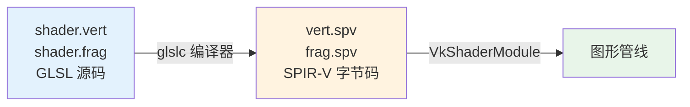

# 着色器模块（Shader Modules）

## GLSL 与 SPIR-V

与早期 API 不同，Vulkan 中的着色器代码必须以**字节码格式（SPIR-V）**提供，而非人类可读的 GLSL/HLSL。



> 💡 **为什么用字节码？**
> - GPU 厂商的编译器更简单，减少兼容性问题
> - 避免不同厂商对 GLSL 语法解释不一致的问题
> - 一套字节码在所有支持 Vulkan 的 GPU 上行为一致

## 顶点着色器

### 标准化设备坐标

```
        Y (-1)
        ↑
        |
(-1) ←——┼——→ X (+1)     Vulkan 坐标系
        |                Y 轴向下为正！（与 OpenGL 相反）
        ↓
       (+1)
       
    Z: 0（近）→ 1（远）     （与 Direct3D 相同，OpenGL 是 -1 到 1）
```

> ⚠️ **从 OpenGL 迁移的关键区别**：
> - Y 轴方向**翻转**（Vulkan 向下为正）
> - Z 深度范围是 **[0, 1]** 而非 [-1, 1]

### 我们的第一个顶点着色器

```glsl
#version 450    // GLSL 4.50 版本

// 直接在着色器中硬编码顶点位置（临时方案）
vec2 positions[3] = vec2[](
    vec2(0.0, -0.5),     // 上
    vec2(0.5, 0.5),      // 右下
    vec2(-0.5, 0.5)      // 左下
);

// 每个顶点的颜色
vec3 colors[3] = vec3[](
    vec3(1.0, 0.0, 0.0),  // 红
    vec3(0.0, 1.0, 0.0),  // 绿
    vec3(0.0, 0.0, 1.0)   // 蓝
);

layout(location = 0) out vec3 fragColor;  // 输出到片段着色器

void main() {
    gl_Position = vec4(positions[gl_VertexIndex], 0.0, 1.0);
    fragColor = colors[gl_VertexIndex];
}
```

> 📌 **关键变量**：
> - `gl_VertexIndex`：内置变量，当前顶点的索引
> - `gl_Position`：内置输出，裁剪坐标（4D 向量，w=1 则无透视除法效果）
> - `layout(location = 0) out`：用户自定义输出，通过 location 与片段着色器输入匹配

## 片段着色器

```glsl
#version 450

layout(location = 0) in vec3 fragColor;   // 从顶点着色器接收（通过光栅化插值）
layout(location = 0) out vec4 outColor;    // 输出到帧缓冲

void main() {
    outColor = vec4(fragColor, 1.0);  // RGB + Alpha=1.0
}
```

> ⚠️ **易错点**：
> - 输入/输出通过 `location` 索引匹配，**不是**通过变量名
> - 片段着色器**没有** `gl_Color` 这样的内置输出，必须自己声明
> - `location = 0` 对应第一个帧缓冲附件

> 📌 **颜色插值**：顶点着色器输出的颜色会在光栅化阶段**自动插值**到各个片段，产生平滑的渐变效果。三个顶点分别为红、绿、蓝时，三角形内部会显示彩虹渐变。

## 编译着色器

### 创建着色器文件

在项目根目录创建 `shaders` 文件夹，将上面的代码分别保存为 `shader.vert` 和 `shader.frag`。

### 编译命令

**Windows（compile.bat）：**
```bat
C:/VulkanSDK/x.x.x.x/Bin/glslc.exe shader.vert -o vert.spv
C:/VulkanSDK/x.x.x.x/Bin/glslc.exe shader.frag -o frag.spv
pause
```

**Linux（compile.sh）：**
```bash
glslc shader.vert -o vert.spv
glslc shader.frag -o frag.spv
```

> 💡 如果着色器有语法错误，编译器会给出**行号和错误信息**。试试删除一个分号看看效果！

## 加载着色器字节码

```c++
#include <fstream>

static std::vector<char> readFile(const std::string& filename) {
    // ate: 从文件末尾开始读（用于获取文件大小）
    // binary: 以二进制模式读取（避免文本转换）
    std::ifstream file(filename, std::ios::ate | std::ios::binary);

    if (!file.is_open()) {
        throw std::runtime_error("failed to open file!");
    }

    size_t fileSize = (size_t) file.tellg();  // 当前位置 = 文件大小
    std::vector<char> buffer(fileSize);

    file.seekg(0);                     // 回到文件开头
    file.read(buffer.data(), fileSize); // 一次性读取所有字节
    file.close();

    return buffer;
}
```

> ⚠️ **常见问题**：
> - 着色器文件路径相对于**可执行文件**，不是源文件
> - 确保编译生成了 `.spv` 文件
> - 可以通过检查 `buffer.size()` 与文件大小是否匹配来验证

## 创建着色器模块

```c++
VkShaderModule createShaderModule(const std::vector<char>& code) {
    VkShaderModuleCreateInfo createInfo{};
    createInfo.sType = VK_STRUCTURE_TYPE_SHADER_MODULE_CREATE_INFO;
    createInfo.codeSize = code.size();
    // 注意：需要 reinterpret_cast 因为 pCode 期望 uint32_t*
    createInfo.pCode = reinterpret_cast<const uint32_t*>(code.data());

    VkShaderModule shaderModule;
    if (vkCreateShaderModule(device, &createInfo, nullptr, &shaderModule) != VK_SUCCESS) {
        throw std::runtime_error("failed to create shader module!");
    }

    return shaderModule;
}
```

> ⚠️ **关于 `reinterpret_cast`**：
> - SPIR-V 字节码以 `uint32_t` 为单位，但我们的缓冲区是 `char`
> - `std::vector` 的默认分配器保证了足够的对齐要求
> - 数据大小（`codeSize`）仍然以**字节**为单位

### 创建着色器阶段信息

```c++
void createGraphicsPipeline() {
    auto vertShaderCode = readFile("shaders/vert.spv");
    auto fragShaderCode = readFile("shaders/frag.spv");

    VkShaderModule vertShaderModule = createShaderModule(vertShaderCode);
    VkShaderModule fragShaderModule = createShaderModule(fragShaderCode);

    // 顶点着色器阶段
    VkPipelineShaderStageCreateInfo vertShaderStageInfo{};
    vertShaderStageInfo.sType = VK_STRUCTURE_TYPE_PIPELINE_SHADER_STAGE_CREATE_INFO;
    vertShaderStageInfo.stage = VK_SHADER_STAGE_VERTEX_BIT;
    vertShaderStageInfo.module = vertShaderModule;
    vertShaderStageInfo.pName = "main";         // 入口函数名

    // 片段着色器阶段
    VkPipelineShaderStageCreateInfo fragShaderStageInfo{};
    fragShaderStageInfo.sType = VK_STRUCTURE_TYPE_PIPELINE_SHADER_STAGE_CREATE_INFO;
    fragShaderStageInfo.stage = VK_SHADER_STAGE_FRAGMENT_BIT;
    fragShaderStageInfo.module = fragShaderModule;
    fragShaderStageInfo.pName = "main";

    VkPipelineShaderStageCreateInfo shaderStages[] = {vertShaderStageInfo, fragShaderStageInfo};

    // ... 后续配置 ...

    // 管线创建后，着色器模块可以立即销毁
    vkDestroyShaderModule(device, fragShaderModule, nullptr);
    vkDestroyShaderModule(device, vertShaderModule, nullptr);
}
```

> 📌 **`pName = "main"`** 指定着色器的**入口函数**。这意味着你可以在一个着色器模块中包含多个入口函数，通过不同的名称区分。

> ⚠️ **着色器模块 vs 管线**：
> - 着色器模块只是字节码的薄封装
> - **真正的编译和链接**发生在管线创建时
> - 管线创建完成后就可以销毁着色器模块
> - 因此着色器模块可以是**局部变量**而非类成员

接下来我们将配置管线的[固定功能阶段](02_固定功能.md)。

[C++ 代码](/code/09_shader_modules.cpp) /
[顶点着色器](/code/09_shader_base.vert) /
[片段着色器](/code/09_shader_base.frag)
