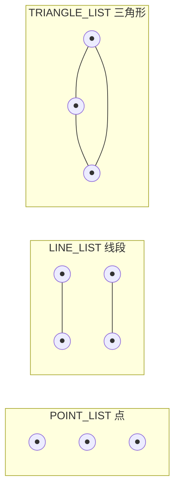
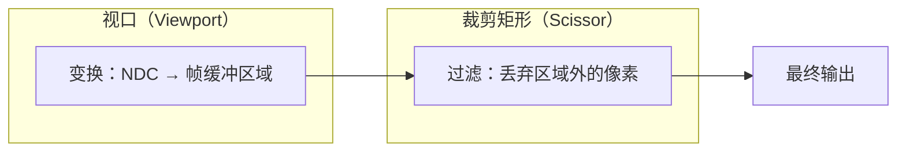
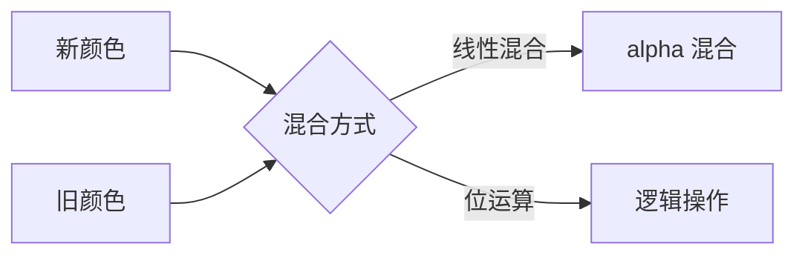

# 固定功能（Fixed Functions）

在 Vulkan 中，**几乎没有默认状态**。图形管线中的所有固定功能阶段都需要显式配置。

## 动态状态

虽然大部分管线状态必须烘焙到不可变管线中，但少量状态可以在绘制时**动态**修改，无需重建管线。

```c++
std::vector<VkDynamicState> dynamicStates = {
    VK_DYNAMIC_STATE_VIEWPORT,   // 视口
    VK_DYNAMIC_STATE_SCISSOR     // 裁剪矩形
};

VkPipelineDynamicStateCreateInfo dynamicState{};
dynamicState.sType = VK_STRUCTURE_TYPE_PIPELINE_DYNAMIC_STATE_CREATE_INFO;
dynamicState.dynamicStateCount = static_cast<uint32_t>(dynamicStates.size());
dynamicState.pDynamicStates = dynamicStates.data();
```

> 📌 **动态状态**意味着这些值可以在绘制时通过命令缓冲区设置，而不必创建新管线。**视口和裁剪是最常用的动态状态**。

## 顶点输入

描述传递给顶点着色器的顶点数据格式：

```c++
VkPipelineVertexInputStateCreateInfo vertexInputInfo{};
vertexInputInfo.sType = VK_STRUCTURE_TYPE_PIPELINE_VERTEX_INPUT_STATE_CREATE_INFO;
vertexInputInfo.vertexBindingDescriptionCount = 0;       // 暂无（着色器硬编码）
vertexInputInfo.pVertexBindingDescriptions = nullptr;
vertexInputInfo.vertexAttributeDescriptionCount = 0;
vertexInputInfo.pVertexAttributeDescriptions = nullptr;
```

> 💡 现在我们硬编码了顶点数据在着色器中，所以这里为空。[顶点缓冲区](../../04_顶点缓冲区/)章节会回来填充。

## 输入装配

定义**图元拓扑类型**和是否启用图元重启：

```c++
VkPipelineInputAssemblyStateCreateInfo inputAssembly{};
inputAssembly.sType = VK_STRUCTURE_TYPE_PIPELINE_INPUT_ASSEMBLY_STATE_CREATE_INFO;
inputAssembly.topology = VK_PRIMITIVE_TOPOLOGY_TRIANGLE_LIST;
inputAssembly.primitiveRestartEnable = VK_FALSE;
```

### 图元拓扑类型



| 拓扑 | 说明 |
|------|------|
| `POINT_LIST` | 每个顶点画一个点 |
| `LINE_LIST` | 每 2 个顶点画一条线段 |
| `LINE_STRIP` | 线段串联（末端连首端） |
| `TRIANGLE_LIST` | 每 3 个顶点画一个三角形（最常用） |
| `TRIANGLE_STRIP` | 三角形共享边 |

## 视口与裁剪矩形



### 视口

```c++
VkViewport viewport{};
viewport.x = 0.0f;
viewport.y = 0.0f;
viewport.width = (float) swapChainExtent.width;
viewport.height = (float) swapChainExtent.height;
viewport.minDepth = 0.0f;   // 深度范围 [0, 1]
viewport.maxDepth = 1.0f;
```

### 裁剪矩形

```c++
VkRect2D scissor{};
scissor.offset = {0, 0};
scissor.extent = swapChainExtent;    // 覆盖整个帧缓冲
```

### 使用动态状态（推荐）

```c++
VkPipelineViewportStateCreateInfo viewportState{};
viewportState.sType = VK_STRUCTURE_TYPE_PIPELINE_VIEWPORT_STATE_CREATE_INFO;
viewportState.viewportCount = 1;     // 只需指定数量
viewportState.scissorCount = 1;      // 实际值在绘制时设置
```

> ⚠️ **如果不用动态状态**，则必须在管线创建时设置 `pViewports` 和 `pScissors`，之后改变分辨率就需要重建管线。使用动态状态更灵活，且**无性能损失**。

## 光栅化器

将图元转化为片段（像素）。

```c++
VkPipelineRasterizationStateCreateInfo rasterizer{};
rasterizer.sType = VK_STRUCTURE_TYPE_PIPELINE_RASTERIZATION_STATE_CREATE_INFO;
rasterizer.depthClampEnable = VK_FALSE;          // 超出近/远裁剪面的片段是否夹到面上
rasterizer.rasterizerDiscardEnable = VK_FALSE;    // 为 TRUE 则丢弃所有输出（禁用帧缓冲写入）
rasterizer.polygonMode = VK_POLYGON_MODE_FILL;    // 填充模式
rasterizer.lineWidth = 1.0f;                      // 线宽（> 1.0 需要 wideLines 特性）
rasterizer.cullMode = VK_CULL_MODE_BACK_BIT;      // 背面剔除
rasterizer.frontFace = VK_FRONT_FACE_CLOCKWISE;   // 顺时针为正面
rasterizer.depthBiasEnable = VK_FALSE;             // 深度偏移（阴影贴图用）
```

**关键参数表：**

| 参数 | 说明 | 常用值 |
|------|------|--------|
| `polygonMode` | `FILL`/`LINE`/`POINT` | `FILL`（其他需 GPU 特性） |
| `cullMode` | 面剔除 | `BACK_BIT` |
| `frontFace` | 正面顶点序 | `CLOCKWISE` |
| `lineWidth` | 线宽 | `1.0f` |

> ⚠️ **`depthClampEnable = VK_TRUE`** 需要启用 GPU 的 `depthClamp` 特性，用于阴影贴图等特殊场景。

## 多重采样（抗锯齿）

```c++
VkPipelineMultisampleStateCreateInfo multisampling{};
multisampling.sType = VK_STRUCTURE_TYPE_PIPELINE_MULTISAMPLE_STATE_CREATE_INFO;
multisampling.sampleShadingEnable = VK_FALSE;
multisampling.rasterizationSamples = VK_SAMPLE_COUNT_1_BIT;  // 1 = 不启用
```

> 💡 多重采样通过对同一像素的多个多边形合并片段着色器结果来实现**抗锯齿**，比简单的超采样（渲染到更高分辨率再缩小）**高效得多**。后续 [Multisampling](../../10_Multisampling.md) 章节详细讲解。

## 深度和模板测试

现在还不需要，传 `nullptr`。将在[深度缓冲](../../07_深度缓冲.md)章节中配置。

## 颜色混合

片段着色器返回颜色后，需要与帧缓冲中**已有的颜色**混合。

### 两种混合方式



### 逐帧缓冲配置

```c++
VkPipelineColorBlendAttachmentState colorBlendAttachment{};
// 指定写入哪些颜色通道
colorBlendAttachment.colorWriteMask = VK_COLOR_COMPONENT_R_BIT | 
    VK_COLOR_COMPONENT_G_BIT | VK_COLOR_COMPONENT_B_BIT | VK_COLOR_COMPONENT_A_BIT;
colorBlendAttachment.blendEnable = VK_FALSE;  // 禁用混合 → 直接覆盖
```

> 📌 **Alpha 混合**（透明效果）的设置：
> ```c++
> colorBlendAttachment.blendEnable = VK_TRUE;
> colorBlendAttachment.srcColorBlendFactor = VK_BLEND_FACTOR_SRC_ALPHA;
> colorBlendAttachment.dstColorBlendFactor = VK_BLEND_FACTOR_ONE_MINUS_SRC_ALPHA;
> colorBlendAttachment.colorBlendOp = VK_BLEND_OP_ADD;
> colorBlendAttachment.srcAlphaBlendFactor = VK_BLEND_FACTOR_ONE;
> colorBlendAttachment.dstAlphaBlendFactor = VK_BLEND_FACTOR_ZERO;
> colorBlendAttachment.alphaBlendOp = VK_BLEND_OP_ADD;
> ```
> 
> 效果等价于：
> ```
> finalColor.rgb = newAlpha × newColor + (1 - newAlpha) × oldColor
> finalColor.a = newAlpha
> ```

### 全局颜色混合设置

```c++
VkPipelineColorBlendStateCreateInfo colorBlending{};
colorBlending.sType = VK_STRUCTURE_TYPE_PIPELINE_COLOR_BLEND_STATE_CREATE_INFO;
colorBlending.logicOpEnable = VK_FALSE;        // 启用则使用位运算混合
colorBlending.logicOp = VK_LOGIC_OP_COPY;
colorBlending.attachmentCount = 1;
colorBlending.pAttachments = &colorBlendAttachment;
colorBlending.blendConstants[0] = 0.0f;
colorBlending.blendConstants[1] = 0.0f;
colorBlending.blendConstants[2] = 0.0f;
colorBlending.blendConstants[3] = 0.0f;
```

> ⚠️ 若启用 `logicOpEnable`，则**自动禁用**所有帧缓冲的 `blendEnable`（两种方式互斥）。

## 管线布局

用于指定着色器中使用的 `uniform` 变量和推送常量：

```c++
VkPipelineLayout pipelineLayout;  // 类成员

VkPipelineLayoutCreateInfo pipelineLayoutInfo{};
pipelineLayoutInfo.sType = VK_STRUCTURE_TYPE_PIPELINE_LAYOUT_CREATE_INFO;
pipelineLayoutInfo.setLayoutCount = 0;             // 暂无描述符集布局
pipelineLayoutInfo.pSetLayouts = nullptr;
pipelineLayoutInfo.pushConstantRangeCount = 0;     // 暂无推送常量
pipelineLayoutInfo.pPushConstantRanges = nullptr;

if (vkCreatePipelineLayout(device, &pipelineLayoutInfo, nullptr, &pipelineLayout) != VK_SUCCESS) {
    throw std::runtime_error("failed to create pipeline layout!");
}
```

> 📌 **管线布局**会在程序整个生命周期中被引用，必须在 `cleanup()` 中销毁：
> ```c++
> vkDestroyPipelineLayout(device, pipelineLayout, nullptr);
> ```

## 本章知识点总结

| 组件 | 结构体 | 关键设置 |
|------|--------|----------|
| 动态状态 | `VkPipelineDynamicStateCreateInfo` | 视口 + 裁剪 |
| 顶点输入 | `VkPipelineVertexInputStateCreateInfo` | 绑定 + 属性描述 |
| 输入装配 | `VkPipelineInputAssemblyStateCreateInfo` | 拓扑类型 |
| 视口状态 | `VkPipelineViewportStateCreateInfo` | 视口/裁剪数量 |
| 光栅化 | `VkPipelineRasterizationStateCreateInfo` | 填充模式 + 剔除 |
| 多重采样 | `VkPipelineMultisampleStateCreateInfo` | 采样数 |
| 颜色混合 | `VkPipelineColorBlendStateCreateInfo` | 混合因子 |
| 管线布局 | `VkPipelineLayoutCreateInfo` | uniform + 推送常量 |

接下来创建管线的最后一个依赖项：[渲染通道](03_渲染通道.md)。

[C++ 代码](/code/10_fixed_functions.cpp) /
[顶点着色器](/code/09_shader_base.vert) /
[片段着色器](/code/09_shader_base.frag)
