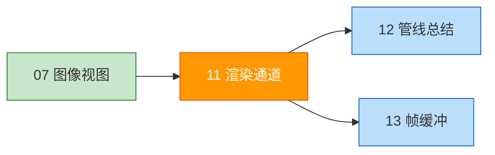
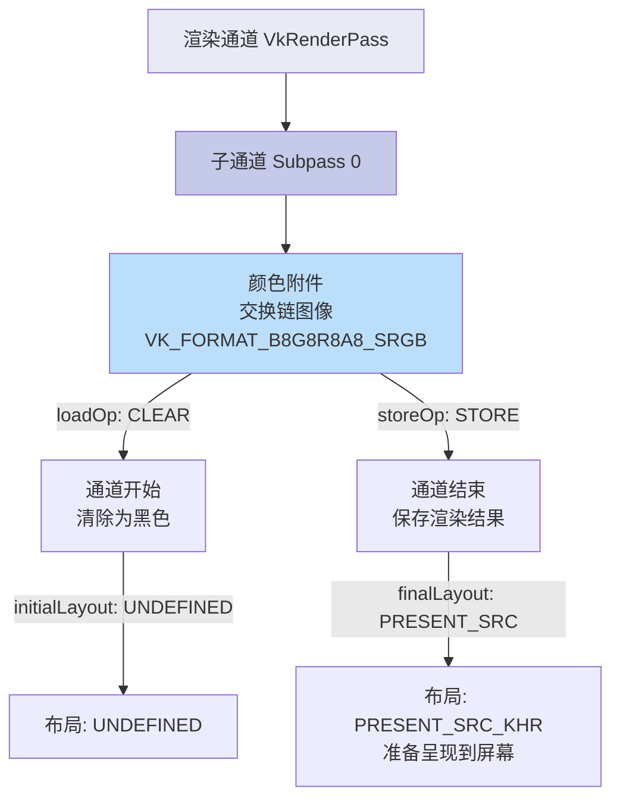
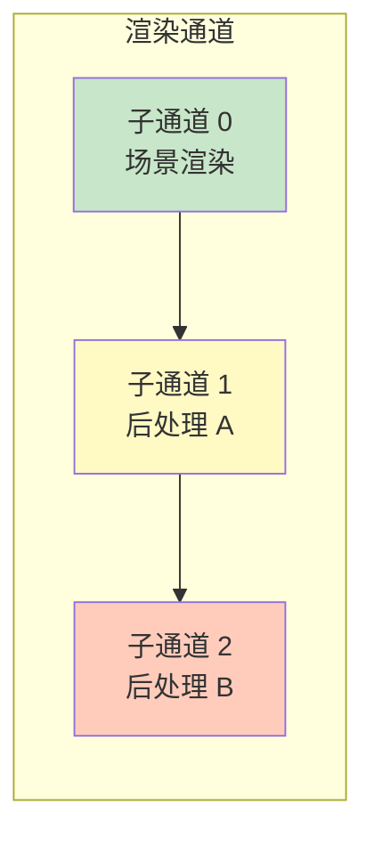

# 渲染通道（Render Passes）

## 📍 本章在教程中的位置



> 📌 **依赖与影响** — 渲染通道是教程中**被修改次数最多的对象之一**：
>
> ```mermaid
> graph TD
>     RP[VkRenderPass<br>本章创建]:::current
>     RP --> Pipe[管线总结<br>创建 VkPipeline 时引用]:::next
>     RP --> FB[帧缓冲<br>创建时引用]:::next
>     RP --> Cmd[命令缓冲区<br>vkCmdBeginRenderPass]:::next
>     RP -.-> Depth[深度缓冲<br>添加深度附件]:::mod
>     RP -.-> MSAA[多重采样<br>添加 resolve 附件]:::mod
>     classDef current fill:#ff9800,color:#fff
>     classDef next fill:#bbdefb
>     classDef mod fill:#fff9c4
> ```
>
> **后续回溯修改渲染通道的章节**：
> - [深度缓冲](../../07_深度缓冲.md)：添加深度附件 + 子通道引用
> - [多重采样](../../10_多重采样.md)：添加 resolve 附件 + 修改采样数

## 为什么需要渲染通道？

在创建管线之前，必须告诉 Vulkan 渲染时会使用什么样的帧缓冲附件：颜色缓冲数量、深度缓冲、采样数，以及如何处理它们的内容。



## 附件描述

```c++
void createRenderPass() {
    VkAttachmentDescription colorAttachment{};
    colorAttachment.format = swapChainImageFormat;    // 与交换链格式匹配
    colorAttachment.samples = VK_SAMPLE_COUNT_1_BIT;  // 无多重采样
    
    // 颜色和深度数据的加载/存储操作
    colorAttachment.loadOp = VK_ATTACHMENT_LOAD_OP_CLEAR;    // 渲染前清除
    colorAttachment.storeOp = VK_ATTACHMENT_STORE_OP_STORE;  // 渲染后保存
    
    // 模板数据（我们不用）
    colorAttachment.stencilLoadOp = VK_ATTACHMENT_LOAD_OP_DONT_CARE;
    colorAttachment.stencilStoreOp = VK_ATTACHMENT_STORE_OP_DONT_CARE;
    
    // 图像布局转换
    colorAttachment.initialLayout = VK_IMAGE_LAYOUT_UNDEFINED;       // 不关心之前的布局
    colorAttachment.finalLayout = VK_IMAGE_LAYOUT_PRESENT_SRC_KHR;   // 渲染后准备呈现
}
```

### loadOp 和 storeOp 详解

| 操作 | loadOp | storeOp |
|------|--------|---------|
| **CLEAR** / **STORE** | 渲染前清除为常量值 | 渲染后保存到内存 |
| **LOAD** / - | 保留已有内容 | - |
| **DONT_CARE** / **DONT_CARE** | 不关心（内容未定义） | 不关心（内容可能丢失） |

> ⚠️ **易错点**：
> - `loadOp` / `storeOp` 只影响颜色和深度数据
> - 模板数据由 `stencilLoadOp` / `stencilStoreOp` 单独控制

### 图像布局

Vulkan 中的图像在内存中可以有不同的布局，影响 GPU 访问效率：

| 布局 | 用途 |
|------|------|
| `VK_IMAGE_LAYOUT_UNDEFINED` | 任意初始状态，内容不保证保留 |
| `VK_IMAGE_LAYOUT_COLOR_ATTACHMENT_OPTIMAL` | 用作颜色附件（**性能最佳**） |
| `VK_IMAGE_LAYOUT_PRESENT_SRC_KHR` | 用于交换链呈现 |
| `VK_IMAGE_LAYOUT_TRANSFER_DST_OPTIMAL` | 用作内存拷贝目标 |

> 📌 `initialLayout = UNDEFINED` 意味着不关心渲染通道开始前图像处于什么布局。虽然内容不保证保留，但反正我们要 CLEAR 清除它。

## 子通道和附件引用

一个渲染通道可以包含**多个子通道**（subpass）。子通道是依赖前一子通道帧缓冲内容的后续渲染操作（如后处理效果链）。



> 💡 将多个渲染操作合并到一个渲染通道中，Vulkan 可以**重排操作**以优化内存带宽。

### 创建附件引用

```c++
VkAttachmentReference colorAttachmentRef{};
colorAttachmentRef.attachment = 0;   // 附件描述数组中的索引
colorAttachmentRef.layout = VK_IMAGE_LAYOUT_COLOR_ATTACHMENT_OPTIMAL;  // 子通道中的布局
```

> 📌 **`layout(location = 0) out vec4 outColor`** 中的 `location = 0` 对应的就是 `pColorAttachments` 数组中索引为 0 的附件！

### 创建子通道

```c++
VkSubpassDescription subpass{};
subpass.pipelineBindPoint = VK_PIPELINE_BIND_POINT_GRAPHICS;  // 图形子通道（非计算）
subpass.colorAttachmentCount = 1;
subpass.pColorAttachments = &colorAttachmentRef;
```

**子通道可引用的附件类型：**

| 字段 | 说明 |
|------|------|
| `pColorAttachments` | 颜色附件（片段着色器输出到这里） |
| `pInputAttachments` | 从着色器读取的附件 |
| `pResolveAttachments` | 多重采样解析附件 |
| `pDepthStencilAttachment` | 深度/模板附件 |
| `pPreserveAttachments` | 本子通道不用但需保留数据的附件 |

## 创建渲染通道

```c++
VkRenderPass renderPass;  // 类成员

VkRenderPassCreateInfo renderPassInfo{};
renderPassInfo.sType = VK_STRUCTURE_TYPE_RENDER_PASS_CREATE_INFO;
renderPassInfo.attachmentCount = 1;
renderPassInfo.pAttachments = &colorAttachment;
renderPassInfo.subpassCount = 1;
renderPassInfo.pSubpasses = &subpass;

if (vkCreateRenderPass(device, &renderPassInfo, nullptr, &renderPass) != VK_SUCCESS) {
    throw std::runtime_error("failed to create render pass!");
}
```

## 调用顺序

```c++
void initVulkan() {
    createInstance();
    setupDebugMessenger();
    createSurface();
    pickPhysicalDevice();
    createLogicalDevice();
    createSwapChain();
    createImageViews();
    createRenderPass();          // ← 在管线之前
    createGraphicsPipeline();
}
```

> ⚠️ **渲染通道必须在图形管线之前创建**，因为管线创建时需要引用渲染通道。

## 清理

```c++
void cleanup() {
    vkDestroyPipelineLayout(device, pipelineLayout, nullptr);
    vkDestroyRenderPass(device, renderPass, nullptr);  // 程序结束时才销毁
    // ...
}
```

接下来我们将所有组件[组合起来创建图形管线](04_总结.md)。

[C++ 代码](/code/11_render_passes.cpp) /
[顶点着色器](/code/09_shader_base.vert) /
[片段着色器](/code/09_shader_base.frag)
