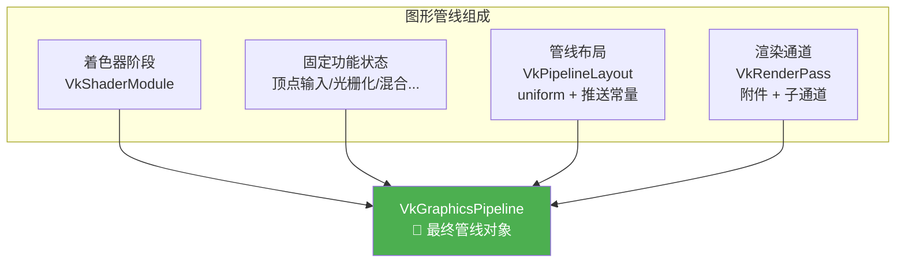
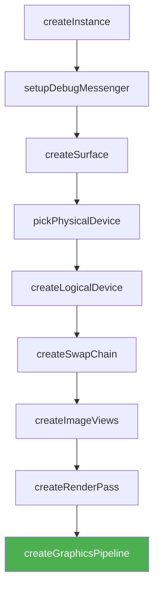

# 图形管线总结

## 组合所有组件

现在我们拥有了创建图形管线所需的所有组件：



## 创建管线

```c++
VkPipeline graphicsPipeline;  // 类成员

void createGraphicsPipeline() {
    // ... 之前的所有配置代码 ...

    VkGraphicsPipelineCreateInfo pipelineInfo{};
    pipelineInfo.sType = VK_STRUCTURE_TYPE_GRAPHICS_PIPELINE_CREATE_INFO;

    // 着色器阶段
    pipelineInfo.stageCount = 2;                           // 顶点 + 片段
    pipelineInfo.pStages = shaderStages;

    // 所有固定功能阶段
    pipelineInfo.pVertexInputState = &vertexInputInfo;
    pipelineInfo.pInputAssemblyState = &inputAssembly;
    pipelineInfo.pViewportState = &viewportState;
    pipelineInfo.pRasterizationState = &rasterizer;
    pipelineInfo.pMultisampleState = &multisampling;
    pipelineInfo.pDepthStencilState = nullptr;              // 暂不使用
    pipelineInfo.pColorBlendState = &colorBlending;
    pipelineInfo.pDynamicState = &dynamicState;

    // 管线布局（uniform 变量描述）
    pipelineInfo.layout = pipelineLayout;

    // 渲染通道
    pipelineInfo.renderPass = renderPass;
    pipelineInfo.subpass = 0;                               // 使用的子通道索引

    // 管线派生（可选，用于从已有管线创建新管线，提升创建速度）
    pipelineInfo.basePipelineHandle = VK_NULL_HANDLE;
    pipelineInfo.basePipelineIndex = -1;

    // 创建管线
    if (vkCreateGraphicsPipelines(device, VK_NULL_HANDLE, 1, &pipelineInfo, nullptr, &graphicsPipeline) != VK_SUCCESS) {
        throw std::runtime_error("failed to create graphics pipeline!");
    }

    // 管线创建完成后，着色器模块可以销毁
    vkDestroyShaderModule(device, fragShaderModule, nullptr);
    vkDestroyShaderModule(device, vertShaderModule, nullptr);
}
```

### `vkCreateGraphicsPipelines` 参数详解

| 参数 | 说明 |
|------|------|
| `device` | 逻辑设备 |
| 第 2 个参数 | `VkPipelineCache`（管线缓存，可跨调用/运行复用，此处传 `VK_NULL_HANDLE`） |
| 第 3 个参数 | 创建信息数量（支持**批量创建**多个管线） |
| `pCreateInfos` | 管线创建信息数组 |
| `pAllocator` | 自定义内存分配器（通常 `nullptr`） |
| `pPipelines` | 输出管线句柄数组 |

> 💡 **管线缓存（Pipeline Cache）**：可以将管线创建数据存储到文件，在下次程序启动时加载，**显著加速管线创建**。

> 📌 **管线派生**：通过 `basePipelineHandle` 从已有管线派生新管线。当多个管线有大量共同配置时，创建速度更快，切换也更快。需要设置 `VK_PIPELINE_CREATE_DERIVATIVE_BIT` 标志。

## 清理

```c++
void cleanup() {
    vkDestroyPipeline(device, graphicsPipeline, nullptr);    // 管线
    vkDestroyPipelineLayout(device, pipelineLayout, nullptr); // 管线布局
    vkDestroyRenderPass(device, renderPass, nullptr);         // 渲染通道
    // ... 其他清理 ...
}
```

> ⚠️ **销毁顺序**：管线 → 管线布局 → 渲染通道（被依赖的对象后销毁）

## 到此为止的完整初始化流程



## 本章知识点总结

- ✅ 图形管线由**着色器阶段 + 固定功能 + 管线布局 + 渲染通道**四大组件构成
- ✅ `vkCreateGraphicsPipelines` 支持批量创建和管线缓存
- ✅ 着色器模块在管线创建后可立即销毁
- ✅ 管线对象在程序结束时销毁
- ✅ 管线一旦创建就**不可变**——需要不同配置就必须创建新管线

接下来我们将设置帧缓冲和[绘制命令](../03_绘制/)。

[C++ 代码](/code/12_graphics_pipeline_complete.cpp) /
[顶点着色器](/code/09_shader_base.vert) /
[片段着色器](/code/09_shader_base.frag)
