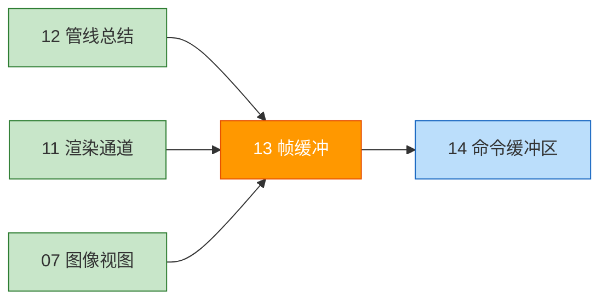
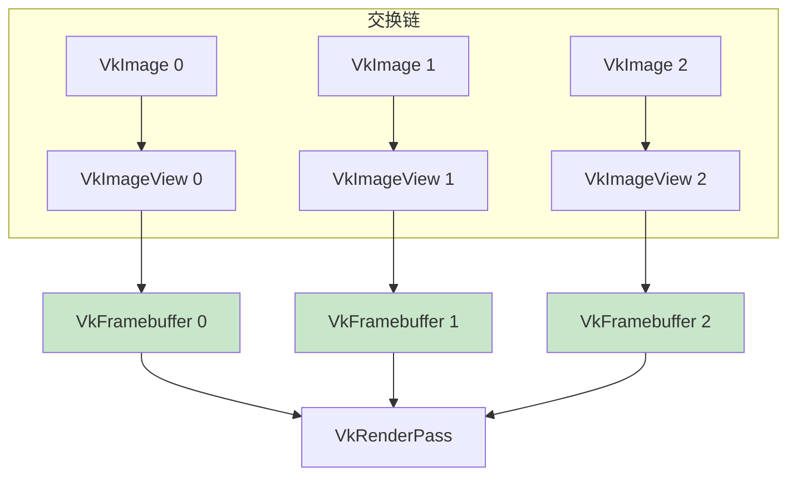
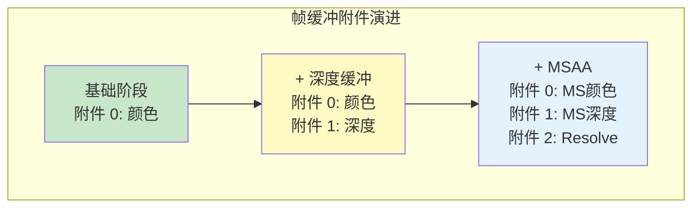
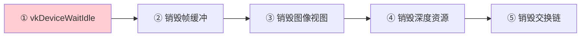

# 帧缓冲（Framebuffers）

## 📍 本章在教程中的位置



> 📌 **依赖与影响** — 帧缓冲是教程中**被回溯修改次数最多的对象之一**：
> - **前置**：
>   - [渲染通道](../02_图形管线基础/03_渲染通道.md) — 帧缓冲与渲染通道的附件一一对应
>   - [图像视图](../01_呈现/02_图像视图.md) — 提供颜色附件
> - **后续回溯修改**：
>
> ```mermaid
> graph TD
>     FB[帧缓冲<br>1 个附件（颜色）]:::current
>     FB -.->|深度缓冲| FB2[帧缓冲<br>2 个附件（颜色+深度）]:::mod
>     FB2 -.->|多重采样| FB3[帧缓冲<br>3 个附件（MS颜色+深度+resolve）]:::mod
>     classDef current fill:#ff9800,color:#fff
>     classDef mod fill:#fff9c4
> ```

## 概念

渲染通道创建时指定的附件需要通过 `VkFramebuffer` 对象绑定。帧缓冲引用所有的 `VkImageView` 作为附件。



> 📌 每个交换链图像需要一个对应的帧缓冲，绘制时根据交换链返回的图像索引选择对应的帧缓冲。

## 创建帧缓冲

```c++
std::vector<VkFramebuffer> swapChainFramebuffers;  // 类成员

void initVulkan() {
    // ...
    createGraphicsPipeline();
    createFramebuffers();    // ← 新增
}

void createFramebuffers() {
    swapChainFramebuffers.resize(swapChainImageViews.size());

    for (size_t i = 0; i < swapChainImageViews.size(); i++) {
        VkImageView attachments[] = {
            swapChainImageViews[i]    // 颜色附件
        };

        VkFramebufferCreateInfo framebufferInfo{};
        framebufferInfo.sType = VK_STRUCTURE_TYPE_FRAMEBUFFER_CREATE_INFO;
        framebufferInfo.renderPass = renderPass;        // 必须兼容的渲染通道
        framebufferInfo.attachmentCount = 1;
        framebufferInfo.pAttachments = attachments;
        framebufferInfo.width = swapChainExtent.width;
        framebufferInfo.height = swapChainExtent.height;
        framebufferInfo.layers = 1;                     // 非立体渲染为 1

        if (vkCreateFramebuffer(device, &framebufferInfo, nullptr, &swapChainFramebuffers[i]) != VK_SUCCESS) {
            throw std::runtime_error("failed to create framebuffer!");
        }
    }
}
```

> ⚠️ **帧缓冲必须与渲染通道兼容**——即使用相同数量和类型的附件。

---

## 🔴 常见错误与易错参数详解

### 错误 1：`attachmentCount` 与渲染通道不匹配

```c++
// ❌ 渲染通道定义了 2 个附件（颜色+深度），但帧缓冲只提供了 1 个
framebufferInfo.attachmentCount = 1;  // 应该是 2！

// 验证层报错：
// VUID-VkFramebufferCreateInfo-attachmentCount-00876
// "vkCreateFramebuffer: attachmentCount does not match render pass"
```

```c++
// ✅ 正确：附件数量和顺序必须与渲染通道定义完全一致
std::array<VkImageView, 2> attachments = {
    swapChainImageViews[i],  // 附件 0：颜色
    depthImageView           // 附件 1：深度
};
framebufferInfo.attachmentCount = static_cast<uint32_t>(attachments.size());
framebufferInfo.pAttachments = attachments.data();
```

### 错误 2：`width`/`height` 与交换链不一致

```c++
// ❌ 硬编码尺寸——窗口缩放后渲染区域错位或崩溃
framebufferInfo.width = 800;
framebufferInfo.height = 600;

// ✅ 始终使用交换链的实际尺寸
framebufferInfo.width = swapChainExtent.width;
framebufferInfo.height = swapChainExtent.height;
```

> ⚠️ 帧缓冲的尺寸必须 ≥ 渲染通道中 `renderArea` 的范围。如果帧缓冲比渲染区域小，行为**未定义**（可能崩溃、画面错乱或 GPU 挂起）。

### 错误 3：`layers` 参数错误

```c++
framebufferInfo.layers = 1;  // 普通渲染
// framebufferInfo.layers = 2;  // VR 立体渲染（左右眼各一层）
```

| `layers` 值 | 使用场景 |
|------------|----------|
| `1` | 普通 2D 渲染（绝大多数情况） |
| `2` | VR 立体渲染（`VK_IMAGE_VIEW_TYPE_2D_ARRAY`） |
| `6` | 立方体贴图渲染 |

> ⚠️ 如果 `layers > 1`，对应的 `VkImageView` 必须创建为 `layerCount ≥ layers` 的数组视图，否则验证层报 `VUID-VkFramebufferCreateInfo-pAttachments-00883`。

### 错误 4：帧缓冲引用已销毁的图像视图

```c++
// ❌ 危险模式——图像视图已销毁，但帧缓冲还在使用
vkDestroyImageView(device, depthImageView, nullptr);
// ... 之后仍然使用引用了 depthImageView 的帧缓冲 → 崩溃！
```

> ⚠️ **帧缓冲不会持有图像视图的引用计数**。图像视图必须在帧缓冲的**整个生命周期内**保持有效。

### 错误 5：交换链重建后忘记重建帧缓冲

```c++
void recreateSwapChain() {
    // ...
    createImageViews();       // 新的图像视图
    createDepthResources();   // 新的深度图像
    createFramebuffers();     // ⚠️ 必须重建帧缓冲！旧的引用了已销毁的图像视图
}
```

## 多附件帧缓冲示例（完整）

后续章节添加深度缓冲和多重采样后，帧缓冲会包含多个附件：

```c++
// 深度缓冲阶段（2 个附件）
std::array<VkImageView, 2> attachments = {
    swapChainImageViews[i],  // 附件 0：颜色
    depthImageView           // 附件 1：深度（所有帧共享）
};

// 多重采样阶段（3 个附件）
std::array<VkImageView, 3> attachments = {
    colorImageView,          // 附件 0：多重采样颜色（临时）
    depthImageView,          // 附件 1：多重采样深度
    swapChainImageViews[i]   // 附件 2：resolve 目标（最终输出）
};
```



## 资源销毁顺序



```c++
void cleanupSwapChain() {
    // 深度资源
    vkDestroyImageView(device, depthImageView, nullptr);
    vkDestroyImage(device, depthImage, nullptr);
    vkFreeMemory(device, depthImageMemory, nullptr);

    // 帧缓冲（在图像视图之前！）
    for (auto framebuffer : swapChainFramebuffers) {
        vkDestroyFramebuffer(device, framebuffer, nullptr);
    }

    // 图像视图
    for (auto imageView : swapChainImageViews) {
        vkDestroyImageView(device, imageView, nullptr);
    }

    vkDestroySwapchainKHR(device, swapChain, nullptr);
}
```

> ⚠️ **销毁帧缓冲之前**必须确保所有使用该帧缓冲的命令缓冲区已执行完毕（`vkDeviceWaitIdle` 或栅栏等待）。

## 知识点检查

| 检查项 | 状态 |
|--------|------|
| `attachmentCount` 与渲染通道一致 | ☐ |
| `width/height` 使用 `swapChainExtent` | ☐ |
| `layers = 1`（除非 VR） | ☐ |
| 交换链重建时重建帧缓冲 | ☐ |
| 图像视图在帧缓冲生命期内有效 | ☐ |
| 销毁顺序：帧缓冲 → 图像视图 → 交换链 | ☐ |

至此，我们拥有了渲染所需的所有对象。接下来编写[命令缓冲区](01_命令缓冲区.md)。

[C++ 代码](/code/13_framebuffers.cpp)
