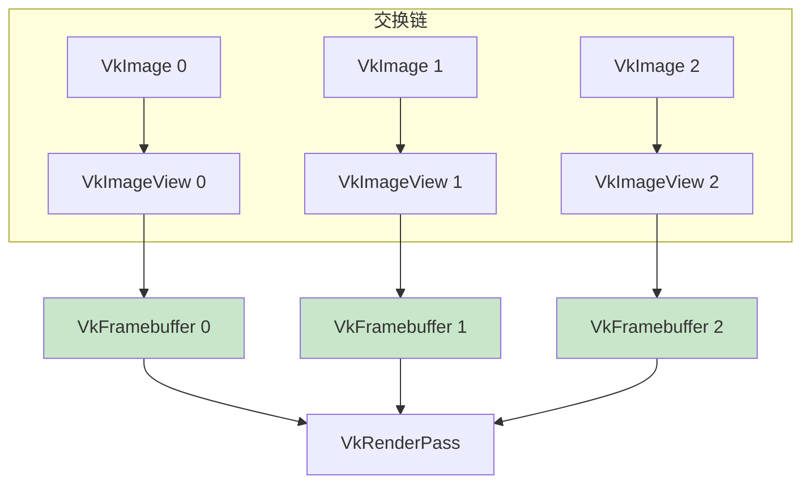

# 帧缓冲（Framebuffers）

## 概念

渲染通道创建时指定的附件需要通过 `VkFramebuffer` 对象绑定。帧缓冲引用所有的 `VkImageView` 作为附件。



> 📌 每个交换链图像需要一个对应的帧缓冲，绘制时根据交换链返回的图像索引选择对应的帧缓冲。

## 创建帧缓冲

```c++
std::vector<VkFramebuffer> swapChainFramebuffers;  // 类成员

void initVulkan() {
    // ...
    createGraphicsPipeline();
    createFramebuffers();    // ← 新增
}

void createFramebuffers() {
    swapChainFramebuffers.resize(swapChainImageViews.size());

    for (size_t i = 0; i < swapChainImageViews.size(); i++) {
        VkImageView attachments[] = {
            swapChainImageViews[i]    // 颜色附件
        };

        VkFramebufferCreateInfo framebufferInfo{};
        framebufferInfo.sType = VK_STRUCTURE_TYPE_FRAMEBUFFER_CREATE_INFO;
        framebufferInfo.renderPass = renderPass;        // 必须兼容的渲染通道
        framebufferInfo.attachmentCount = 1;
        framebufferInfo.pAttachments = attachments;
        framebufferInfo.width = swapChainExtent.width;
        framebufferInfo.height = swapChainExtent.height;
        framebufferInfo.layers = 1;                     // 非立体渲染为 1

        if (vkCreateFramebuffer(device, &framebufferInfo, nullptr, &swapChainFramebuffers[i]) != VK_SUCCESS) {
            throw std::runtime_error("failed to create framebuffer!");
        }
    }
}
```

> ⚠️ **帧缓冲必须与渲染通道兼容**——即使用相同数量和类型的附件。

## 清理

```c++
void cleanup() {
    for (auto framebuffer : swapChainFramebuffers) {
        vkDestroyFramebuffer(device, framebuffer, nullptr);
    }
    // ... 然后销毁图像视图和渲染通道
}
```

> ⚠️ 帧缓冲必须在图像视图和渲染通道**之前**销毁，但要在渲染**完成之后**。

至此，我们拥有了渲染所需的所有对象。接下来编写[命令缓冲区](01_命令缓冲区.md)。

[C++ 代码](/code/13_framebuffers.cpp)
