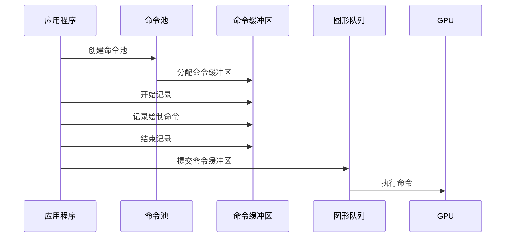
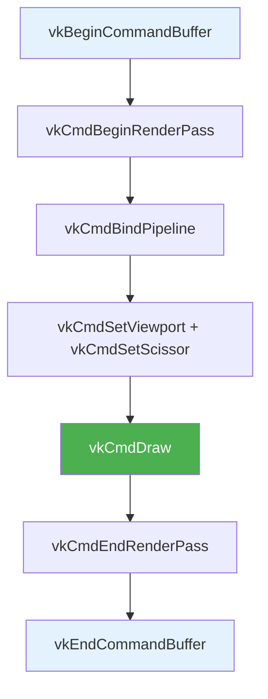

# 命令缓冲区（Command Buffers）

## 概念

Vulkan 中的绘制和内存传输操作**不通过直接函数调用执行**，而是记录在命令缓冲区对象中，然后一起提交。



> 💡 **优势**：所有命令一起提交，驱动可以更高效地处理；支持多线程并行记录。

## 命令池（Command Pool）

命令池管理命令缓冲区使用的内存。

```c++
VkCommandPool commandPool;  // 类成员

void createCommandPool() {
    QueueFamilyIndices queueFamilyIndices = findQueueFamilies(physicalDevice);

    VkCommandPoolCreateInfo poolInfo{};
    poolInfo.sType = VK_STRUCTURE_TYPE_COMMAND_POOL_CREATE_INFO;
    poolInfo.flags = VK_COMMAND_POOL_CREATE_RESET_COMMAND_BUFFER_BIT;  // 允许单独重置
    poolInfo.queueFamilyIndex = queueFamilyIndices.graphicsFamily.value();

    if (vkCreateCommandPool(device, &poolInfo, nullptr, &commandPool) != VK_SUCCESS) {
        throw std::runtime_error("failed to create command pool!");
    }
}
```

**命令池标志：**

| 标志 | 说明 |
|------|------|
| `RESET_COMMAND_BUFFER_BIT` | 允许单个命令缓冲区被**单独重置和重新记录** |
| `TRANSIENT_BIT` | 提示命令缓冲区会被频繁重新记录（优化内存分配策略） |

> ⚠️ 命令池**绑定到特定队列族**。我们用图形队列，所以使用 `graphicsFamily`。

## 分配命令缓冲区

```c++
VkCommandBuffer commandBuffer;  // 类成员（命令池销毁时自动释放）

void createCommandBuffer() {
    VkCommandBufferAllocateInfo allocInfo{};
    allocInfo.sType = VK_STRUCTURE_TYPE_COMMAND_BUFFER_ALLOCATE_INFO;
    allocInfo.commandPool = commandPool;
    allocInfo.level = VK_COMMAND_BUFFER_LEVEL_PRIMARY;  // 主命令缓冲区
    allocInfo.commandBufferCount = 1;

    if (vkAllocateCommandBuffers(device, &allocInfo, &commandBuffer) != VK_SUCCESS) {
        throw std::runtime_error("failed to allocate command buffers!");
    }
}
```

| 级别 | 说明 |
|------|------|
| `PRIMARY` | 可直接提交到队列执行，**不能**被其他命令缓冲区调用 |
| `SECONDARY` | 不能直接提交，但**可被**主命令缓冲区调用（复用公共操作） |

## 记录命令缓冲区

```c++
void recordCommandBuffer(VkCommandBuffer commandBuffer, uint32_t imageIndex) {
    // 1. 开始记录
    VkCommandBufferBeginInfo beginInfo{};
    beginInfo.sType = VK_STRUCTURE_TYPE_COMMAND_BUFFER_BEGIN_INFO;
    beginInfo.flags = 0;
    beginInfo.pInheritanceInfo = nullptr;  // 仅次级缓冲区使用

    if (vkBeginCommandBuffer(commandBuffer, &beginInfo) != VK_SUCCESS) {
        throw std::runtime_error("failed to begin recording command buffer!");
    }

    // 2. 开始渲染通道
    VkRenderPassBeginInfo renderPassInfo{};
    renderPassInfo.sType = VK_STRUCTURE_TYPE_RENDER_PASS_BEGIN_INFO;
    renderPassInfo.renderPass = renderPass;
    renderPassInfo.framebuffer = swapChainFramebuffers[imageIndex];  // 选择对应帧缓冲
    renderPassInfo.renderArea.offset = {0, 0};
    renderPassInfo.renderArea.extent = swapChainExtent;

    VkClearValue clearColor = {{{0.0f, 0.0f, 0.0f, 1.0f}}};  // 清除为黑色
    renderPassInfo.clearValueCount = 1;
    renderPassInfo.pClearValues = &clearColor;

    vkCmdBeginRenderPass(commandBuffer, &renderPassInfo, VK_SUBPASS_CONTENTS_INLINE);

    // 3. 绑定图形管线
    vkCmdBindPipeline(commandBuffer, VK_PIPELINE_BIND_POINT_GRAPHICS, graphicsPipeline);

    // 4. 设置动态状态（视口和裁剪）
    VkViewport viewport{};
    viewport.x = 0.0f;
    viewport.y = 0.0f;
    viewport.width = static_cast<float>(swapChainExtent.width);
    viewport.height = static_cast<float>(swapChainExtent.height);
    viewport.minDepth = 0.0f;
    viewport.maxDepth = 1.0f;
    vkCmdSetViewport(commandBuffer, 0, 1, &viewport);

    VkRect2D scissor{};
    scissor.offset = {0, 0};
    scissor.extent = swapChainExtent;
    vkCmdSetScissor(commandBuffer, 0, 1, &scissor);

    // 5. 绘制！
    vkCmdDraw(commandBuffer, 3, 1, 0, 0);
    //                       │  │  │  └─ firstInstance（实例渲染偏移）
    //                       │  │  └──── firstVertex（gl_VertexIndex 起始值）
    //                       │  └─────── instanceCount（1 = 非实例渲染）
    //                       └────────── vertexCount（3 个顶点 = 三角形）

    // 6. 结束渲染通道
    vkCmdEndRenderPass(commandBuffer);

    // 7. 结束记录
    if (vkEndCommandBuffer(commandBuffer) != VK_SUCCESS) {
        throw std::runtime_error("failed to record command buffer!");
    }
}
```

### 命令记录流程图



> ⚠️ **所有 `vkCmd*` 函数返回 `void`**——错误要在 `vkEndCommandBuffer` 时才能检测到。

> ⚠️ **`vkBeginCommandBuffer` 会隐式重置命令缓冲区**——如果之前已经记录过一次，不能追加命令。

## 清理

```c++
void cleanup() {
    vkDestroyCommandPool(device, commandPool, nullptr);
    // 命令缓冲区随命令池自动释放，无需手动释放
}
```

接下来实现[渲染与呈现](02_渲染与呈现.md)的主循环。

[C++ 代码](/code/14_command_buffers.cpp)
