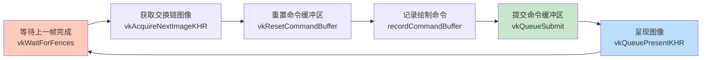
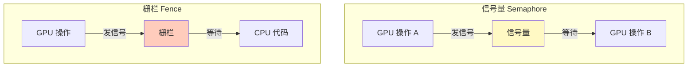
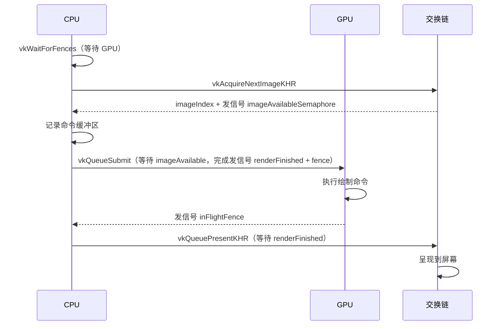

# 渲染与呈现

## 帧渲染概览



## 同步机制

Vulkan 的 GPU 操作是**异步的**——函数返回时操作可能尚未完成。我们需要**显式同步**。

### 信号量 vs 栅栏



| 同步原语 | 用途 | 等待方 |
|----------|------|--------|
| **信号量**（Semaphore） | GPU-GPU 同步 | GPU 等待 |
| **栅栏**（Fence） | GPU-CPU 同步 | CPU 等待（阻塞主机） |

> 📌 **选择原则**：
> - 交换链操作（GPU 内部）→ **信号量**
> - 等待上一帧完成（CPU 需要等 GPU）→ **栅栏**

## 创建同步对象

```c++
VkSemaphore imageAvailableSemaphore;   // 图像已从交换链获取
VkSemaphore renderFinishedSemaphore;   // 渲染已完成，可以呈现
VkFence inFlightFence;                 // 上一帧已完成

void createSyncObjects() {
    VkSemaphoreCreateInfo semaphoreInfo{};
    semaphoreInfo.sType = VK_STRUCTURE_TYPE_SEMAPHORE_CREATE_INFO;

    VkFenceCreateInfo fenceInfo{};
    fenceInfo.sType = VK_STRUCTURE_TYPE_FENCE_CREATE_INFO;
    fenceInfo.flags = VK_FENCE_CREATE_SIGNALED_BIT;  // ⚠️ 初始为已发信号状态！

    if (vkCreateSemaphore(device, &semaphoreInfo, nullptr, &imageAvailableSemaphore) != VK_SUCCESS ||
        vkCreateSemaphore(device, &semaphoreInfo, nullptr, &renderFinishedSemaphore) != VK_SUCCESS ||
        vkCreateFence(device, &fenceInfo, nullptr, &inFlightFence) != VK_SUCCESS) {
        throw std::runtime_error("failed to create synchronization objects!");
    }
}
```

> ⚠️ **栅栏必须以 `SIGNALED` 状态创建**！否则第一帧调用 `vkWaitForFences` 会**永久阻塞**——因为没有"上一帧"来发信号。

## drawFrame 实现

```c++
void drawFrame() {
    // 1. 等待上一帧完成
    vkWaitForFences(device, 1, &inFlightFence, VK_TRUE, UINT64_MAX);
    vkResetFences(device, 1, &inFlightFence);  // 手动重置栅栏

    // 2. 从交换链获取图像
    uint32_t imageIndex;
    vkAcquireNextImageKHR(device, swapChain, UINT64_MAX, 
                          imageAvailableSemaphore, VK_NULL_HANDLE, &imageIndex);

    // 3. 重置并记录命令缓冲区
    vkResetCommandBuffer(commandBuffer, 0);
    recordCommandBuffer(commandBuffer, imageIndex);

    // 4. 提交命令缓冲区
    VkSubmitInfo submitInfo{};
    submitInfo.sType = VK_STRUCTURE_TYPE_SUBMIT_INFO;

    VkSemaphore waitSemaphores[] = {imageAvailableSemaphore};
    VkPipelineStageFlags waitStages[] = {VK_PIPELINE_STAGE_COLOR_ATTACHMENT_OUTPUT_BIT};
    submitInfo.waitSemaphoreCount = 1;
    submitInfo.pWaitSemaphores = waitSemaphores;      // 等待图像可用
    submitInfo.pWaitDstStageMask = waitStages;         // 在颜色输出阶段等待

    submitInfo.commandBufferCount = 1;
    submitInfo.pCommandBuffers = &commandBuffer;

    VkSemaphore signalSemaphores[] = {renderFinishedSemaphore};
    submitInfo.signalSemaphoreCount = 1;
    submitInfo.pSignalSemaphores = signalSemaphores;   // 完成后发信号

    if (vkQueueSubmit(graphicsQueue, 1, &submitInfo, inFlightFence) != VK_SUCCESS) {
        throw std::runtime_error("failed to submit draw command buffer!");
    }

    // 5. 呈现
    VkPresentInfoKHR presentInfo{};
    presentInfo.sType = VK_STRUCTURE_TYPE_PRESENT_INFO_KHR;
    presentInfo.waitSemaphoreCount = 1;
    presentInfo.pWaitSemaphores = signalSemaphores;    // 等待渲染完成

    VkSwapchainKHR swapChains[] = {swapChain};
    presentInfo.swapchainCount = 1;
    presentInfo.pSwapchains = swapChains;
    presentInfo.pImageIndices = &imageIndex;

    vkQueuePresentKHR(presentQueue, &presentInfo);
}
```

### 同步流程图



> 📌 **`waitStages` 的含义**：GPU 可以在图像可用之前就开始执行顶点着色器等早期阶段，只在需要写入颜色附件时才等待。

## 子通道依赖

渲染通道中的图像布局转换需要正确的子通道依赖配置：

```c++
// 在 createRenderPass() 中添加
VkSubpassDependency dependency{};
dependency.srcSubpass = VK_SUBPASS_EXTERNAL;   // 渲染通道之前的隐式子通道
dependency.dstSubpass = 0;                      // 我们的子通道

dependency.srcStageMask = VK_PIPELINE_STAGE_COLOR_ATTACHMENT_OUTPUT_BIT;
dependency.srcAccessMask = 0;

dependency.dstStageMask = VK_PIPELINE_STAGE_COLOR_ATTACHMENT_OUTPUT_BIT;
dependency.dstAccessMask = VK_ACCESS_COLOR_ATTACHMENT_WRITE_BIT;

// 添加到渲染通道创建信息中
renderPassInfo.dependencyCount = 1;
renderPassInfo.pDependencies = &dependency;
```

> ⚠️ 没有这个依赖，布局转换可能在图像还未从交换链获取时就开始了。

## 退出时等待

```c++
void mainLoop() {
    while (!glfwWindowShouldClose(window)) {
        glfwPollEvents();
        drawFrame();
    }
    vkDeviceWaitIdle(device);  // ⚠️ 必须等待所有 GPU 操作完成才能清理资源！
}
```

> ⚠️ **不加 `vkDeviceWaitIdle`**，退出时验证层会报错——因为正在销毁还在使用的同步对象。

## 清理

```c++
void cleanup() {
    vkDestroySemaphore(device, imageAvailableSemaphore, nullptr);
    vkDestroySemaphore(device, renderFinishedSemaphore, nullptr);
    vkDestroyFence(device, inFlightFence, nullptr);
    // ...
}
```

运行程序，你应该能看到一个彩色三角形！🎉

接下来处理[多帧并行](03_多帧并行.md)以提高性能。

[C++ 代码](/code/15_hello_triangle.cpp)
