# 多帧并行（Frames in Flight）

## 📍 本章在教程中的位置


> 📌 **依赖与影响**：
> - **前置**：[渲染与呈现](02_渲染与呈现.md) — 单帧渲染已完成，现在优化多帧
> - **产出**：`MAX_FRAMES_IN_FLIGHT` 常量 + 每帧独立的同步对象
> - **影响后续**：`MAX_FRAMES_IN_FLIGHT` 常量贯穿整个教程：
>   - [Uniform 缓冲区](../../05_Uniform缓冲区/00_描述符集布局与缓冲区.md)：每帧独立 UBO
>   - [描述符池](../../05_Uniform缓冲区/01_描述符池与描述符集.md)：每帧独立描述符集
>   - [计算着色器](../../11_计算着色器.md)：每帧独立的计算命令缓冲、SSBO、同步对象

## 问题

当前的渲染循环有一个严重缺陷：**CPU 必须等待上一帧 GPU 渲染完成**才能开始下一帧。

```mermaid
gantt
    title 单帧渲染（低效）
    dateFormat X
    axisFormat %s
    
    section CPU
    记录帧1     :0, 1
    等待GPU...  :1, 3
    记录帧2     :3, 4
    等待GPU...  :4, 6
    
    section GPU
    空闲        :0, 1
    渲染帧1     :1, 3
    空闲        :3, 4
    渲染帧2     :4, 6
```



## 解决方案：多帧并行

允许多帧**同时处于不同阶段**——CPU 记录下一帧时，GPU 渲染当前帧。

```mermaid
gantt
    title 双帧并行（高效）
    dateFormat X
    axisFormat %s
    
    section CPU
    记录帧0     :0, 1
    记录帧1     :1, 2
    记录帧0     :2, 3
    记录帧1     :3, 4
    
    section GPU
    渲染帧0     :1, 2
    渲染帧1     :2, 3
    渲染帧0     :3, 4
    渲染帧1     :4, 5
```



## 实现

### 1. 定义并行帧数

```c++
const int MAX_FRAMES_IN_FLIGHT = 2;  // 双缓冲
```

> 📌 **选择 2 的原因**：CPU 和 GPU 可以各忙各的。3 及以上会增加延迟，通常不推荐。

### 2. 复制每帧资源

每帧需要**独立的**命令缓冲区和同步对象：

```c++
std::vector<VkCommandBuffer> commandBuffers;           // 每帧一个
std::vector<VkSemaphore> imageAvailableSemaphores;     // 每帧一个
std::vector<VkSemaphore> renderFinishedSemaphores;     // 每帧一个
std::vector<VkFence> inFlightFences;                   // 每帧一个

uint32_t currentFrame = 0;  // 当前帧索引
```

### 3. 创建多个命令缓冲区

```c++
void createCommandBuffers() {
    commandBuffers.resize(MAX_FRAMES_IN_FLIGHT);

    VkCommandBufferAllocateInfo allocInfo{};
    allocInfo.sType = VK_STRUCTURE_TYPE_COMMAND_BUFFER_ALLOCATE_INFO;
    allocInfo.commandPool = commandPool;
    allocInfo.level = VK_COMMAND_BUFFER_LEVEL_PRIMARY;
    allocInfo.commandBufferCount = (uint32_t)commandBuffers.size();

    if (vkAllocateCommandBuffers(device, &allocInfo, commandBuffers.data()) != VK_SUCCESS) {
        throw std::runtime_error("failed to allocate command buffers!");
    }
}
```

### 4. 创建多组同步对象

```c++
void createSyncObjects() {
    imageAvailableSemaphores.resize(MAX_FRAMES_IN_FLIGHT);
    renderFinishedSemaphores.resize(MAX_FRAMES_IN_FLIGHT);
    inFlightFences.resize(MAX_FRAMES_IN_FLIGHT);

    VkSemaphoreCreateInfo semaphoreInfo{};
    semaphoreInfo.sType = VK_STRUCTURE_TYPE_SEMAPHORE_CREATE_INFO;

    VkFenceCreateInfo fenceInfo{};
    fenceInfo.sType = VK_STRUCTURE_TYPE_FENCE_CREATE_INFO;
    fenceInfo.flags = VK_FENCE_CREATE_SIGNALED_BIT;

    for (size_t i = 0; i < MAX_FRAMES_IN_FLIGHT; i++) {
        if (vkCreateSemaphore(device, &semaphoreInfo, nullptr, &imageAvailableSemaphores[i]) != VK_SUCCESS ||
            vkCreateSemaphore(device, &semaphoreInfo, nullptr, &renderFinishedSemaphores[i]) != VK_SUCCESS ||
            vkCreateFence(device, &fenceInfo, nullptr, &inFlightFences[i]) != VK_SUCCESS) {
            throw std::runtime_error("failed to create synchronization objects for a frame!");
        }
    }
}
```

### 5. 修改 drawFrame

```c++
void drawFrame() {
    // 使用当前帧的同步对象
    vkWaitForFences(device, 1, &inFlightFences[currentFrame], VK_TRUE, UINT64_MAX);
    vkResetFences(device, 1, &inFlightFences[currentFrame]);

    uint32_t imageIndex;
    vkAcquireNextImageKHR(device, swapChain, UINT64_MAX, 
                          imageAvailableSemaphores[currentFrame], VK_NULL_HANDLE, &imageIndex);

    vkResetCommandBuffer(commandBuffers[currentFrame], 0);
    recordCommandBuffer(commandBuffers[currentFrame], imageIndex);

    VkSubmitInfo submitInfo{};
    submitInfo.sType = VK_STRUCTURE_TYPE_SUBMIT_INFO;

    VkSemaphore waitSemaphores[] = {imageAvailableSemaphores[currentFrame]};
    VkPipelineStageFlags waitStages[] = {VK_PIPELINE_STAGE_COLOR_ATTACHMENT_OUTPUT_BIT};
    submitInfo.waitSemaphoreCount = 1;
    submitInfo.pWaitSemaphores = waitSemaphores;
    submitInfo.pWaitDstStageMask = waitStages;
    submitInfo.commandBufferCount = 1;
    submitInfo.pCommandBuffers = &commandBuffers[currentFrame];

    VkSemaphore signalSemaphores[] = {renderFinishedSemaphores[currentFrame]};
    submitInfo.signalSemaphoreCount = 1;
    submitInfo.pSignalSemaphores = signalSemaphores;

    if (vkQueueSubmit(graphicsQueue, 1, &submitInfo, inFlightFences[currentFrame]) != VK_SUCCESS) {
        throw std::runtime_error("failed to submit draw command buffer!");
    }

    VkPresentInfoKHR presentInfo{};
    presentInfo.sType = VK_STRUCTURE_TYPE_PRESENT_INFO_KHR;
    presentInfo.waitSemaphoreCount = 1;
    presentInfo.pWaitSemaphores = signalSemaphores;
    VkSwapchainKHR swapChains[] = {swapChain};
    presentInfo.swapchainCount = 1;
    presentInfo.pSwapchains = swapChains;
    presentInfo.pImageIndices = &imageIndex;

    vkQueuePresentKHR(presentQueue, &presentInfo);

    // 轮转帧索引
    currentFrame = (currentFrame + 1) % MAX_FRAMES_IN_FLIGHT;
}
```

> 📌 `currentFrame` 通过取模操作在 `0` 和 `1` 之间循环。

### 6. 清理所有同步对象

```c++
void cleanup() {
    for (size_t i = 0; i < MAX_FRAMES_IN_FLIGHT; i++) {
        vkDestroySemaphore(device, renderFinishedSemaphores[i], nullptr);
        vkDestroySemaphore(device, imageAvailableSemaphores[i], nullptr);
        vkDestroyFence(device, inFlightFences[i], nullptr);
    }
    // ...
}
```

## 知识点总结

| 概念 | 说明 |
|------|------|
| `MAX_FRAMES_IN_FLIGHT` | 并行处理的最大帧数（通常 2） |
| 帧索引 `currentFrame` | 在 `[0, MAX-1]` 间轮转 |
| 为什么复制资源 | 避免 CPU 和 GPU 同时访问同一资源 |
| 栅栏的作用 | 确保对应帧的 GPU 工作完成后才复用其资源 |

接下来处理[交换链重建](../04_交换链重建.md)。

[C++ 代码](/code/16_frames_in_flight.cpp)
