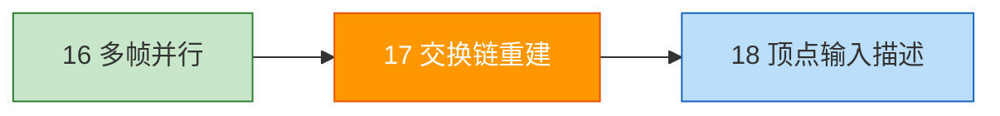
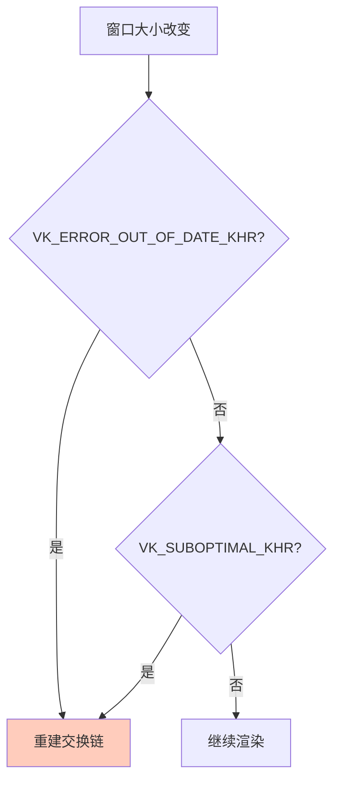

# 交换链重建（Swap Chain Recreation）

## 📍 本章在教程中的位置



> 📌 **依赖与影响**：
> - **本章重建的对象**——以及后续章节添加的新对象：
>
> ```mermaid
> graph TD
>     RC[recreateSwapChain]:::current
>     RC --> SC[交换链]:::done
>     RC --> IV[图像视图]:::done
>     RC --> FB[帧缓冲]:::done
>     RC -.->|深度缓冲章节| DI[深度图像+视图]:::mod
>     RC -.->|多重采样章节| CI[MSAA 颜色图像+视图]:::mod
>     classDef current fill:#ff9800,color:#fff
>     classDef done fill:#c8e6c9
>     classDef mod fill:#fff9c4
> ```
>
> ❗ **每次添加与交换链尺寸相关的新资源，都必须回来修改 `recreateSwapChain()` 和 `cleanupSwapChain()`**

## 为什么需要重建？

窗口表面变化时（如窗口大小改变），交换链不再兼容，必须重建。



## 重建函数

```c++
void recreateSwapChain() {
    // 处理窗口最小化（帧缓冲大小为 0）
    int width = 0, height = 0;
    glfwGetFramebufferSize(window, &width, &height);
    while (width == 0 || height == 0) {
        glfwGetFramebufferSize(window, &width, &height);
        glfwWaitEvents();  // 暂停，等待窗口恢复
    }

    vkDeviceWaitIdle(device);  // 等待所有 GPU 操作完成

    cleanupSwapChain();        // 清理旧资源

    createSwapChain();         // 重建交换链
    createImageViews();        // 重建图像视图
    createFramebuffers();      // 重建帧缓冲
}
```

> ⚠️ **不需要重建渲染通道和管线**——除非交换链图像格式发生变化（如从 SDR 移到 HDR 显示器）。

### 清理旧资源

```c++
void cleanupSwapChain() {
    for (auto framebuffer : swapChainFramebuffers) {
        vkDestroyFramebuffer(device, framebuffer, nullptr);
    }
    for (auto imageView : swapChainImageViews) {
        vkDestroyImageView(device, imageView, nullptr);
    }
    vkDestroySwapchainKHR(device, swapChain, nullptr);
}
```

### 更新 cleanup

```c++
void cleanup() {
    cleanupSwapChain();  // 复用清理函数

    vkDestroyPipeline(device, graphicsPipeline, nullptr);
    vkDestroyPipelineLayout(device, pipelineLayout, nullptr);
    vkDestroyRenderPass(device, renderPass, nullptr);

    for (size_t i = 0; i < MAX_FRAMES_IN_FLIGHT; i++) {
        vkDestroySemaphore(device, renderFinishedSemaphores[i], nullptr);
        vkDestroySemaphore(device, imageAvailableSemaphores[i], nullptr);
        vkDestroyFence(device, inFlightFences[i], nullptr);
    }

    vkDestroyCommandPool(device, commandPool, nullptr);
    vkDestroyDevice(device, nullptr);

    if (enableValidationLayers) {
        DestroyDebugUtilsMessengerEXT(instance, debugMessenger, nullptr);
    }
    vkDestroySurfaceKHR(instance, surface, nullptr);
    vkDestroyInstance(instance, nullptr);

    glfwDestroyWindow(window);
    glfwTerminate();
}
```

## 检测需要重建的时机

### 在 drawFrame 中处理

```c++
void drawFrame() {
    vkWaitForFences(device, 1, &inFlightFences[currentFrame], VK_TRUE, UINT64_MAX);

    uint32_t imageIndex;
    VkResult result = vkAcquireNextImageKHR(device, swapChain, UINT64_MAX,
        imageAvailableSemaphores[currentFrame], VK_NULL_HANDLE, &imageIndex);

    // ⚠️ 获取图像失败 → 立即重建
    if (result == VK_ERROR_OUT_OF_DATE_KHR) {
        recreateSwapChain();
        return;
    } else if (result != VK_SUCCESS && result != VK_SUBOPTIMAL_KHR) {
        throw std::runtime_error("failed to acquire swap chain image!");
    }

    // ⚠️ 只有确定要提交工作时才重置栅栏！
    vkResetFences(device, 1, &inFlightFences[currentFrame]);

    // ... 记录和提交命令 ...

    result = vkQueuePresentKHR(presentQueue, &presentInfo);

    // 呈现时也检查
    if (result == VK_ERROR_OUT_OF_DATE_KHR || result == VK_SUBOPTIMAL_KHR || framebufferResized) {
        framebufferResized = false;
        recreateSwapChain();
    } else if (result != VK_SUCCESS) {
        throw std::runtime_error("failed to present swap chain image!");
    }

    currentFrame = (currentFrame + 1) % MAX_FRAMES_IN_FLIGHT;
}
```

> ⚠️ **死锁陷阱**：
> 如果在 `vkAcquireNextImageKHR` 返回 `OUT_OF_DATE` 后提前 return，但**栅栏已被重置**，下一帧 `vkWaitForFences` 将**永远阻塞**！
> 
> **解决方案**：将 `vkResetFences` 移到确认要提交工作**之后**。

## 显式处理窗口大小变化

并非所有驱动都会自动触发 `OUT_OF_DATE`，需要手动检测：

```c++
bool framebufferResized = false;  // 类成员

void initWindow() {
    // ...
    glfwSetWindowUserPointer(window, this);
    glfwSetFramebufferSizeCallback(window, framebufferResizeCallback);
}

static void framebufferResizeCallback(GLFWwindow* window, int width, int height) {
    auto app = reinterpret_cast<HelloTriangleApplication*>(glfwGetWindowUserPointer(window));
    app->framebufferResized = true;
}
```

> 📌 **为什么是 static 函数？** GLFW 是 C 库，不能直接调用 C++ 成员函数。通过 `glfwSetWindowUserPointer` 存储 `this` 指针，再在回调中取出。

## 处理窗口最小化

最小化时帧缓冲大小为 0，不能创建交换链。解决方案：**暂停等待**。

```c++
void recreateSwapChain() {
    int width = 0, height = 0;
    glfwGetFramebufferSize(window, &width, &height);
    while (width == 0 || height == 0) {   // 等待窗口恢复
        glfwGetFramebufferSize(window, &width, &height);
        glfwWaitEvents();
    }
    // ...
}
```

## 本章知识点总结

| 要点 | 说明 |
|------|------|
| `OUT_OF_DATE` | 交换链不兼容，**必须重建** |
| `SUBOPTIMAL` | 可用但不是最优，**建议重建** |
| 栅栏重置时机 | 确认提交工作后才重置，**避免死锁** |
| 窗口最小化 | 帧缓冲大小为 0，需暂停等待 |
| 回调机制 | `glfwSetFramebufferSizeCallback` + `glfwSetWindowUserPointer` |

### 🔴 交换链重建常见错误

#### 错误 1：`vkResetFences` 位置不对 → 死锁

```c++
// ❌ 栅栏在 acquire 之前就被重置
vkWaitForFences(device, 1, &fence, VK_TRUE, UINT64_MAX);
vkResetFences(device, 1, &fence);                         // ← 已重置
VkResult result = vkAcquireNextImageKHR(...);
if (result == VK_ERROR_OUT_OF_DATE_KHR) {
    recreateSwapChain();
    return;  // 没有提交 → 栅栏永远不会被 signal → 下一帧 WaitForFences 死锁！
}

// ✅ 将 ResetFences 移到确认要提交之后
vkWaitForFences(device, 1, &fence, VK_TRUE, UINT64_MAX);
VkResult result = vkAcquireNextImageKHR(...);
if (result == VK_ERROR_OUT_OF_DATE_KHR) {
    recreateSwapChain();
    return;  // 安全：栅栏仍处于 signaled 状态
}
vkResetFences(device, 1, &fence);  // ← 确认要提交后才重置
```

#### 错误 2：重建后忘记清理旧资源 → 内存泄漏

```c++
// ❌ 直接重建不清理旧的
void recreateSwapChain() {
    createSwapChain();      // 旧的交换链没有销毁！
    createImageViews();     // 旧的图像视图没有销毁！
    createFramebuffers();   // 旧的帧缓冲没有销毁！
}
// 每次窗口缩放都泄漏一整套交换链资源

// ✅ 先清理再重建
void recreateSwapChain() {
    vkDeviceWaitIdle(device);
    cleanupSwapChain();     // ← 先清理！
    createSwapChain();
    createImageViews();
    createFramebuffers();
}
```

#### 错误 3：`SUBOPTIMAL` 被当成致命错误

```c++
// ❌ SUBOPTIMAL 不是错误，交换链仍可用
if (result != VK_SUCCESS) {
    throw std::runtime_error("...");  // 把 SUBOPTIMAL 也当错误了！
}

// ✅ SUBOPTIMAL 和 SUCCESS 都可以继续
if (result == VK_ERROR_OUT_OF_DATE_KHR) {
    recreateSwapChain();
    return;
} else if (result != VK_SUCCESS && result != VK_SUBOPTIMAL_KHR) {
    throw std::runtime_error("...");
}
// 呈现后再根据 SUBOPTIMAL 决定是否重建
```

#### 错误 4：连续快速缩放导致崩溃

```c++
// ❌ 多次快速缩放可能让 recreateSwapChain 被连续调用
// 在某些驱动上，旧交换链的信号量仍被引用

// ✅ 每次重建前 vkDeviceWaitIdle 确保安全
void recreateSwapChain() {
    vkDeviceWaitIdle(device);  // ← 等待所有 GPU 操作完成
    cleanupSwapChain();
    // ...
}
```

#### 错误 5：后续章节的新资源忘记在重建中处理

```c++
// ❌ 随着教程推进，添加了深度缓冲和 MSAA 颜色资源
// 但 recreateSwapChain 和 cleanupSwapChain 没有更新
void cleanupSwapChain() {
    // 缺少 depth image/view 和 color image/view 的清理！
    for (auto fb : framebuffers) vkDestroyFramebuffer(...);
    for (auto iv : imageViews) vkDestroyImageView(...);
    vkDestroySwapchainKHR(...);
}

// ✅ 每次添加与交换链尺寸相关的资源后都要更新这两个函数
void cleanupSwapChain() {
    vkDestroyImageView(device, colorImageView, nullptr);    // MSAA
    vkDestroyImage(device, colorImage, nullptr);
    vkFreeMemory(device, colorImageMemory, nullptr);
    vkDestroyImageView(device, depthImageView, nullptr);    // 深度
    vkDestroyImage(device, depthImage, nullptr);
    vkFreeMemory(device, depthImageMemory, nullptr);
    // ... 帧缓冲、图像视图、交换链
}
```

恭喜！你已经完成了一个功能完整的 Vulkan 三角形程序！接下来进入[顶点缓冲区](../04_顶点缓冲区/00_顶点输入描述.md)章节。

[C++ 代码](/code/17_swap_chain_recreation.cpp)
