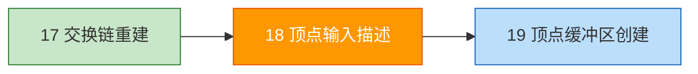
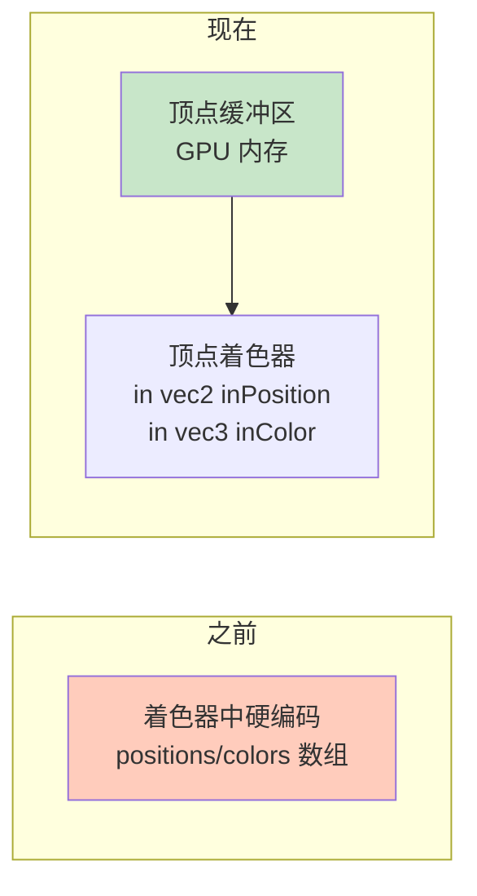

# 顶点输入描述（Vertex Input Description）

## 📍 本章在教程中的位置



> 📌 **依赖与影响**：
> - **回溯修改**：
>   - 修改[固定功能](../03_绘制三角形/02_图形管线基础/02_固定功能.md)的顶点输入状态（从空变有）
>   - 修改[着色器模块](../03_绘制三角形/02_图形管线基础/01_着色器模块.md)：从硬编码改为 `layout(location)` 输入
> - **产出**：`Vertex` 结构体 + 绑定/属性描述 → 后续多次扩展：
>
> | 章节 | Vertex 变化 |
> |------|------------|
> | 本章 | `pos` + `color` |
> | [组合图像采样器](../06_纹理映射/02_组合图像采样器.md) | + `texCoord` |
> | [加载模型](../08_加载模型.md) | + `operator==` + `hash` |

## 概述

我们将把硬编码在着色器中的顶点数据改为使用**顶点缓冲区**。



## 修改顶点着色器

```glsl
#version 450

layout(location = 0) in vec2 inPosition;   // 从顶点缓冲区读取位置
layout(location = 1) in vec3 inColor;       // 从顶点缓冲区读取颜色

layout(location = 0) out vec3 fragColor;

void main() {
    gl_Position = vec4(inPosition, 0.0, 1.0);
    fragColor = inColor;
}
```

> ⚠️ 修改着色器后**必须重新编译** `.spv` 文件！

> 📌 **64 位类型占多个 slot**：
> ```glsl
> layout(location = 0) in dvec3 inPosition;  // 占用 location 0 和 1
> layout(location = 2) in vec3 inColor;       // 必须从 2 开始
> ```

## C++ 顶点数据结构

```c++
#include <glm/glm.hpp>

struct Vertex {
    glm::vec2 pos;      // 位置
    glm::vec3 color;    // 颜色
};

const std::vector<Vertex> vertices = {
    {{0.0f, -0.5f}, {1.0f, 0.0f, 0.0f}},   // 上：红
    {{0.5f, 0.5f}, {0.0f, 1.0f, 0.0f}},    // 右下：绿
    {{-0.5f, 0.5f}, {0.0f, 0.0f, 1.0f}}    // 左下：蓝
};
```

> 📌 这种将多个属性交织在同一数组中的方式称为**交织顶点属性（Interleaving）**。

## 绑定描述（Binding Description）

告诉 Vulkan 如何从内存中**按步长读取**顶点数据：

```c++
static VkVertexInputBindingDescription getBindingDescription() {
    VkVertexInputBindingDescription bindingDescription{};
    bindingDescription.binding = 0;                          // 绑定索引
    bindingDescription.stride = sizeof(Vertex);              // 每个顶点的字节数
    bindingDescription.inputRate = VK_VERTEX_INPUT_RATE_VERTEX;  // 逐顶点
    return bindingDescription;
}
```

| 参数 | 说明 |
|------|------|
| `binding` | 绑定数组中的索引 |
| `stride` | 相邻顶点之间的字节间距 |
| `inputRate` | `VERTEX`=逐顶点，`INSTANCE`=逐实例 |

## 属性描述（Attribute Descriptions）

告诉 Vulkan 如何从绑定中**提取各个属性**：

```c++
static std::array<VkVertexInputAttributeDescription, 2> getAttributeDescriptions() {
    std::array<VkVertexInputAttributeDescription, 2> attributeDescriptions{};

    // 位置属性
    attributeDescriptions[0].binding = 0;
    attributeDescriptions[0].location = 0;                    // 对应着色器 layout(location = 0)
    attributeDescriptions[0].format = VK_FORMAT_R32G32_SFLOAT; // vec2
    attributeDescriptions[0].offset = offsetof(Vertex, pos);

    // 颜色属性
    attributeDescriptions[1].binding = 0;
    attributeDescriptions[1].location = 1;                     // 对应着色器 layout(location = 1)
    attributeDescriptions[1].format = VK_FORMAT_R32G32B32_SFLOAT; // vec3
    attributeDescriptions[1].offset = offsetof(Vertex, color);

    return attributeDescriptions;
}
```

### 格式对照表

| GLSL 类型 | Vulkan 格式 |
|-----------|-------------|
| `float` | `VK_FORMAT_R32_SFLOAT` |
| `vec2` | `VK_FORMAT_R32G32_SFLOAT` |
| `vec3` | `VK_FORMAT_R32G32B32_SFLOAT` |
| `vec4` | `VK_FORMAT_R32G32B32A32_SFLOAT` |
| `ivec2` | `VK_FORMAT_R32G32_SINT` |
| `double` | `VK_FORMAT_R64_SFLOAT` |

> ⚠️ 格式名用颜色通道命名（R32G32），但实际含义是**分量数和类型**，与颜色无关。

## 更新管线顶点输入

```c++
auto bindingDescription = Vertex::getBindingDescription();
auto attributeDescriptions = Vertex::getAttributeDescriptions();

vertexInputInfo.vertexBindingDescriptionCount = 1;
vertexInputInfo.vertexAttributeDescriptionCount = static_cast<uint32_t>(attributeDescriptions.size());
vertexInputInfo.pVertexBindingDescriptions = &bindingDescription;
vertexInputInfo.pVertexAttributeDescriptions = attributeDescriptions.data();
```

接下来创建[顶点缓冲区](01_顶点缓冲区创建.md)并将数据上传到 GPU。

[C++ 代码](/code/18_vertex_input.cpp)
