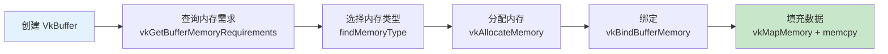

# 顶点缓冲区创建（Vertex Buffer Creation）

## Vulkan 内存管理概念

Vulkan 中缓冲区**不会自动分配内存**——需要手动创建缓冲区、查询内存需求、分配内存、绑定。



## 创建缓冲区

```c++
VkBuffer vertexBuffer;
VkDeviceMemory vertexBufferMemory;

void createVertexBuffer() {
    VkBufferCreateInfo bufferInfo{};
    bufferInfo.sType = VK_STRUCTURE_TYPE_BUFFER_CREATE_INFO;
    bufferInfo.size = sizeof(vertices[0]) * vertices.size();  // 总字节数
    bufferInfo.usage = VK_BUFFER_USAGE_VERTEX_BUFFER_BIT;     // 用途：顶点缓冲
    bufferInfo.sharingMode = VK_SHARING_MODE_EXCLUSIVE;        // 独占（仅图形队列使用）

    if (vkCreateBuffer(device, &bufferInfo, nullptr, &vertexBuffer) != VK_SUCCESS) {
        throw std::runtime_error("failed to create vertex buffer!");
    }
}
```

## 查找合适的内存类型

GPU 有多种内存类型，各有不同特性：

```c++
uint32_t findMemoryType(uint32_t typeFilter, VkMemoryPropertyFlags properties) {
    VkPhysicalDeviceMemoryProperties memProperties;
    vkGetPhysicalDeviceMemoryProperties(physicalDevice, &memProperties);

    for (uint32_t i = 0; i < memProperties.memoryTypeCount; i++) {
        if ((typeFilter & (1 << i)) &&
            (memProperties.memoryTypes[i].propertyFlags & properties) == properties) {
            return i;
        }
    }
    throw std::runtime_error("failed to find suitable memory type!");
}
```

**常用内存属性标志：**

| 标志 | 说明 |
|------|------|
| `HOST_VISIBLE` | CPU 可以映射和写入 |
| `HOST_COHERENT` | CPU 写入自动对 GPU 可见（无需手动 flush） |
| `DEVICE_LOCAL` | GPU 本地高速内存（CPU 通常不可访问） |

## 分配和绑定内存

```c++
VkMemoryRequirements memRequirements;
vkGetBufferMemoryRequirements(device, vertexBuffer, &memRequirements);

VkMemoryAllocateInfo allocInfo{};
allocInfo.sType = VK_STRUCTURE_TYPE_MEMORY_ALLOCATE_INFO;
allocInfo.allocationSize = memRequirements.size;
allocInfo.memoryTypeIndex = findMemoryType(memRequirements.memoryTypeBits,
    VK_MEMORY_PROPERTY_HOST_VISIBLE_BIT | VK_MEMORY_PROPERTY_HOST_COHERENT_BIT);

if (vkAllocateMemory(device, &allocInfo, nullptr, &vertexBufferMemory) != VK_SUCCESS) {
    throw std::runtime_error("failed to allocate vertex buffer memory!");
}

vkBindBufferMemory(device, vertexBuffer, vertexBufferMemory, 0);  // 偏移量为 0
```

> ⚠️ **`vkAllocateMemory` 调用次数有限**（通常上限几千次）。实际应用应使用内存分配器（如 VMA）一次分配大块内存再分割。

## 填充数据

```c++
void* data;
vkMapMemory(device, vertexBufferMemory, 0, bufferInfo.size, 0, &data);
    memcpy(data, vertices.data(), (size_t)bufferInfo.size);
vkUnmapMemory(device, vertexBufferMemory);
```

> 📌 **`HOST_COHERENT`** 确保 CPU 写入立即对 GPU 可见。如果不用此标志，则需手动调用 `vkFlushMappedMemoryRanges`。

## 绑定顶点缓冲区（渲染时）

```c++
// 在 recordCommandBuffer 中
vkCmdBindPipeline(commandBuffer, VK_PIPELINE_BIND_POINT_GRAPHICS, graphicsPipeline);

VkBuffer vertexBuffers[] = {vertexBuffer};
VkDeviceSize offsets[] = {0};
vkCmdBindVertexBuffers(commandBuffer, 0, 1, vertexBuffers, offsets);

vkCmdDraw(commandBuffer, static_cast<uint32_t>(vertices.size()), 1, 0, 0);
```

## 清理

```c++
void cleanup() {
    cleanupSwapChain();
    vkDestroyBuffer(device, vertexBuffer, nullptr);
    vkFreeMemory(device, vertexBufferMemory, nullptr);
    // ...
}
```

> ⚠️ **先销毁缓冲区，再释放内存**。

接下来使用[暂存缓冲区](02_暂存缓冲区.md)将数据放入更高性能的 GPU 本地内存。

[C++ 代码](/code/19_vertex_buffer.cpp)
