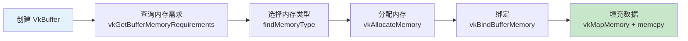
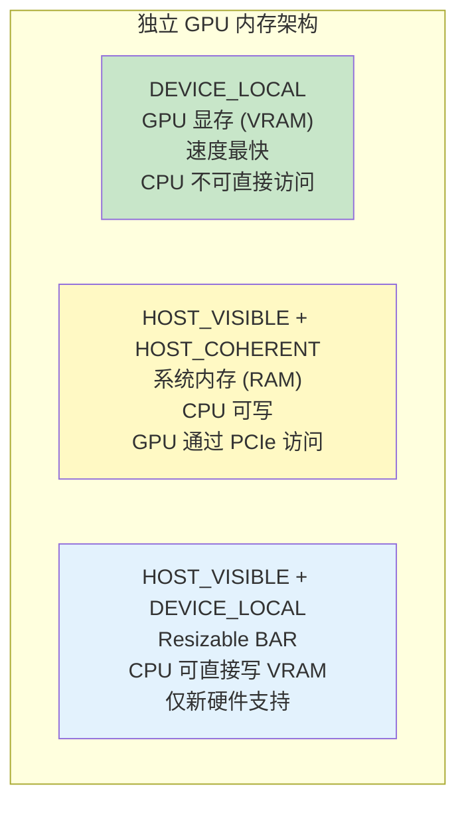

# 顶点缓冲区创建（Vertex Buffer Creation）

## 📍 本章在教程中的位置


> 📌 **依赖与影响**：
> - **本章引入的核心模式**：“创建缓冲区 → 查询内存需求 → 分配内存 → 绑定”
> - 这个模式被后续多个章节复用：
>   - [暂存缓冲区](02_暂存缓冲区.md)：抽取为 `createBuffer()` 通用函数
>   - [索引缓冲区](03_索引缓冲区.md)：复用 `createBuffer()`
>   - [Uniform 缓冲区](../05_Uniform缓冲区/00_描述符集布局与缓冲区.md)：复用 `createBuffer()`
>   - [纹理图像](../06_纹理映射/00_纹理图像.md)：用于暴存缓冲上传纹理
>   - [计算着色器](../11_计算着色器.md)：SSBO 缓冲区创建

## Vulkan 内存管理概念

Vulkan 中缓冲区**不会自动分配内存**——需要手动创建缓冲区、查询内存需求、分配内存、绑定。



## 创建缓冲区

```c++
VkBuffer vertexBuffer;
VkDeviceMemory vertexBufferMemory;

void createVertexBuffer() {
    VkBufferCreateInfo bufferInfo{};
    bufferInfo.sType = VK_STRUCTURE_TYPE_BUFFER_CREATE_INFO;
    bufferInfo.size = sizeof(vertices[0]) * vertices.size();  // 总字节数
    bufferInfo.usage = VK_BUFFER_USAGE_VERTEX_BUFFER_BIT;     // 用途：顶点缓冲
    bufferInfo.sharingMode = VK_SHARING_MODE_EXCLUSIVE;        // 独占（仅图形队列使用）

    if (vkCreateBuffer(device, &bufferInfo, nullptr, &vertexBuffer) != VK_SUCCESS) {
        throw std::runtime_error("failed to create vertex buffer!");
    }
}
```

## 查找合适的内存类型

GPU 有多种内存类型，各有不同特性：

```c++
uint32_t findMemoryType(uint32_t typeFilter, VkMemoryPropertyFlags properties) {
    VkPhysicalDeviceMemoryProperties memProperties;
    vkGetPhysicalDeviceMemoryProperties(physicalDevice, &memProperties);

    for (uint32_t i = 0; i < memProperties.memoryTypeCount; i++) {
        if ((typeFilter & (1 << i)) &&
            (memProperties.memoryTypes[i].propertyFlags & properties) == properties) {
            return i;
        }
    }
    throw std::runtime_error("failed to find suitable memory type!");
}
```

**常用内存属性标志：**

| 标志 | 说明 |
|------|------|
| `HOST_VISIBLE` | CPU 可以映射和写入 |
| `HOST_COHERENT` | CPU 写入自动对 GPU 可见（无需手动 flush） |
| `DEVICE_LOCAL` | GPU 本地高速内存（CPU 通常不可访问） |

## 分配和绑定内存

```c++
VkMemoryRequirements memRequirements;
vkGetBufferMemoryRequirements(device, vertexBuffer, &memRequirements);

VkMemoryAllocateInfo allocInfo{};
allocInfo.sType = VK_STRUCTURE_TYPE_MEMORY_ALLOCATE_INFO;
allocInfo.allocationSize = memRequirements.size;
allocInfo.memoryTypeIndex = findMemoryType(memRequirements.memoryTypeBits,
    VK_MEMORY_PROPERTY_HOST_VISIBLE_BIT | VK_MEMORY_PROPERTY_HOST_COHERENT_BIT);

if (vkAllocateMemory(device, &allocInfo, nullptr, &vertexBufferMemory) != VK_SUCCESS) {
    throw std::runtime_error("failed to allocate vertex buffer memory!");
}

vkBindBufferMemory(device, vertexBuffer, vertexBufferMemory, 0);  // 偏移量为 0
```

> ⚠️ **`vkAllocateMemory` 调用次数有限**（通常上限几千次）。实际应用应使用内存分配器（如 VMA）一次分配大块内存再分割。

### 🔴 内存分配常见错误

#### 错误 1：超过 `maxMemoryAllocationCount` 限制

```c++
// ❌ 为每个小缓冲区单独分配 → 快速耗尽分配次数
for (int i = 0; i < 5000; i++) {
    VkBuffer buf;
    VkDeviceMemory mem;
    createBuffer(256, ..., buf, mem);  // 5000 次 vkAllocateMemory！
}
// maxMemoryAllocationCount 通常只有 4096 → 第 4097 次会失败

// ✅ 生产环境使用 VMA（Vulkan Memory Allocator）
// https://github.com/GPUOpen-LibrariesAndSDKs/VulkanMemoryAllocator
// VMA 自动处理子分配，一次大分配内部分割
```

#### 错误 2：`vkBindBufferMemory` 的 offset 不满足对齐

```c++
// ❌ 手动子分配时 offset 未对齐
vkBindBufferMemory(device, buffer2, sharedMemory, 100);  // alignment 可能要求 256！

// ✅ 查询并对齐
VkMemoryRequirements memReqs;
vkGetBufferMemoryRequirements(device, buffer2, &memReqs);
VkDeviceSize alignedOffset = (currentOffset + memReqs.alignment - 1) & ~(memReqs.alignment - 1);
vkBindBufferMemory(device, buffer2, sharedMemory, alignedOffset);
```

#### 错误 3：忘记先 Bind 再 Map

```c++
// ❌ 分配内存后直接 Map，没有 Bind → 未定义行为
vkAllocateMemory(device, &allocInfo, nullptr, &memory);
vkMapMemory(device, memory, 0, size, 0, &data);  // 虽然可能成功...
// 但没有 BindBufferMemory → GPU 不知道这块内存属于哪个缓冲区！

// ✅ 正确顺序：Create → Allocate → Bind → Map
vkCreateBuffer(device, &bufferInfo, nullptr, &buffer);
vkAllocateMemory(device, &allocInfo, nullptr, &memory);
vkBindBufferMemory(device, buffer, memory, 0);
vkMapMemory(device, memory, 0, size, 0, &data);
```

#### 错误 4：内存泄漏——忘记释放

```c++
// ❌ 只销毁缓冲区，不释放内存 → 内存泄漏！
vkDestroyBuffer(device, vertexBuffer, nullptr);
// 漏掉了 vkFreeMemory！

// ✅ 始终成对：先销毁缓冲区，再释放内存
vkDestroyBuffer(device, vertexBuffer, nullptr);
vkFreeMemory(device, vertexBufferMemory, nullptr);
```

## 内存类型选择深度理解



| 内存类型 | 用途 | 性能 |
|----------|------|------|
| `DEVICE_LOCAL` | 顶点/索引缓冲区、纹理（通过暂存上传） | ⭐⭐⭐⭐⭐ 最快 |
| `HOST_VISIBLE + COHERENT` | 暂存缓冲区、每帧更新的 UBO | ⭐⭐⭐ 中等 |
| `HOST_VISIBLE + DEVICE_LOCAL` | Resizable BAR（并非所有 GPU 支持） | ⭐⭐⭐⭐ 快 |

## 填充数据

```c++
void* data;
vkMapMemory(device, vertexBufferMemory, 0, bufferInfo.size, 0, &data);
    memcpy(data, vertices.data(), (size_t)bufferInfo.size);
vkUnmapMemory(device, vertexBufferMemory);
```

> 📌 **`HOST_COHERENT`** 确保 CPU 写入立即对 GPU 可见。如果不用此标志，则需手动调用 `vkFlushMappedMemoryRanges`。

## 绑定顶点缓冲区（渲染时）

```c++
// 在 recordCommandBuffer 中
vkCmdBindPipeline(commandBuffer, VK_PIPELINE_BIND_POINT_GRAPHICS, graphicsPipeline);

VkBuffer vertexBuffers[] = {vertexBuffer};
VkDeviceSize offsets[] = {0};
vkCmdBindVertexBuffers(commandBuffer, 0, 1, vertexBuffers, offsets);

vkCmdDraw(commandBuffer, static_cast<uint32_t>(vertices.size()), 1, 0, 0);
```

## 清理

```c++
void cleanup() {
    cleanupSwapChain();
    vkDestroyBuffer(device, vertexBuffer, nullptr);
    vkFreeMemory(device, vertexBufferMemory, nullptr);
    // ...
}
```

> ⚠️ **先销毁缓冲区，再释放内存**。

接下来使用[暂存缓冲区](02_暂存缓冲区.md)将数据放入更高性能的 GPU 本地内存。

[C++ 代码](/code/19_vertex_buffer.cpp)
