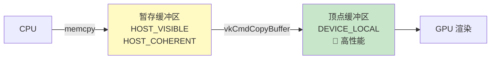

# 暂存缓冲区（Staging Buffer）

## 为什么需要暂存缓冲区？

`HOST_VISIBLE` 内存可以被 CPU 访问但**不是 GPU 最快的内存**。最优的 `DEVICE_LOCAL` 内存在独立显卡上通常**CPU 不可访问**。



## 抽象缓冲区创建

由于要创建多个缓冲区，将创建逻辑提取为通用函数：

```c++
void createBuffer(VkDeviceSize size, VkBufferUsageFlags usage, 
                  VkMemoryPropertyFlags properties,
                  VkBuffer& buffer, VkDeviceMemory& bufferMemory) {
    VkBufferCreateInfo bufferInfo{};
    bufferInfo.sType = VK_STRUCTURE_TYPE_BUFFER_CREATE_INFO;
    bufferInfo.size = size;
    bufferInfo.usage = usage;
    bufferInfo.sharingMode = VK_SHARING_MODE_EXCLUSIVE;

    if (vkCreateBuffer(device, &bufferInfo, nullptr, &buffer) != VK_SUCCESS) {
        throw std::runtime_error("failed to create buffer!");
    }

    VkMemoryRequirements memRequirements;
    vkGetBufferMemoryRequirements(device, buffer, &memRequirements);

    VkMemoryAllocateInfo allocInfo{};
    allocInfo.sType = VK_STRUCTURE_TYPE_MEMORY_ALLOCATE_INFO;
    allocInfo.allocationSize = memRequirements.size;
    allocInfo.memoryTypeIndex = findMemoryType(memRequirements.memoryTypeBits, properties);

    if (vkAllocateMemory(device, &allocInfo, nullptr, &bufferMemory) != VK_SUCCESS) {
        throw std::runtime_error("failed to allocate buffer memory!");
    }

    vkBindBufferMemory(device, buffer, bufferMemory, 0);
}
```

## 使用暂存缓冲区

```c++
void createVertexBuffer() {
    VkDeviceSize bufferSize = sizeof(vertices[0]) * vertices.size();

    // 1. 创建暂存缓冲区（CPU 可写 + 传输源）
    VkBuffer stagingBuffer;
    VkDeviceMemory stagingBufferMemory;
    createBuffer(bufferSize,
        VK_BUFFER_USAGE_TRANSFER_SRC_BIT,                          // 传输源
        VK_MEMORY_PROPERTY_HOST_VISIBLE_BIT | VK_MEMORY_PROPERTY_HOST_COHERENT_BIT,
        stagingBuffer, stagingBufferMemory);

    // 2. 将顶点数据复制到暂存缓冲区
    void* data;
    vkMapMemory(device, stagingBufferMemory, 0, bufferSize, 0, &data);
    memcpy(data, vertices.data(), (size_t)bufferSize);
    vkUnmapMemory(device, stagingBufferMemory);

    // 3. 创建设备本地顶点缓冲区（传输目标 + 顶点缓冲）
    createBuffer(bufferSize,
        VK_BUFFER_USAGE_TRANSFER_DST_BIT | VK_BUFFER_USAGE_VERTEX_BUFFER_BIT,  // 传输目标 + 顶点
        VK_MEMORY_PROPERTY_DEVICE_LOCAL_BIT,                        // GPU 本地高速内存
        vertexBuffer, vertexBufferMemory);

    // 4. GPU 端复制
    copyBuffer(stagingBuffer, vertexBuffer, bufferSize);

    // 5. 清理暂存缓冲区
    vkDestroyBuffer(device, stagingBuffer, nullptr);
    vkFreeMemory(device, stagingBufferMemory, nullptr);
}
```

### 缓冲区复制命令

```c++
void copyBuffer(VkBuffer srcBuffer, VkBuffer dstBuffer, VkDeviceSize size) {
    // 分配临时命令缓冲区
    VkCommandBufferAllocateInfo allocInfo{};
    allocInfo.sType = VK_STRUCTURE_TYPE_COMMAND_BUFFER_ALLOCATE_INFO;
    allocInfo.level = VK_COMMAND_BUFFER_LEVEL_PRIMARY;
    allocInfo.commandPool = commandPool;
    allocInfo.commandBufferCount = 1;

    VkCommandBuffer commandBuffer;
    vkAllocateCommandBuffers(device, &allocInfo, &commandBuffer);

    // 开始记录
    VkCommandBufferBeginInfo beginInfo{};
    beginInfo.sType = VK_STRUCTURE_TYPE_COMMAND_BUFFER_BEGIN_INFO;
    beginInfo.flags = VK_COMMAND_BUFFER_USAGE_ONE_TIME_SUBMIT_BIT;  // 只用一次

    vkBeginCommandBuffer(commandBuffer, &beginInfo);

    VkBufferCopy copyRegion{};
    copyRegion.size = size;
    vkCmdCopyBuffer(commandBuffer, srcBuffer, dstBuffer, 1, &copyRegion);

    vkEndCommandBuffer(commandBuffer);

    // 提交并等待完成
    VkSubmitInfo submitInfo{};
    submitInfo.sType = VK_STRUCTURE_TYPE_SUBMIT_INFO;
    submitInfo.commandBufferCount = 1;
    submitInfo.pCommandBuffers = &commandBuffer;

    vkQueueSubmit(graphicsQueue, 1, &submitInfo, VK_NULL_HANDLE);
    vkQueueWaitIdle(graphicsQueue);  // 等待传输完成

    vkFreeCommandBuffers(device, commandPool, 1, &commandBuffer);
}
```

> ⚠️ **`vkQueueWaitIdle` 是简单但低效的同步方式**。生产代码应使用栅栏（Fence），允许同时调度多个传输操作。

> 💡 **可以为传输操作创建专用命令池**，使用 `VK_COMMAND_POOL_CREATE_TRANSIENT_BIT` 标志优化短暂命令缓冲区的内存分配。

## 知识点总结

| 概念 | 说明 |
|------|------|
| 暂存缓冲区 | CPU 写入，作为传输源 |
| 设备本地缓冲区 | GPU 高速内存，作为传输目标 |
| `TRANSFER_SRC_BIT` | 缓冲区可作为传输源 |
| `TRANSFER_DST_BIT` | 缓冲区可作为传输目标 |
| `DEVICE_LOCAL_BIT` | GPU 本地内存，性能最佳 |

接下来学习[索引缓冲区](03_索引缓冲区.md)以复用顶点数据。

[C++ 代码](/code/20_staging_buffer.cpp)
