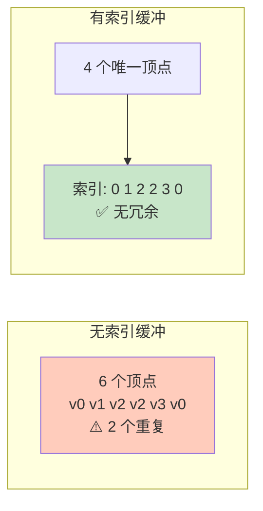

# 索引缓冲区（Index Buffer）

## 📍 本章在教程中的位置


> 📌 **依赖与影响**：
> - **复用**：[暂存缓冲区](02_暂存缓冲区.md)的 `createBuffer()` + `copyBuffer()`
> - **回溯修改**：[命令缓冲区](../03_绘制三角形/03_绘制/01_命令缓冲区.md)中 `vkCmdDraw` 改为 `vkCmdDrawIndexed`
> - **后续使用**：[加载模型](../08_加载模型.md)时顶点数可能超过 65535，需从 `uint16_t` 切换到 `uint32_t`

## 为什么需要索引缓冲区？

绘制矩形需要 2 个三角形 = 6 个顶点，但实际只有 4 个不同的顶点。**50% 的数据被重复**。



## 顶点和索引数据

```c++
// 4 个唯一顶点（矩形的四个角）
const std::vector<Vertex> vertices = {
    {{-0.5f, -0.5f}, {1.0f, 0.0f, 0.0f}},   // 左上：红
    {{0.5f, -0.5f}, {0.0f, 1.0f, 0.0f}},    // 右上：绿
    {{0.5f, 0.5f}, {0.0f, 0.0f, 1.0f}},     // 右下：蓝
    {{-0.5f, 0.5f}, {1.0f, 1.0f, 1.0f}}     // 左下：白
};

// 索引数组：定义两个三角形
const std::vector<uint16_t> indices = {
    0, 1, 2,    // 右上三角形
    2, 3, 0     // 左下三角形
};
```

> 📌 索引类型可选 `uint16_t`（最多 65535 个顶点）或 `uint32_t`（更大网格）。

## 创建索引缓冲区

与顶点缓冲区创建方式相同，也使用暂存缓冲区：

```c++
VkBuffer indexBuffer;
VkDeviceMemory indexBufferMemory;

void createIndexBuffer() {
    VkDeviceSize bufferSize = sizeof(indices[0]) * indices.size();

    VkBuffer stagingBuffer;
    VkDeviceMemory stagingBufferMemory;
    createBuffer(bufferSize, VK_BUFFER_USAGE_TRANSFER_SRC_BIT,
        VK_MEMORY_PROPERTY_HOST_VISIBLE_BIT | VK_MEMORY_PROPERTY_HOST_COHERENT_BIT,
        stagingBuffer, stagingBufferMemory);

    void* data;
    vkMapMemory(device, stagingBufferMemory, 0, bufferSize, 0, &data);
    memcpy(data, indices.data(), (size_t)bufferSize);
    vkUnmapMemory(device, stagingBufferMemory);

    createBuffer(bufferSize,
        VK_BUFFER_USAGE_TRANSFER_DST_BIT | VK_BUFFER_USAGE_INDEX_BUFFER_BIT,  // 索引缓冲
        VK_MEMORY_PROPERTY_DEVICE_LOCAL_BIT,
        indexBuffer, indexBufferMemory);

    copyBuffer(stagingBuffer, indexBuffer, bufferSize);

    vkDestroyBuffer(device, stagingBuffer, nullptr);
    vkFreeMemory(device, stagingBufferMemory, nullptr);
}
```

> ⚠️ 注意 `usage` 标志是 `INDEX_BUFFER_BIT` 而非 `VERTEX_BUFFER_BIT`。

## 使用索引缓冲区绘制

```c++
// 在 recordCommandBuffer 中
vkCmdBindVertexBuffers(commandBuffer, 0, 1, vertexBuffers, offsets);

// 绑定索引缓冲区
vkCmdBindIndexBuffer(commandBuffer, indexBuffer, 0, VK_INDEX_TYPE_UINT16);

// 使用 vkCmdDrawIndexed 替代 vkCmdDraw
vkCmdDrawIndexed(commandBuffer, static_cast<uint32_t>(indices.size()), 1, 0, 0, 0);
//                               │                                      │  │  │  └ firstInstance
//                               │                                      │  │  └── vertexOffset（索引值的偏移）
//                               │                                      │  └───── firstIndex
//                               │                                      └──────── instanceCount
//                               └───────────────────────────────────────────────── indexCount
```

| 参数 | `vkCmdDraw` | `vkCmdDrawIndexed` |
|------|-------------|-------------------|
| 顶点来源 | 直接从顶点缓冲区 | 通过索引缓冲区间接引用 |
| 顶点重用 | 不支持 | ✅ 支持 |
| 内存效率 | 低（复杂网格） | 高 |

## 清理

```c++
void cleanup() {
    cleanupSwapChain();
    vkDestroyBuffer(device, indexBuffer, nullptr);
    vkFreeMemory(device, indexBufferMemory, nullptr);
    vkDestroyBuffer(device, vertexBuffer, nullptr);
    vkFreeMemory(device, vertexBufferMemory, nullptr);
    // ...
}
```

接下来进入 [Uniform 缓冲区](../05_Uniform缓冲区/00_描述符集布局与缓冲区.md)章节。

[C++ 代码](/code/21_index_buffer.cpp)
