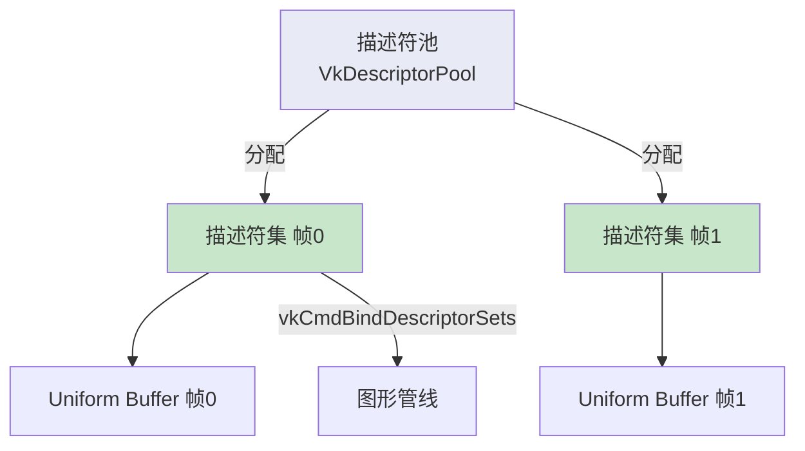

# 描述符池与描述符集

## 概念

描述符集不能直接创建，必须从**描述符池**分配，类似命令缓冲区从命令池分配。



## 创建描述符池

```c++
VkDescriptorPool descriptorPool;

void createDescriptorPool() {
    VkDescriptorPoolSize poolSize{};
    poolSize.type = VK_DESCRIPTOR_TYPE_UNIFORM_BUFFER;
    poolSize.descriptorCount = static_cast<uint32_t>(MAX_FRAMES_IN_FLIGHT);

    VkDescriptorPoolCreateInfo poolInfo{};
    poolInfo.sType = VK_STRUCTURE_TYPE_DESCRIPTOR_POOL_CREATE_INFO;
    poolInfo.poolSizeCount = 1;
    poolInfo.pPoolSizes = &poolSize;
    poolInfo.maxSets = static_cast<uint32_t>(MAX_FRAMES_IN_FLIGHT);

    if (vkCreateDescriptorPool(device, &poolInfo, nullptr, &descriptorPool) != VK_SUCCESS) {
        throw std::runtime_error("failed to create descriptor pool!");
    }
}
```

> ⚠️ `poolSize.descriptorCount` 和 `poolInfo.maxSets` 必须足够大以容纳所有要分配的描述符和集。

## 分配描述符集

```c++
std::vector<VkDescriptorSet> descriptorSets;

void createDescriptorSets() {
    std::vector<VkDescriptorSetLayout> layouts(MAX_FRAMES_IN_FLIGHT, descriptorSetLayout);

    VkDescriptorSetAllocateInfo allocInfo{};
    allocInfo.sType = VK_STRUCTURE_TYPE_DESCRIPTOR_SET_ALLOCATE_INFO;
    allocInfo.descriptorPool = descriptorPool;
    allocInfo.descriptorSetCount = static_cast<uint32_t>(MAX_FRAMES_IN_FLIGHT);
    allocInfo.pSetLayouts = layouts.data();

    descriptorSets.resize(MAX_FRAMES_IN_FLIGHT);
    if (vkAllocateDescriptorSets(device, &allocInfo, descriptorSets.data()) != VK_SUCCESS) {
        throw std::runtime_error("failed to allocate descriptor sets!");
    }

    // 配置每个描述符集
    for (size_t i = 0; i < MAX_FRAMES_IN_FLIGHT; i++) {
        VkDescriptorBufferInfo bufferInfo{};
        bufferInfo.buffer = uniformBuffers[i];
        bufferInfo.offset = 0;
        bufferInfo.range = sizeof(UniformBufferObject);

        VkWriteDescriptorSet descriptorWrite{};
        descriptorWrite.sType = VK_STRUCTURE_TYPE_WRITE_DESCRIPTOR_SET;
        descriptorWrite.dstSet = descriptorSets[i];
        descriptorWrite.dstBinding = 0;                    // 对应 binding = 0
        descriptorWrite.dstArrayElement = 0;
        descriptorWrite.descriptorType = VK_DESCRIPTOR_TYPE_UNIFORM_BUFFER;
        descriptorWrite.descriptorCount = 1;
        descriptorWrite.pBufferInfo = &bufferInfo;

        vkUpdateDescriptorSets(device, 1, &descriptorWrite, 0, nullptr);
    }
}
```

> 📌 描述符集**不需要手动释放**——随描述符池销毁时自动释放。

## 使用描述符集

在命令缓冲区记录中绑定描述符集：

```c++
vkCmdBindDescriptorSets(commandBuffer, VK_PIPELINE_BIND_POINT_GRAPHICS,
    pipelineLayout, 0, 1, &descriptorSets[currentFrame], 0, nullptr);

vkCmdDrawIndexed(commandBuffer, static_cast<uint32_t>(indices.size()), 1, 0, 0, 0);
```

## 在 drawFrame 中更新 Uniform

```c++
void drawFrame() {
    // ...
    updateUniformBuffer(currentFrame);  // ← 每帧更新变换矩阵
    // ... 记录命令缓冲区、提交 ...
}
```

## 清理

```c++
void cleanup() {
    // ...
    vkDestroyDescriptorPool(device, descriptorPool, nullptr);
    vkDestroyDescriptorSetLayout(device, descriptorSetLayout, nullptr);

    for (size_t i = 0; i < MAX_FRAMES_IN_FLIGHT; i++) {
        vkDestroyBuffer(device, uniformBuffers[i], nullptr);
        vkFreeMemory(device, uniformBuffersMemory[i], nullptr);
    }
    // ...
}
```

## 知识点总结

| 概念 | 说明 |
|------|------|
| 描述符池 | 管理描述符集的内存分配 |
| 描述符集 | 将实际资源（缓冲区/图像）绑定到着色器 |
| `vkUpdateDescriptorSets` | 配置描述符集指向的具体资源 |
| `vkCmdBindDescriptorSets` | 渲染时绑定描述符集 |

接下来进入[纹理映射](../06_纹理映射/00_纹理图像.md)章节。

[C++ 代码](/code/23_descriptor_sets.cpp)
