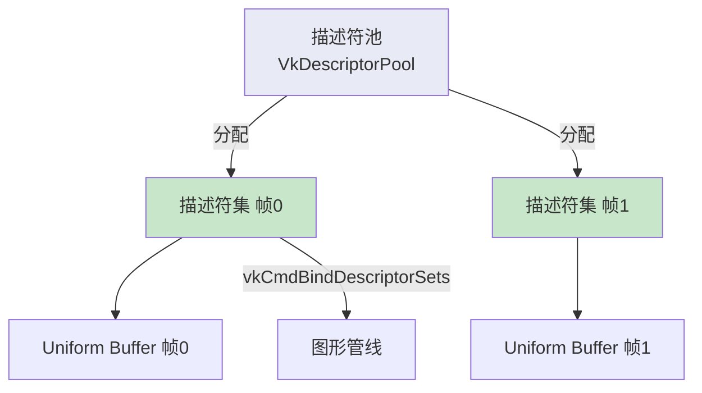

# 描述符池与描述符集

## 📍 本章在教程中的位置


> 📌 **依赖与影响**：
> - **前置**：[描述符集布局](00_描述符集布局与缓冲区.md) 提供布局和 UBO
> - **产出**：`VkDescriptorPool` + `VkDescriptorSet[]` →
>   - [命令缓冲区](../03_绘制三角形/03_绘制/01_命令缓冲区.md)：添加 `vkCmdBindDescriptorSets`
> - **后续回溯修改**：
>   - [组合图像采样器](../06_纹理映射/02_组合图像采样器.md)：池添加 `COMBINED_IMAGE_SAMPLER` 类型，描述符集写入添加图像信息
>   - [计算着色器](../11_计算着色器.md)：池添加 `STORAGE_BUFFER` 类型

## 概念

描述符集不能直接创建，必须从**描述符池**分配，类似命令缓冲区从命令池分配。



## 创建描述符池

```c++
VkDescriptorPool descriptorPool;

void createDescriptorPool() {
    VkDescriptorPoolSize poolSize{};
    poolSize.type = VK_DESCRIPTOR_TYPE_UNIFORM_BUFFER;
    poolSize.descriptorCount = static_cast<uint32_t>(MAX_FRAMES_IN_FLIGHT);

    VkDescriptorPoolCreateInfo poolInfo{};
    poolInfo.sType = VK_STRUCTURE_TYPE_DESCRIPTOR_POOL_CREATE_INFO;
    poolInfo.poolSizeCount = 1;
    poolInfo.pPoolSizes = &poolSize;
    poolInfo.maxSets = static_cast<uint32_t>(MAX_FRAMES_IN_FLIGHT);

    if (vkCreateDescriptorPool(device, &poolInfo, nullptr, &descriptorPool) != VK_SUCCESS) {
        throw std::runtime_error("failed to create descriptor pool!");
    }
}
```

> ⚠️ `poolSize.descriptorCount` 和 `poolInfo.maxSets` 必须足够大以容纳所有要分配的描述符和集。

## 分配描述符集

```c++
std::vector<VkDescriptorSet> descriptorSets;

void createDescriptorSets() {
    std::vector<VkDescriptorSetLayout> layouts(MAX_FRAMES_IN_FLIGHT, descriptorSetLayout);

    VkDescriptorSetAllocateInfo allocInfo{};
    allocInfo.sType = VK_STRUCTURE_TYPE_DESCRIPTOR_SET_ALLOCATE_INFO;
    allocInfo.descriptorPool = descriptorPool;
    allocInfo.descriptorSetCount = static_cast<uint32_t>(MAX_FRAMES_IN_FLIGHT);
    allocInfo.pSetLayouts = layouts.data();

    descriptorSets.resize(MAX_FRAMES_IN_FLIGHT);
    if (vkAllocateDescriptorSets(device, &allocInfo, descriptorSets.data()) != VK_SUCCESS) {
        throw std::runtime_error("failed to allocate descriptor sets!");
    }

    // 配置每个描述符集
    for (size_t i = 0; i < MAX_FRAMES_IN_FLIGHT; i++) {
        VkDescriptorBufferInfo bufferInfo{};
        bufferInfo.buffer = uniformBuffers[i];
        bufferInfo.offset = 0;
        bufferInfo.range = sizeof(UniformBufferObject);

        VkWriteDescriptorSet descriptorWrite{};
        descriptorWrite.sType = VK_STRUCTURE_TYPE_WRITE_DESCRIPTOR_SET;
        descriptorWrite.dstSet = descriptorSets[i];
        descriptorWrite.dstBinding = 0;                    // 对应 binding = 0
        descriptorWrite.dstArrayElement = 0;
        descriptorWrite.descriptorType = VK_DESCRIPTOR_TYPE_UNIFORM_BUFFER;
        descriptorWrite.descriptorCount = 1;
        descriptorWrite.pBufferInfo = &bufferInfo;

        vkUpdateDescriptorSets(device, 1, &descriptorWrite, 0, nullptr);
    }
}
```

> 📌 描述符集**不需要手动释放**——随描述符池销毁时自动释放。

### 🔴 描述符池与集常见错误

#### 错误 1：`poolSize` 不足

```c++
// ❌ 池只分配了 2 个 UNIFORM_BUFFER 描述符，但尝试分配 3 个描述符集
poolSize.descriptorCount = 2;
poolInfo.maxSets = 3;
// 第 3 次 vkAllocateDescriptorSets → VK_ERROR_OUT_OF_POOL_MEMORY

// ✅ 确保 descriptorCount ≥ maxSets × 每集使用的该类型描述符数
poolSize.descriptorCount = static_cast<uint32_t>(MAX_FRAMES_IN_FLIGHT);
```

#### 错误 2：添加新绑定后忘记更新池大小

```c++
// ❌ 着色器新增了 sampler2D（binding 1），但池没有添加对应类型
// 池只有 UNIFORM_BUFFER 类型 → 分配组合图像采样器时失败

// ✅ 每种描述符类型都需要在池中声明（见纹理映射章节）
std::array<VkDescriptorPoolSize, 2> poolSizes{};
poolSizes[0] = {VK_DESCRIPTOR_TYPE_UNIFORM_BUFFER, MAX_FRAMES_IN_FLIGHT};
poolSizes[1] = {VK_DESCRIPTOR_TYPE_COMBINED_IMAGE_SAMPLER, MAX_FRAMES_IN_FLIGHT};
```

#### 错误 3：`dstBinding` 与着色器不匹配

```c++
// ❌ 着色器用 binding = 0，但 WriteDescriptorSet 写到 binding = 1
descriptorWrite.dstBinding = 1;  // 应该是 0！
// → 着色器读到全零数据或随机数据

// ✅ 仔细核对着色器中每个 layout(binding = X) 的编号
```

#### 错误 4：描述符集的 `pSetLayouts` 数组大小不对

```c++
// ❌ layouts 数组的大小与 descriptorSetCount 不一致
std::vector<VkDescriptorSetLayout> layouts(1, descriptorSetLayout);  // 只有 1 个
allocInfo.descriptorSetCount = MAX_FRAMES_IN_FLIGHT;  // 但要分配 2 个！
// → 第 2 个描述符集使用了无效的布局 → 未定义行为

// ✅ layouts 数组大小必须等于 descriptorSetCount
std::vector<VkDescriptorSetLayout> layouts(MAX_FRAMES_IN_FLIGHT, descriptorSetLayout);
```

## 使用描述符集

在命令缓冲区记录中绑定描述符集：

```c++
vkCmdBindDescriptorSets(commandBuffer, VK_PIPELINE_BIND_POINT_GRAPHICS,
    pipelineLayout, 0, 1, &descriptorSets[currentFrame], 0, nullptr);

vkCmdDrawIndexed(commandBuffer, static_cast<uint32_t>(indices.size()), 1, 0, 0, 0);
```

## 在 drawFrame 中更新 Uniform

```c++
void drawFrame() {
    // ...
    updateUniformBuffer(currentFrame);  // ← 每帧更新变换矩阵
    // ... 记录命令缓冲区、提交 ...
}
```

## 清理

```c++
void cleanup() {
    // ...
    vkDestroyDescriptorPool(device, descriptorPool, nullptr);
    vkDestroyDescriptorSetLayout(device, descriptorSetLayout, nullptr);

    for (size_t i = 0; i < MAX_FRAMES_IN_FLIGHT; i++) {
        vkDestroyBuffer(device, uniformBuffers[i], nullptr);
        vkFreeMemory(device, uniformBuffersMemory[i], nullptr);
    }
    // ...
}
```

## 知识点总结

| 概念 | 说明 |
|------|------|
| 描述符池 | 管理描述符集的内存分配 |
| 描述符集 | 将实际资源（缓冲区/图像）绑定到着色器 |
| `vkUpdateDescriptorSets` | 配置描述符集指向的具体资源 |
| `vkCmdBindDescriptorSets` | 渲染时绑定描述符集 |

接下来进入[纹理映射](../06_纹理映射/00_纹理图像.md)章节。

[C++ 代码](/code/23_descriptor_sets.cpp)
