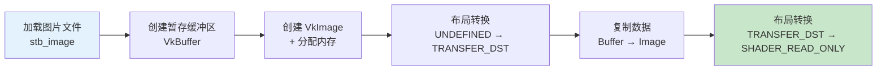

# 纹理图像（Texture Image）

## 概述

纹理映射分为以下步骤：



## 加载图片

使用 `stb_image` 库：

```c++
#define STB_IMAGE_IMPLEMENTATION
#include <stb_image.h>

void createTextureImage() {
    int texWidth, texHeight, texChannels;
    stbi_uc* pixels = stbi_load("textures/texture.jpg", &texWidth, &texHeight, &texChannels, STBI_rgb_alpha);
    VkDeviceSize imageSize = texWidth * texHeight * 4;  // RGBA = 4 字节/像素

    if (!pixels) {
        throw std::runtime_error("failed to load texture image!");
    }
    // ... 创建暂存缓冲区并复制 ...
    stbi_image_free(pixels);
}
```

## 创建 VkImage

```c++
VkImage textureImage;
VkDeviceMemory textureImageMemory;

VkImageCreateInfo imageInfo{};
imageInfo.sType = VK_STRUCTURE_TYPE_IMAGE_CREATE_INFO;
imageInfo.imageType = VK_IMAGE_TYPE_2D;
imageInfo.extent.width = static_cast<uint32_t>(texWidth);
imageInfo.extent.height = static_cast<uint32_t>(texHeight);
imageInfo.extent.depth = 1;
imageInfo.mipLevels = 1;
imageInfo.arrayLayers = 1;
imageInfo.format = VK_FORMAT_R8G8B8A8_SRGB;
imageInfo.tiling = VK_IMAGE_TILING_OPTIMAL;     // GPU 最优排列
imageInfo.initialLayout = VK_IMAGE_LAYOUT_UNDEFINED;
imageInfo.usage = VK_IMAGE_USAGE_TRANSFER_DST_BIT | VK_IMAGE_USAGE_SAMPLED_BIT;
imageInfo.sharingMode = VK_SHARING_MODE_EXCLUSIVE;
imageInfo.samples = VK_SAMPLE_COUNT_1_BIT;
```

### 关键参数

| 参数 | 说明 |
|------|------|
| `tiling` | `OPTIMAL`=GPU 最优（不可直接 CPU 访问），`LINEAR`=行优先 |
| `usage` | `TRANSFER_DST`=可作为传输目标，`SAMPLED`=可被着色器采样 |
| `format` | `R8G8B8A8_SRGB`=每通道 8 位 SRGB |

> ⚠️ **`TILING_OPTIMAL` 不能直接从 CPU 写入**，所以需要先写入暂存缓冲区再复制。

## 布局转换

通过**管线屏障（Pipeline Barrier）**转换图像布局：

```c++
void transitionImageLayout(VkImage image, VkFormat format,
                           VkImageLayout oldLayout, VkImageLayout newLayout) {
    VkCommandBuffer commandBuffer = beginSingleTimeCommands();

    VkImageMemoryBarrier barrier{};
    barrier.sType = VK_STRUCTURE_TYPE_IMAGE_MEMORY_BARRIER;
    barrier.oldLayout = oldLayout;
    barrier.newLayout = newLayout;
    barrier.srcQueueFamilyIndex = VK_QUEUE_FAMILY_IGNORED;
    barrier.dstQueueFamilyIndex = VK_QUEUE_FAMILY_IGNORED;
    barrier.image = image;
    barrier.subresourceRange.aspectMask = VK_IMAGE_ASPECT_COLOR_BIT;
    barrier.subresourceRange.baseMipLevel = 0;
    barrier.subresourceRange.levelCount = 1;
    barrier.subresourceRange.baseArrayLayer = 0;
    barrier.subresourceRange.layerCount = 1;

    VkPipelineStageFlags sourceStage, destinationStage;

    if (oldLayout == VK_IMAGE_LAYOUT_UNDEFINED &&
        newLayout == VK_IMAGE_LAYOUT_TRANSFER_DST_OPTIMAL) {
        barrier.srcAccessMask = 0;
        barrier.dstAccessMask = VK_ACCESS_TRANSFER_WRITE_BIT;
        sourceStage = VK_PIPELINE_STAGE_TOP_OF_PIPE_BIT;
        destinationStage = VK_PIPELINE_STAGE_TRANSFER_BIT;
    } else if (oldLayout == VK_IMAGE_LAYOUT_TRANSFER_DST_OPTIMAL &&
               newLayout == VK_IMAGE_LAYOUT_SHADER_READ_ONLY_OPTIMAL) {
        barrier.srcAccessMask = VK_ACCESS_TRANSFER_WRITE_BIT;
        barrier.dstAccessMask = VK_ACCESS_SHADER_READ_BIT;
        sourceStage = VK_PIPELINE_STAGE_TRANSFER_BIT;
        destinationStage = VK_PIPELINE_STAGE_FRAGMENT_SHADER_BIT;
    }

    vkCmdPipelineBarrier(commandBuffer, sourceStage, destinationStage,
        0, 0, nullptr, 0, nullptr, 1, &barrier);

    endSingleTimeCommands(commandBuffer);
}
```

> 📌 **管线屏障**不仅用于布局转换，也是 Vulkan 同步的核心机制之一。

## 知识点总结

- ✅ 纹理通过 `VkImage` 对象表示，需要手动分配内存
- ✅ 使用暂存缓冲区 → `vkCmdCopyBufferToImage` 上传像素数据
- ✅ 图像布局必须通过管线屏障显式转换
- ✅ `TILING_OPTIMAL` 性能最佳但 CPU 不可直接访问

接下来创建[图像视图和采样器](01_图像视图与采样器.md)。

[C++ 代码](/code/24_texture_image.cpp)
