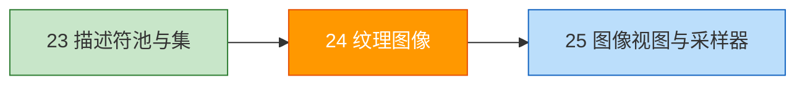
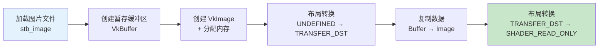

# 纹理图像（Texture Image）

## 📍 本章在教程中的位置



> 📌 **依赖与影响** — 本章首次引入 `VkImage`，是缓冲区之外的第二种 GPU 资源：
> - **复用了之前章节的多个函数**：
>   - `createBuffer()` ← [暂存缓冲区](../04_顶点缓冲区/02_暂存缓冲区.md)
>   - `beginSingleTimeCommands()` ← 同上
>   - `findMemoryType()` ← [顶点缓冲区创建](../04_顶点缓冲区/01_顶点缓冲区创建.md)
> - **产出**：`createImage()` + `transitionImageLayout()` 函数
> - **后续复用**：
>   - [深度缓冲](../07_深度缓冲.md)：复用 `createImage()` 创建深度图像
>   - [Mipmaps](../09_生成Mipmaps.md)：扩展 `createImage()` 支持多级 mip
>   - [多重采样](../10_多重采样.md)：复用 `createImage()` 创建 MSAA 颜色图像

## 概述

纹理映射分为以下步骤：



## 加载图片

使用 `stb_image` 库：

```c++
#define STB_IMAGE_IMPLEMENTATION
#include <stb_image.h>

void createTextureImage() {
    int texWidth, texHeight, texChannels;
    stbi_uc* pixels = stbi_load("textures/texture.jpg", &texWidth, &texHeight, &texChannels, STBI_rgb_alpha);
    VkDeviceSize imageSize = texWidth * texHeight * 4;  // RGBA = 4 字节/像素

    if (!pixels) {
        throw std::runtime_error("failed to load texture image!");
    }
    // ... 创建暂存缓冲区并复制 ...
    stbi_image_free(pixels);
}
```

## 创建 VkImage

```c++
VkImage textureImage;
VkDeviceMemory textureImageMemory;

VkImageCreateInfo imageInfo{};
imageInfo.sType = VK_STRUCTURE_TYPE_IMAGE_CREATE_INFO;
imageInfo.imageType = VK_IMAGE_TYPE_2D;
imageInfo.extent.width = static_cast<uint32_t>(texWidth);
imageInfo.extent.height = static_cast<uint32_t>(texHeight);
imageInfo.extent.depth = 1;
imageInfo.mipLevels = 1;
imageInfo.arrayLayers = 1;
imageInfo.format = VK_FORMAT_R8G8B8A8_SRGB;
imageInfo.tiling = VK_IMAGE_TILING_OPTIMAL;     // GPU 最优排列
imageInfo.initialLayout = VK_IMAGE_LAYOUT_UNDEFINED;
imageInfo.usage = VK_IMAGE_USAGE_TRANSFER_DST_BIT | VK_IMAGE_USAGE_SAMPLED_BIT;
imageInfo.sharingMode = VK_SHARING_MODE_EXCLUSIVE;
imageInfo.samples = VK_SAMPLE_COUNT_1_BIT;
```

### 关键参数

| 参数 | 说明 |
|------|------|
| `tiling` | `OPTIMAL`=GPU 最优（不可直接 CPU 访问），`LINEAR`=行优先 |
| `usage` | `TRANSFER_DST`=可作为传输目标，`SAMPLED`=可被着色器采样 |
| `format` | `R8G8B8A8_SRGB`=每通道 8 位 SRGB |

> ⚠️ **`TILING_OPTIMAL` 不能直接从 CPU 写入**，所以需要先写入暂存缓冲区再复制。

### 🔴 纹理创建常见错误

#### 错误 1：`stb_image.h` 多次定义实现

```c++
// ❌ 在多个 .cpp 文件中都写了 #define STB_IMAGE_IMPLEMENTATION
// 链接时报 "multiple definition of stbi_load" 等重复符号错误

// ✅ 只在一个 .cpp 文件中定义
// main.cpp 或 texture_utils.cpp
#define STB_IMAGE_IMPLEMENTATION
#include <stb_image.h>

// 其他 .cpp 文件中只包含头文件
#include <stb_image.h>  // 不加 #define
```

#### 错误 2：图片加载失败未处理

```c++
// ❌ 不检查返回值，pixels 为 nullptr 时继续使用
stbi_uc* pixels = stbi_load("texture.jpg", &w, &h, &c, STBI_rgb_alpha);
// 如果文件路径错误 → pixels == nullptr → memcpy 崩溃！

// ✅ 始终检查 + 提供有意义的错误信息
if (!pixels) {
    throw std::runtime_error(
        std::string("Failed to load texture: ") + stbi_failure_reason());
}
```

> 💡 **路径问题**：相对路径相对于**工作目录**而非源文件。IDE 中工作目录通常是项目根目录，但命令行运行可能不同。建议使用绝对路径或确认工作目录。

#### 错误 3：忘记设置 `TRANSFER_DST_BIT` 和 `SAMPLED_BIT`

```c++
// ❌ 只设了 SAMPLED → 无法作为传输目标
imageInfo.usage = VK_IMAGE_USAGE_SAMPLED_BIT;
// vkCmdCopyBufferToImage 会失败！

// ✅ 纹理图像必须同时支持传输目标和采样
imageInfo.usage = VK_IMAGE_USAGE_TRANSFER_DST_BIT | VK_IMAGE_USAGE_SAMPLED_BIT;
// 如果需要 mipmap 生成，还需要：
imageInfo.usage |= VK_IMAGE_USAGE_TRANSFER_SRC_BIT;  // blit 源
```

#### 错误 4：格式不支持

```c++
// ❌ 假设所有 GPU 都支持 R8G8B8A8_SRGB
// 某些嵌入式 GPU 可能不支持特定格式

// ✅ 检查格式支持
VkFormatProperties formatProps;
vkGetPhysicalDeviceFormatProperties(physicalDevice, VK_FORMAT_R8G8B8A8_SRGB, &formatProps);
if (!(formatProps.optimalTilingFeatures & VK_FORMAT_FEATURE_SAMPLED_IMAGE_BIT)) {
    throw std::runtime_error("Texture format not supported!");
}
```

### `vkCmdCopyBufferToImage` 完整代码

上传纹理时容易遗漏的关键步骤：

```c++
void copyBufferToImage(VkBuffer buffer, VkImage image, uint32_t width, uint32_t height) {
    VkCommandBuffer commandBuffer = beginSingleTimeCommands();

    VkBufferImageCopy region{};
    region.bufferOffset = 0;
    region.bufferRowLength = 0;    // 0 = 紧密排列（无行填充）
    region.bufferImageHeight = 0;  // 0 = 紧密排列

    region.imageSubresource.aspectMask = VK_IMAGE_ASPECT_COLOR_BIT;
    region.imageSubresource.mipLevel = 0;
    region.imageSubresource.baseArrayLayer = 0;
    region.imageSubresource.layerCount = 1;

    region.imageOffset = {0, 0, 0};
    region.imageExtent = {width, height, 1};

    // ⚠️ 图像必须已经在 TRANSFER_DST_OPTIMAL 布局！
    vkCmdCopyBufferToImage(commandBuffer, buffer, image,
        VK_IMAGE_LAYOUT_TRANSFER_DST_OPTIMAL, 1, &region);

    endSingleTimeCommands(commandBuffer);
}
```

> ⚠️ **调用 `vkCmdCopyBufferToImage` 前**必须先将图像布局转换为 `TRANSFER_DST_OPTIMAL`。调用后再转为 `SHADER_READ_ONLY_OPTIMAL`。

## 布局转换

通过**管线屏障（Pipeline Barrier）**转换图像布局：

```c++
void transitionImageLayout(VkImage image, VkFormat format,
                           VkImageLayout oldLayout, VkImageLayout newLayout) {
    VkCommandBuffer commandBuffer = beginSingleTimeCommands();

    VkImageMemoryBarrier barrier{};
    barrier.sType = VK_STRUCTURE_TYPE_IMAGE_MEMORY_BARRIER;
    barrier.oldLayout = oldLayout;
    barrier.newLayout = newLayout;
    barrier.srcQueueFamilyIndex = VK_QUEUE_FAMILY_IGNORED;
    barrier.dstQueueFamilyIndex = VK_QUEUE_FAMILY_IGNORED;
    barrier.image = image;
    barrier.subresourceRange.aspectMask = VK_IMAGE_ASPECT_COLOR_BIT;
    barrier.subresourceRange.baseMipLevel = 0;
    barrier.subresourceRange.levelCount = 1;
    barrier.subresourceRange.baseArrayLayer = 0;
    barrier.subresourceRange.layerCount = 1;

    VkPipelineStageFlags sourceStage, destinationStage;

    if (oldLayout == VK_IMAGE_LAYOUT_UNDEFINED &&
        newLayout == VK_IMAGE_LAYOUT_TRANSFER_DST_OPTIMAL) {
        barrier.srcAccessMask = 0;
        barrier.dstAccessMask = VK_ACCESS_TRANSFER_WRITE_BIT;
        sourceStage = VK_PIPELINE_STAGE_TOP_OF_PIPE_BIT;
        destinationStage = VK_PIPELINE_STAGE_TRANSFER_BIT;
    } else if (oldLayout == VK_IMAGE_LAYOUT_TRANSFER_DST_OPTIMAL &&
               newLayout == VK_IMAGE_LAYOUT_SHADER_READ_ONLY_OPTIMAL) {
        barrier.srcAccessMask = VK_ACCESS_TRANSFER_WRITE_BIT;
        barrier.dstAccessMask = VK_ACCESS_SHADER_READ_BIT;
        sourceStage = VK_PIPELINE_STAGE_TRANSFER_BIT;
        destinationStage = VK_PIPELINE_STAGE_FRAGMENT_SHADER_BIT;
    }

    vkCmdPipelineBarrier(commandBuffer, sourceStage, destinationStage,
        0, 0, nullptr, 0, nullptr, 1, &barrier);

    endSingleTimeCommands(commandBuffer);
}
```

> 📌 **管线屏障**不仅用于布局转换，也是 Vulkan 同步的核心机制之一。

## 知识点总结

- ✅ 纹理通过 `VkImage` 对象表示，需要手动分配内存
- ✅ 使用暂存缓冲区 → `vkCmdCopyBufferToImage` 上传像素数据
- ✅ 图像布局必须通过管线屏障显式转换
- ✅ `TILING_OPTIMAL` 性能最佳但 CPU 不可直接访问

接下来创建[图像视图和采样器](01_图像视图与采样器.md)。

[C++ 代码](/code/24_texture_image.cpp)
