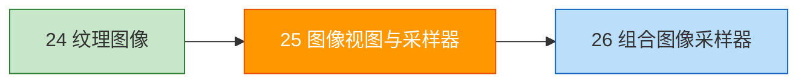

# 图像视图与采样器

## 📍 本章在教程中的位置



> 📍 **依赖与影响**：
> - **复用**：[图像视图章节](../03_绘制三角形/01_呈现/02_图像视图.md)的 `createImageView()` 函数
> - **回溯修改**：[逻辑设备](../03_绘制三角形/00_基础设置/04_逻辑设备与队列.md) 启用 `samplerAnisotropy` 特性
> - **产出**：`VkImageView` + `VkSampler` → [组合图像采样器](02_组合图像采样器.md)中绑定到描述符集
> - **采样器配置在后续章节的变化**：
>   - [Mipmaps](../09_生成Mipmaps.md)：设置 `maxLod`、`mipmapMode`

## 纹理图像视图

与交换链图像一样，纹理也需要通过 `VkImageView` 访问。

```c++
VkImageView textureImageView;

void createTextureImageView() {
    textureImageView = createImageView(textureImage, VK_FORMAT_R8G8B8A8_SRGB);
}

// 通用图像视图创建函数（可复用于交换链图像和纹理图像）
VkImageView createImageView(VkImage image, VkFormat format) {
    VkImageViewCreateInfo viewInfo{};
    viewInfo.sType = VK_STRUCTURE_TYPE_IMAGE_VIEW_CREATE_INFO;
    viewInfo.image = image;
    viewInfo.viewType = VK_IMAGE_VIEW_TYPE_2D;
    viewInfo.format = format;
    viewInfo.subresourceRange.aspectMask = VK_IMAGE_ASPECT_COLOR_BIT;
    viewInfo.subresourceRange.baseMipLevel = 0;
    viewInfo.subresourceRange.levelCount = 1;
    viewInfo.subresourceRange.baseArrayLayer = 0;
    viewInfo.subresourceRange.layerCount = 1;

    VkImageView imageView;
    if (vkCreateImageView(device, &viewInfo, nullptr, &imageView) != VK_SUCCESS) {
        throw std::runtime_error("failed to create texture image view!");
    }
    return imageView;
}
```

## 采样器（Sampler）

采样器定义如何从纹理中读取像素（texel），包括过滤、寻址模式等。

```mermaid
graph LR
    UV[纹理坐标<br>UV ∈ [0,1]] --> Sampler[VkSampler<br>过滤 + 寻址 + 各向异性]
    Sampler --> Texel[输出颜色]
    
    style Sampler fill:#fff9c4
```

```c++
VkSampler textureSampler;

void createTextureSampler() {
    VkSamplerCreateInfo samplerInfo{};
    samplerInfo.sType = VK_STRUCTURE_TYPE_SAMPLER_CREATE_INFO;
    samplerInfo.magFilter = VK_FILTER_LINEAR;    // 放大：线性插值
    samplerInfo.minFilter = VK_FILTER_LINEAR;    // 缩小：线性插值

    // 寻址模式（纹理坐标超出 [0,1] 时的行为）
    samplerInfo.addressModeU = VK_SAMPLER_ADDRESS_MODE_REPEAT;
    samplerInfo.addressModeV = VK_SAMPLER_ADDRESS_MODE_REPEAT;
    samplerInfo.addressModeW = VK_SAMPLER_ADDRESS_MODE_REPEAT;

    // 各向异性过滤（提高斜角观察时的纹理质量）
    samplerInfo.anisotropyEnable = VK_TRUE;
    VkPhysicalDeviceProperties properties{};
    vkGetPhysicalDeviceProperties(physicalDevice, &properties);
    samplerInfo.maxAnisotropy = properties.limits.maxSamplerAnisotropy;

    samplerInfo.borderColor = VK_BORDER_COLOR_INT_OPAQUE_BLACK;
    samplerInfo.unnormalizedCoordinates = VK_FALSE;  // UV 使用 [0,1] 范围
    samplerInfo.compareEnable = VK_FALSE;
    samplerInfo.mipmapMode = VK_SAMPLER_MIPMAP_MODE_LINEAR;

    if (vkCreateSampler(device, &samplerInfo, nullptr, &textureSampler) != VK_SUCCESS) {
        throw std::runtime_error("failed to create texture sampler!");
    }
}
```

### 过滤模式对比

| 过滤 | 效果 |
|------|------|
| `NEAREST` | 最近邻（像素化，适合像素艺术） |
| `LINEAR` | 双线性插值（平滑） |

### 寻址模式

| 模式 | 效果 |
|------|------|
| `REPEAT` | 平铺重复 |
| `MIRRORED_REPEAT` | 镜像重复 |
| `CLAMP_TO_EDGE` | 拉伸边缘像素 |
| `CLAMP_TO_BORDER` | 使用指定边框颜色 |

> ⚠️ **各向异性过滤需要 GPU 特性**。在 `createLogicalDevice` 时通过 `deviceFeatures.samplerAnisotropy = VK_TRUE` 启用。

### 🔴 采样器常见错误

#### 错误 1：忘记启用 `samplerAnisotropy` 特性（最常见！）

```c++
// ❌ 采样器请求了各向异性，但逻辑设备创建时没有启用该特性
samplerInfo.anisotropyEnable = VK_TRUE;
// 但 createLogicalDevice 中：
VkPhysicalDeviceFeatures deviceFeatures{};
// deviceFeatures.samplerAnisotropy = VK_TRUE;  ← 忘了！
// → 验证层报错 VUID-VkSamplerCreateInfo-anisotropyEnable-01070，某些驱动直接崩溃

// ✅ 在 createLogicalDevice 中启用：
VkPhysicalDeviceFeatures deviceFeatures{};
deviceFeatures.samplerAnisotropy = VK_TRUE;
```

#### 错误 2：`maxAnisotropy` 超过硬件限制

```c++
// ❌ 硬编码最大值
samplerInfo.maxAnisotropy = 64.0f;  // 大多数 GPU 最大支持 16

// ✅ 查询硬件限制
VkPhysicalDeviceProperties properties{};
vkGetPhysicalDeviceProperties(physicalDevice, &properties);
samplerInfo.maxAnisotropy = properties.limits.maxSamplerAnisotropy;  // 通常 16
```

#### 错误 3：`unnormalizedCoordinates` 的限制

```c++
// 设为 VK_TRUE 时（使用像素坐标 [0, width] 而非 [0, 1]）：
samplerInfo.unnormalizedCoordinates = VK_TRUE;
// ⚠️ 此时以下限制生效：
// - 只能用 VK_IMAGE_VIEW_TYPE_1D 或 2D（不能用 CUBE/ARRAY）
// - mipmap 和各向异性必须禁用
// - minFilter 和 magFilter 必须相同
// 新手建议始终保持 VK_FALSE
```

#### 错误 4：采样器对象数量超限

```c++
// maxSamplerAllocationCount 通常为 4000
// 不要为每个纹理创建独立的采样器——共享采样器！

// ✅ 大多数纹理可以共享同一个采样器
// 只有过滤模式/寻址模式不同时才创建新采样器
```

### 各向异性过滤视觉效果

| 场景 | 无各向异性 | 16x 各向异性 |
|------|-----------|-------------|
| 地面纹理（斜角观察） | 模糊、拉伸 | 清晰、自然 |
| 远处墙壁 | 摩尔纹 | 平滑 |
| 性能影响 | 无 | 极小（现代 GPU 几乎免费） |

> 💡 **16x 各向异性过滤**在现代 GPU 上性能影响可以忽略，建议始终开启。

## 清理

```c++
void cleanup() {
    // ...
    vkDestroySampler(device, textureSampler, nullptr);
    vkDestroyImageView(device, textureImageView, nullptr);
    vkDestroyImage(device, textureImage, nullptr);
    vkFreeMemory(device, textureImageMemory, nullptr);
    // ...
}
```

接下来将纹理与采样器[组合到描述符集中](02_组合图像采样器.md)以在着色器中使用。

[C++ 代码](/code/25_sampler.cpp)
