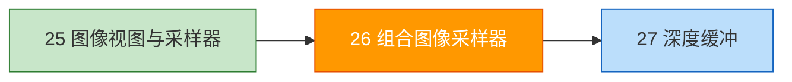
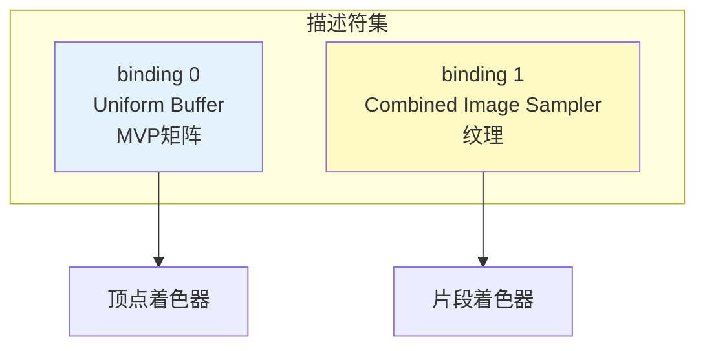

# 组合图像采样器

## 📍 本章在教程中的位置



> 📍 **依赖与影响** — 本章是“汇聚章”，把前面多个章节的成果连接起来：
>
> ```mermaid
> graph TD
>     DSL[描述符集布局<br>binding 0: UBO]:::done
>     DP[描述符池<br>添加 COMBINED_IMAGE_SAMPLER]:::mod
>     TV[纹理图像视图]:::done
>     TS[纹理采样器]:::done
>     VTX[顶点结构体<br>添加 texCoord]:::mod
>     SH[着色器<br>添加 sampler2D]:::mod
>     
>     DSL -->|扩展 binding 1| CIS[本章：组合图像采样器]:::current
>     DP --> CIS
>     TV --> CIS
>     TS --> CIS
>     VTX --> CIS
>     SH --> CIS
>     
>     classDef done fill:#c8e6c9
>     classDef mod fill:#fff9c4
>     classDef current fill:#ff9800,color:#fff
> ```

## 概述

将纹理图像视图和采样器通过**组合图像采样器（Combined Image Sampler）**描述符绑定到着色器。



## 更新描述符集布局

添加第二个绑定（纹理采样器）：

```c++
void createDescriptorSetLayout() {
    VkDescriptorSetLayoutBinding uboLayoutBinding{};
    uboLayoutBinding.binding = 0;
    uboLayoutBinding.descriptorType = VK_DESCRIPTOR_TYPE_UNIFORM_BUFFER;
    uboLayoutBinding.descriptorCount = 1;
    uboLayoutBinding.stageFlags = VK_SHADER_STAGE_VERTEX_BIT;

    VkDescriptorSetLayoutBinding samplerLayoutBinding{};
    samplerLayoutBinding.binding = 1;  // ← 新绑定
    samplerLayoutBinding.descriptorType = VK_DESCRIPTOR_TYPE_COMBINED_IMAGE_SAMPLER;
    samplerLayoutBinding.descriptorCount = 1;
    samplerLayoutBinding.stageFlags = VK_SHADER_STAGE_FRAGMENT_BIT;  // 片段着色器使用
    samplerLayoutBinding.pImmutableSamplers = nullptr;

    std::array<VkDescriptorSetLayoutBinding, 2> bindings = {uboLayoutBinding, samplerLayoutBinding};

    VkDescriptorSetLayoutCreateInfo layoutInfo{};
    layoutInfo.sType = VK_STRUCTURE_TYPE_DESCRIPTOR_SET_LAYOUT_CREATE_INFO;
    layoutInfo.bindingCount = static_cast<uint32_t>(bindings.size());
    layoutInfo.pBindings = bindings.data();

    // ...
}
```

## 更新描述符池

池必须能提供 `COMBINED_IMAGE_SAMPLER` 类型的描述符：

```c++
std::array<VkDescriptorPoolSize, 2> poolSizes{};
poolSizes[0].type = VK_DESCRIPTOR_TYPE_UNIFORM_BUFFER;
poolSizes[0].descriptorCount = static_cast<uint32_t>(MAX_FRAMES_IN_FLIGHT);
poolSizes[1].type = VK_DESCRIPTOR_TYPE_COMBINED_IMAGE_SAMPLER;
poolSizes[1].descriptorCount = static_cast<uint32_t>(MAX_FRAMES_IN_FLIGHT);

poolInfo.poolSizeCount = static_cast<uint32_t>(poolSizes.size());
poolInfo.pPoolSizes = poolSizes.data();
```

## 更新描述符集写入

```c++
VkDescriptorImageInfo imageInfo{};
imageInfo.imageLayout = VK_IMAGE_LAYOUT_SHADER_READ_ONLY_OPTIMAL;
imageInfo.imageView = textureImageView;
imageInfo.sampler = textureSampler;

std::array<VkWriteDescriptorSet, 2> descriptorWrites{};

// binding 0: Uniform Buffer
descriptorWrites[0].sType = VK_STRUCTURE_TYPE_WRITE_DESCRIPTOR_SET;
descriptorWrites[0].dstSet = descriptorSets[i];
descriptorWrites[0].dstBinding = 0;
descriptorWrites[0].descriptorType = VK_DESCRIPTOR_TYPE_UNIFORM_BUFFER;
descriptorWrites[0].descriptorCount = 1;
descriptorWrites[0].pBufferInfo = &bufferInfo;

// binding 1: Combined Image Sampler
descriptorWrites[1].sType = VK_STRUCTURE_TYPE_WRITE_DESCRIPTOR_SET;
descriptorWrites[1].dstSet = descriptorSets[i];
descriptorWrites[1].dstBinding = 1;
descriptorWrites[1].descriptorType = VK_DESCRIPTOR_TYPE_COMBINED_IMAGE_SAMPLER;
descriptorWrites[1].descriptorCount = 1;
descriptorWrites[1].pImageInfo = &imageInfo;

vkUpdateDescriptorSets(device, static_cast<uint32_t>(descriptorWrites.size()),
    descriptorWrites.data(), 0, nullptr);
```

## 着色器中使用纹理

**顶点着色器**——传递纹理坐标：

```glsl
layout(location = 0) in vec2 inPosition;
layout(location = 1) in vec3 inColor;
layout(location = 2) in vec2 inTexCoord;  // ← 新增

layout(location = 0) out vec3 fragColor;
layout(location = 1) out vec2 fragTexCoord;  // ← 传递给片段着色器

void main() {
    // ...
    fragTexCoord = inTexCoord;
}
```

**片段着色器**——采样纹理：

```glsl
layout(binding = 1) uniform sampler2D texSampler;  // 组合图像采样器

layout(location = 0) in vec3 fragColor;
layout(location = 1) in vec2 fragTexCoord;

layout(location = 0) out vec4 outColor;

void main() {
    outColor = texture(texSampler, fragTexCoord);  // 采样纹理
}
```

## 更新顶点数据

```c++
struct Vertex {
    glm::vec2 pos;
    glm::vec3 color;
    glm::vec2 texCoord;  // 新增纹理坐标

    static auto getAttributeDescriptions() {
        // ... 添加第三个属性描述（location=2, format=R32G32_SFLOAT）
    }
};

const std::vector<Vertex> vertices = {
    {{-0.5f, -0.5f}, {1.0f, 0.0f, 0.0f}, {1.0f, 0.0f}},
    {{ 0.5f, -0.5f}, {0.0f, 1.0f, 0.0f}, {0.0f, 0.0f}},
    {{ 0.5f,  0.5f}, {0.0f, 0.0f, 1.0f}, {0.0f, 1.0f}},
    {{-0.5f,  0.5f}, {1.0f, 1.0f, 1.0f}, {1.0f, 1.0f}}
};
```

> ⚠️ **纹理坐标范围**：Vulkan 中 (0,0) 为左上角，(1,1) 为右下角，与 OpenGL 不同。

### 🔴 组合图像采样器常见错误

#### 错误 1：C++ 绑定编号与着色器不匹配

```c++
// ❌ C++ 中设置 binding = 1，但着色器中写的 binding = 0
descriptorWrites[1].dstBinding = 1;
// 着色器：layout(binding = 0) uniform sampler2D texSampler;  // 编号不对！
// → 纹理数据被写到了错误的绑定点

// ✅ 两者必须完全一致
// C++: dstBinding = 1
// GLSL: layout(binding = 1) uniform sampler2D texSampler;
```

#### 错误 2：描述符池忘记添加新类型

```c++
// ❌ 描述符池只声明了 UNIFORM_BUFFER，没有 COMBINED_IMAGE_SAMPLER
VkDescriptorPoolSize poolSize{};
poolSize.type = VK_DESCRIPTOR_TYPE_UNIFORM_BUFFER;
poolSize.descriptorCount = MAX_FRAMES_IN_FLIGHT;
// → vkAllocateDescriptorSets 分配组合图像采样器时失败
// → VK_ERROR_OUT_OF_POOL_MEMORY

// ✅ 每种使用的描述符类型都要在池中声明
std::array<VkDescriptorPoolSize, 2> poolSizes{};
poolSizes[0] = {VK_DESCRIPTOR_TYPE_UNIFORM_BUFFER, MAX_FRAMES_IN_FLIGHT};
poolSizes[1] = {VK_DESCRIPTOR_TYPE_COMBINED_IMAGE_SAMPLER, MAX_FRAMES_IN_FLIGHT};
```

#### 错误 3：`imageLayout` 与实际图像布局不匹配

```c++
// ❌ 图像仍处于 TRANSFER_DST 布局，但写入描述符时声明 SHADER_READ_ONLY
imageInfo.imageLayout = VK_IMAGE_LAYOUT_SHADER_READ_ONLY_OPTIMAL;
// 实际图像还没转换到该布局 → 未定义行为

// ✅ 确保在写入描述符之前已完成布局转换
transitionImageLayout(textureImage, ...,
    VK_IMAGE_LAYOUT_TRANSFER_DST_OPTIMAL,
    VK_IMAGE_LAYOUT_SHADER_READ_ONLY_OPTIMAL);  // ← 先转换！
// 然后再 vkUpdateDescriptorSets
```

#### 错误 4：`pImageInfo` 和 `pBufferInfo` 混用

```c++
// ❌ 图像采样器描述符用了 pBufferInfo
descriptorWrites[1].descriptorType = VK_DESCRIPTOR_TYPE_COMBINED_IMAGE_SAMPLER;
descriptorWrites[1].pBufferInfo = &bufferInfo;  // 应该用 pImageInfo！
// → 读取到错误的内存 → 崩溃或显示垃圾

// ✅ 不同类型用不同的 info 指针
// UNIFORM_BUFFER → pBufferInfo
// COMBINED_IMAGE_SAMPLER → pImageInfo
// STORAGE_BUFFER → pBufferInfo
// STORAGE_IMAGE → pImageInfo
```

#### 错误 5：着色器中 `stageFlags` 设置错误

```c++
// ❌ 纹理采样器只在片段着色器使用，但 stageFlags 设了 VERTEX_BIT
samplerLayoutBinding.stageFlags = VK_SHADER_STAGE_VERTEX_BIT;
// → 片段着色器访问不到采样器 → 渲染黑色

// ✅ 根据实际使用阶段设置
samplerLayoutBinding.stageFlags = VK_SHADER_STAGE_FRAGMENT_BIT;
// 如果顶点和片段都用：VK_SHADER_STAGE_VERTEX_BIT | VK_SHADER_STAGE_FRAGMENT_BIT
```

## 知识点总结

| 要素 | 修改内容 |
|------|----------|
| 描述符集布局 | 添加 binding 1 (COMBINED_IMAGE_SAMPLER) |
| 描述符池 | 增加 COMBINED_IMAGE_SAMPLER 类型大小 |
| 描述符集写入 | 使用 `VkDescriptorImageInfo` |
| 顶点数据 | 增加 `texCoord` 属性 |
| 着色器 | 使用 `sampler2D` + `texture()` 采样 |

接下来进入[深度缓冲](../07_深度缓冲.md)章节。

[C++ 代码](/code/26_texture_mapping.cpp) | [顶点着色器](/code/26_shader_textures.vert) | [片段着色器](/code/26_shader_textures.frag)
