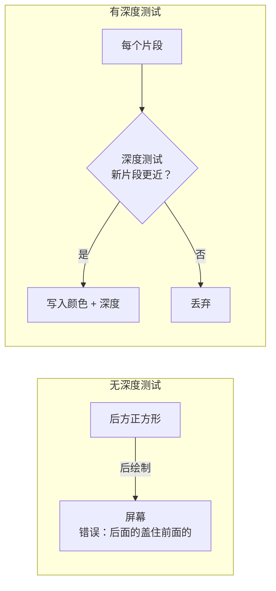

# 深度缓冲（Depth Buffering）

## 问题引入

当渲染多个重叠的 3D 几何体时，后绘制的片段会覆盖先绘制的片段，导致深度关系错误。



**解决方案**：深度缓冲（Z-Buffer）为每个像素存储深度值，新片段只有在更近时才写入。

## 准备：3D 顶点

将 `Vertex` 的位置改为 3D：

```c++
struct Vertex {
    glm::vec3 pos;       // ← 从 vec2 改为 vec3
    glm::vec3 color;
    glm::vec2 texCoord;
};

// 属性描述中 format 改为 VK_FORMAT_R32G32B32_SFLOAT
```

配置 GLM 使用 Vulkan 深度范围：

```c++
#define GLM_FORCE_DEPTH_ZERO_TO_ONE  // Vulkan 深度范围 [0, 1]（OpenGL 为 [-1, 1]）
#include <glm/glm.hpp>
```

> ⚠️ 必须定义 `GLM_FORCE_DEPTH_ZERO_TO_ONE`，否则 GLM 使用 OpenGL 的 [-1, 1] 深度范围，在 Vulkan 中会导致渲染错误。

## 创建深度资源

```c++
VkImage depthImage;
VkDeviceMemory depthImageMemory;
VkImageView depthImageView;

void createDepthResources() {
    VkFormat depthFormat = findDepthFormat();

    // 创建深度图像（分辨率与交换链相同）
    createImage(swapChainExtent.width, swapChainExtent.height,
        depthFormat, VK_IMAGE_TILING_OPTIMAL,
        VK_IMAGE_USAGE_DEPTH_STENCIL_ATTACHMENT_BIT,
        VK_MEMORY_PROPERTY_DEVICE_LOCAL_BIT,
        depthImage, depthImageMemory);

    depthImageView = createImageView(depthImage, depthFormat, VK_IMAGE_ASPECT_DEPTH_BIT);
}
```

### 选择深度格式

```c++
VkFormat findDepthFormat() {
    return findSupportedFormat(
        {VK_FORMAT_D32_SFLOAT, VK_FORMAT_D32_SFLOAT_S8_UINT, VK_FORMAT_D24_UNORM_S8_UINT},
        VK_IMAGE_TILING_OPTIMAL,
        VK_FORMAT_FEATURE_DEPTH_STENCIL_ATTACHMENT_BIT
    );
}

VkFormat findSupportedFormat(const std::vector<VkFormat>& candidates,
    VkImageTiling tiling, VkFormatFeatureFlags features) {
    for (VkFormat format : candidates) {
        VkFormatProperties props;
        vkGetPhysicalDeviceFormatProperties(physicalDevice, format, &props);
        if (tiling == VK_IMAGE_TILING_OPTIMAL &&
            (props.optimalTilingFeatures & features) == features) {
            return format;
        }
    }
    throw std::runtime_error("failed to find supported format!");
}
```

| 深度格式 | 说明 |
|----------|------|
| `D32_SFLOAT` | 32 位浮点深度 |
| `D32_SFLOAT_S8_UINT` | 32 位深度 + 8 位模板 |
| `D24_UNORM_S8_UINT` | 24 位深度 + 8 位模板 |

## 修改渲染通道

添加深度附件描述：

```c++
VkAttachmentDescription depthAttachment{};
depthAttachment.format = findDepthFormat();
depthAttachment.samples = VK_SAMPLE_COUNT_1_BIT;
depthAttachment.loadOp = VK_ATTACHMENT_LOAD_OP_CLEAR;      // 每帧清除
depthAttachment.storeOp = VK_ATTACHMENT_STORE_OP_DONT_CARE; // 绘制后不需要
depthAttachment.stencilLoadOp = VK_ATTACHMENT_LOAD_OP_DONT_CARE;
depthAttachment.stencilStoreOp = VK_ATTACHMENT_STORE_OP_DONT_CARE;
depthAttachment.initialLayout = VK_IMAGE_LAYOUT_UNDEFINED;
depthAttachment.finalLayout = VK_IMAGE_LAYOUT_DEPTH_STENCIL_ATTACHMENT_OPTIMAL;

VkAttachmentReference depthAttachmentRef{};
depthAttachmentRef.attachment = 1;  // 附件索引 1
depthAttachmentRef.layout = VK_IMAGE_LAYOUT_DEPTH_STENCIL_ATTACHMENT_OPTIMAL;

subpass.pDepthStencilAttachment = &depthAttachmentRef;
```

## 修改图形管线

启用深度测试：

```c++
VkPipelineDepthStencilStateCreateInfo depthStencil{};
depthStencil.sType = VK_STRUCTURE_TYPE_PIPELINE_DEPTH_STENCIL_STATE_CREATE_INFO;
depthStencil.depthTestEnable = VK_TRUE;       // 启用深度测试
depthStencil.depthWriteEnable = VK_TRUE;      // 写入深度值
depthStencil.depthCompareOp = VK_COMPARE_OP_LESS;  // 更小=更近=通过
depthStencil.depthBoundsTestEnable = VK_FALSE;
depthStencil.stencilTestEnable = VK_FALSE;
```

## 修改帧缓冲

帧缓冲需要包含深度图像视图：

```c++
std::array<VkImageView, 2> attachments = {
    swapChainImageViews[i],
    depthImageView              // 所有帧共享同一深度图像
};

framebufferInfo.attachmentCount = static_cast<uint32_t>(attachments.size());
framebufferInfo.pAttachments = attachments.data();
```

## 清除深度值

```c++
std::array<VkClearValue, 2> clearValues{};
clearValues[0].color = {{0.0f, 0.0f, 0.0f, 1.0f}};
clearValues[1].depthStencil = {1.0f, 0};  // 1.0 = 最远（远平面）

renderPassInfo.clearValueCount = static_cast<uint32_t>(clearValues.size());
renderPassInfo.pClearValues = clearValues.data();
```

> ⚠️ `clearValues` 的顺序必须与附件顺序一致：先颜色后深度。

## 交换链重建时重建深度资源

```c++
void cleanupSwapChain() {
    vkDestroyImageView(device, depthImageView, nullptr);
    vkDestroyImage(device, depthImage, nullptr);
    vkFreeMemory(device, depthImageMemory, nullptr);
    // ...
}

void recreateSwapChain() {
    // ...
    createDepthResources();  // 重建深度图像
    createFramebuffers();
}
```

## 知识点总结

| 概念 | 说明 |
|------|------|
| 深度缓冲 | 每像素存储深度值，解决遮挡问题 |
| 深度测试 | `COMPARE_OP_LESS`——更近的片段通过 |
| 深度格式 | 优先 `D32_SFLOAT`，按硬件支持选择 |
| 深度范围 | Vulkan [0,1]，需 `GLM_FORCE_DEPTH_ZERO_TO_ONE` |
| 清除值 | 深度初始化为 1.0（最远） |

接下来进入[加载模型](08_加载模型.md)章节。

[C++ 代码](/code/27_depth_buffering.cpp) | [着色器](/code/27_shader_depth.vert)
