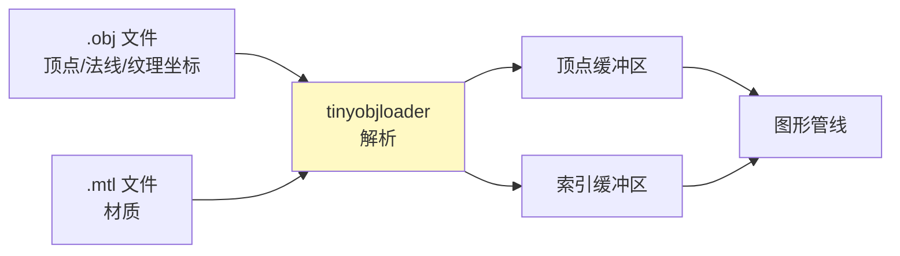

# 加载模型（Loading Models）

## 概述

从手动定义顶点转向加载真实 3D 模型文件。使用 **tinyobjloader** 库加载 OBJ 格式模型。



## 库集成

### tinyobjloader

```c++
// 在一个 .cpp 文件中定义实现
#define TINYOBJLOADER_IMPLEMENTATION
#include <tiny_obj_loader.h>
```

### 模型与纹理

本教程使用 Viking Room 模型。将 `viking_room.obj`、`viking_room.mtl` 和 `viking_room.png` 放入项目目录。

## 加载模型

```c++
#include <unordered_map>

std::vector<Vertex> vertices;
std::vector<uint32_t> indices;

void loadModel() {
    tinyobj::attrib_t attrib;                    // 顶点属性（位置、法线、纹理坐标）
    std::vector<tinyobj::shape_t> shapes;        // 独立的对象/组
    std::vector<tinyobj::material_t> materials;  // 材质
    std::string warn, err;

    if (!tinyobj::LoadObj(&attrib, &shapes, &materials, &warn, &err, MODEL_PATH)) {
        throw std::runtime_error(warn + err);
    }

    std::unordered_map<Vertex, uint32_t> uniqueVertices{};  // 去重

    for (const auto& shape : shapes) {
        for (const auto& index : shape.mesh.indices) {
            Vertex vertex{};

            vertex.pos = {
                attrib.vertices[3 * index.vertex_index + 0],
                attrib.vertices[3 * index.vertex_index + 1],
                attrib.vertices[3 * index.vertex_index + 2]
            };

            vertex.texCoord = {
                attrib.texcoords[2 * index.texcoord_index + 0],
                1.0f - attrib.texcoords[2 * index.texcoord_index + 1]  // ⚠️ 翻转 V
            };

            vertex.color = {1.0f, 1.0f, 1.0f};

            // 顶点去重——相同顶点只存一份
            if (uniqueVertices.count(vertex) == 0) {
                uniqueVertices[vertex] = static_cast<uint32_t>(vertices.size());
                vertices.push_back(vertex);
            }
            indices.push_back(uniqueVertices[vertex]);
        }
    }
}
```

> ⚠️ **纹理坐标 V 翻转**：OBJ 格式中 V=0 在图像底部，Vulkan 中 V=0 在顶部，需要 `1.0f - texcoord.v`。

## 顶点哈希（去重所需）

为了使用 `unordered_map` 进行去重，需要为 `Vertex` 实现哈希：

```c++
#define GLM_ENABLE_EXPERIMENTAL
#include <glm/gtx/hash.hpp>

namespace std {
    template<> struct hash<Vertex> {
        size_t operator()(Vertex const& vertex) const {
            return ((hash<glm::vec3>()(vertex.pos) ^
                   (hash<glm::vec3>()(vertex.color) << 1)) >> 1) ^
                   (hash<glm::vec2>()(vertex.texCoord) << 1);
        }
    };
}
```

同时为 `Vertex` 添加 `operator==`：

```c++
bool operator==(const Vertex& other) const {
    return pos == other.pos && color == other.color && texCoord == other.texCoord;
}
```

## 修改缓冲区创建

索引类型从 `uint16_t` 改为 `uint32_t`（模型顶点超过 65535）：

```c++
// 索引缓冲区绑定
vkCmdBindIndexBuffer(commandBuffer, indexBuffer, 0, VK_INDEX_TYPE_UINT32);  // ← 改为 UINT32
```

> ⚠️ 模型顶点数可能超过 65535，必须使用 `uint32_t` 索引。

## 调用顺序

```c++
void initVulkan() {
    // ...
    createTextureImage();
    createTextureImageView();
    createTextureSampler();
    loadModel();           // ← 加载模型后再创建顶点/索引缓冲区
    createVertexBuffer();
    createIndexBuffer();
    // ...
}
```

## 知识点总结

| 概念 | 说明 |
|------|------|
| tinyobjloader | 轻量级 OBJ 加载库（头文件库） |
| OBJ 格式 | 存储顶点位置、法线、纹理坐标和面 |
| 顶点去重 | `unordered_map` 哈希去重，减少顶点数据 |
| V 坐标翻转 | `1.0f - v`，OBJ 与 Vulkan Y 轴方向不同 |
| uint32_t 索引 | 模型顶点超过 65535 时必须使用 |

接下来学习[生成 Mipmaps](09_生成Mipmaps.md)。

[C++ 代码](/code/28_model_loading.cpp) | [着色器](/code/28_model_loading.vert)
