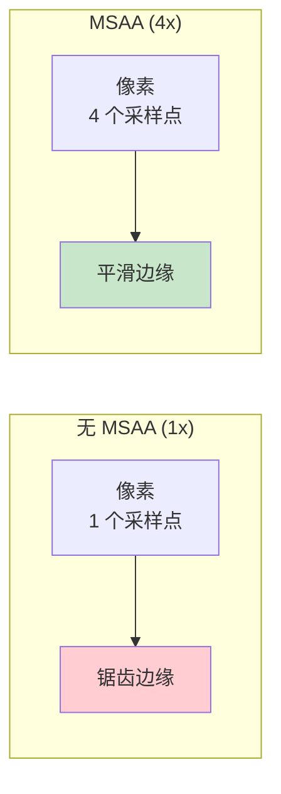
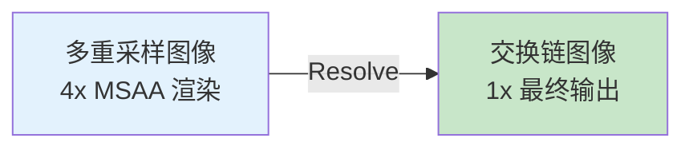

# 多重采样（Multisampling / MSAA）

## 什么是 MSAA

**多重采样抗锯齿（MSAA）** 通过在每个像素多个位置采样来平滑几何体边缘的锯齿。



## 查询硬件支持

```c++
VkSampleCountFlagBits getMaxUsableSampleCount() {
    VkPhysicalDeviceProperties physicalDeviceProperties;
    vkGetPhysicalDeviceProperties(physicalDevice, &physicalDeviceProperties);

    VkSampleCountFlags counts = physicalDeviceProperties.limits.framebufferColorSampleCounts
                              & physicalDeviceProperties.limits.framebufferDepthSampleCounts;

    if (counts & VK_SAMPLE_COUNT_64_BIT) return VK_SAMPLE_COUNT_64_BIT;
    if (counts & VK_SAMPLE_COUNT_32_BIT) return VK_SAMPLE_COUNT_32_BIT;
    if (counts & VK_SAMPLE_COUNT_16_BIT) return VK_SAMPLE_COUNT_16_BIT;
    if (counts & VK_SAMPLE_COUNT_8_BIT)  return VK_SAMPLE_COUNT_8_BIT;
    if (counts & VK_SAMPLE_COUNT_4_BIT)  return VK_SAMPLE_COUNT_4_BIT;
    if (counts & VK_SAMPLE_COUNT_2_BIT)  return VK_SAMPLE_COUNT_2_BIT;

    return VK_SAMPLE_COUNT_1_BIT;
}

VkSampleCountFlagBits msaaSamples = VK_SAMPLE_COUNT_1_BIT;  // 默认无 MSAA
```

## 创建多重采样颜色资源

MSAA 需要一个**多重采样颜色图像**作为渲染目标，最后 resolve 到交换链图像：

```c++
VkImage colorImage;
VkDeviceMemory colorImageMemory;
VkImageView colorImageView;

void createColorResources() {
    VkFormat colorFormat = swapChainImageFormat;

    createImage(swapChainExtent.width, swapChainExtent.height, 1,
        msaaSamples,  // ← 多重采样数
        colorFormat, VK_IMAGE_TILING_OPTIMAL,
        VK_IMAGE_USAGE_TRANSIENT_ATTACHMENT_BIT | VK_IMAGE_USAGE_COLOR_ATTACHMENT_BIT,
        VK_MEMORY_PROPERTY_DEVICE_LOCAL_BIT, colorImage, colorImageMemory);

    colorImageView = createImageView(colorImage, colorFormat, VK_IMAGE_ASPECT_COLOR_BIT, 1);
}
```



## 修改渲染通道

```c++
// 颜色附件（多重采样）
VkAttachmentDescription colorAttachment{};
colorAttachment.samples = msaaSamples;  // ← 多重采样
colorAttachment.finalLayout = VK_IMAGE_LAYOUT_COLOR_ATTACHMENT_OPTIMAL;  // 不直接呈现

// 颜色 Resolve 附件（交换链图像，单采样）
VkAttachmentDescription colorAttachmentResolve{};
colorAttachmentResolve.samples = VK_SAMPLE_COUNT_1_BIT;
colorAttachmentResolve.loadOp = VK_ATTACHMENT_LOAD_OP_DONT_CARE;
colorAttachmentResolve.storeOp = VK_ATTACHMENT_STORE_OP_STORE;
colorAttachmentResolve.finalLayout = VK_IMAGE_LAYOUT_PRESENT_SRC_KHR;

// 深度附件
VkAttachmentDescription depthAttachment{};
depthAttachment.samples = msaaSamples;  // ← 深度也需要多重采样

// 子通道
VkAttachmentReference colorAttachmentRef{};
colorAttachmentRef.attachment = 0;

VkAttachmentReference depthAttachmentRef{};
depthAttachmentRef.attachment = 1;

VkAttachmentReference colorAttachmentResolveRef{};
colorAttachmentResolveRef.attachment = 2;  // resolve 目标

subpass.pResolveAttachments = &colorAttachmentResolveRef;  // ← 新增
```

## 修改帧缓冲

```c++
std::array<VkImageView, 3> attachments = {
    colorImageView,              // 0: 多重采样颜色
    depthImageView,              // 1: 多重采样深度
    swapChainImageViews[i]       // 2: resolve 目标（交换链）
};
```

## 修改图形管线

```c++
multisampling.rasterizationSamples = msaaSamples;  // ← 设置采样数
```

## 交换链重建

```c++
void cleanupSwapChain() {
    vkDestroyImageView(device, colorImageView, nullptr);
    vkDestroyImage(device, colorImage, nullptr);
    vkFreeMemory(device, colorImageMemory, nullptr);
    // ... 深度和帧缓冲清理 ...
}

void recreateSwapChain() {
    // ...
    createColorResources();   // 重建多重采样资源
    createDepthResources();
    createFramebuffers();
}
```

## 知识点总结

| 概念 | 说明 |
|------|------|
| MSAA | 多重采样抗锯齿，在边缘处多点采样 |
| 采样数 | 常用 4x，越高质量越好但性能越低 |
| Resolve | 将多重采样图像合并为单采样最终输出 |
| 附件顺序 | 颜色(MS) → 深度(MS) → Resolve(1x) |
| `TRANSIENT_ATTACHMENT` | 多重采样图像不需要持久存储 |

> 💡 4x MSAA 是性能与质量的良好平衡点，大多数桌面 GPU 都支持。

接下来学习[计算着色器](11_计算着色器.md)。

[C++ 代码](/code/30_multisampling.cpp)
