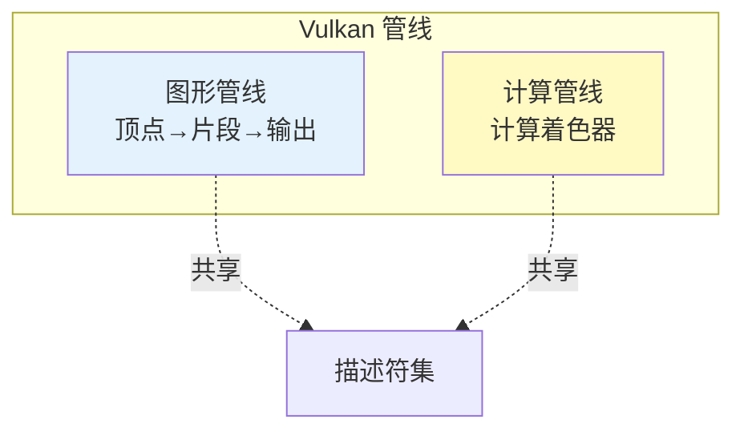
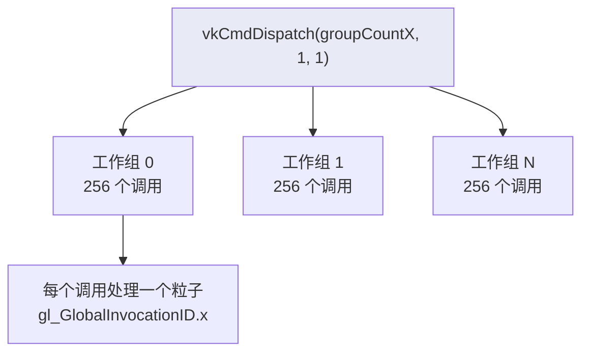
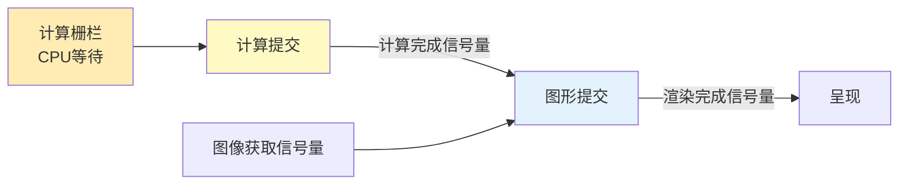

# 计算着色器（Compute Shader）

## 📍 本章在教程中的位置


> 📍 **依赖与影响** — 本章是教程的最后一章，但复用了大量前面的基础设施：
>
> ```mermaid
> graph TD
>     subgraph "复用之前章节的基础设施"
>         CB[createBuffer（）]:::done
>         DSL[描述符集布局]:::done
>         DP[描述符池]:::done
>         SM[着色器模块加载]:::done
>         SYNC[信号量+栅栏]:::done
>     end
>     
>     subgraph "回溯修改"
>         QF[物理设备<br>添加计算队列族]:::mod
>         LD[逻辑设备<br>请求计算队列]:::mod
>         DF[drawFrame（）<br>添加计算提交]:::mod
>     end
>     
>     CB --> COMP[计算着色器<br>本章]:::current
>     DSL --> COMP
>     DP --> COMP
>     SM --> COMP
>     SYNC --> COMP
>     QF --> COMP
>     LD --> COMP
>     DF --> COMP
>     
>     classDef done fill:#c8e6c9
>     classDef mod fill:#fff9c4
>     classDef current fill:#ff9800,color:#fff
> ```

## 概述

计算着色器独立于图形管线，可用于 GPU 通用计算（GPGPU）。Vulkan **强制支持**计算着色器。



### 应用场景

- 粒子系统（本章示例）
- 图像后处理
- 物理模拟
- AI 推理
- 无图形输出的纯计算（Headless Compute）

## 核心概念

### 着色器存储缓冲区（SSBO）

SSBO 允许着色器**读写**数据（Uniform Buffer 只读），且大小可变。

```c++
// 创建缓冲区时指定多种用途
createBuffer(bufferSize,
    VK_BUFFER_USAGE_STORAGE_BUFFER_BIT |    // 计算着色器读写
    VK_BUFFER_USAGE_VERTEX_BUFFER_BIT |     // 顶点着色器读取
    VK_BUFFER_USAGE_TRANSFER_DST_BIT,       // 从主机传输
    VK_MEMORY_PROPERTY_DEVICE_LOCAL_BIT,
    shaderStorageBuffers[i], shaderStorageBuffersMemory[i]);
```

GLSL 中声明：

```glsl
struct Particle {
    vec2 position;
    vec2 velocity;
    vec4 color;
};

layout(std140, binding = 1) readonly buffer ParticleSSBOIn {
    Particle particlesIn[];   // 上一帧粒子数据（只读）
};

layout(std140, binding = 2) buffer ParticleSSBOOut {
    Particle particlesOut[];  // 当前帧粒子数据（读写）
};
```

> 📌 SSBO 与 UBO 的区别：
> | 特性 | UBO | SSBO |
> |------|-----|------|
> | 访问方式 | 只读 | 读写 |
> | 大小限制 | 通常 16-64KB | 可达数 GB |
> | 性能 | 更快（缓存优化） | 较慢 |

### 计算队列

计算使用 `VK_QUEUE_COMPUTE_BIT` 队列。本教程使用同时支持图形和计算的队列：

```c++
if ((queueFamily.queueFlags & VK_QUEUE_GRAPHICS_BIT) &&
    (queueFamily.queueFlags & VK_QUEUE_COMPUTE_BIT)) {
    indices.graphicsAndComputeFamily = i;
}

// 获取计算队列
vkGetDeviceQueue(device, indices.graphicsAndComputeFamily.value(), 0, &computeQueue);
```

## 计算管线

计算管线比图形管线简单得多——只需一个着色器阶段：

```c++
VkPipelineShaderStageCreateInfo computeShaderStageInfo{};
computeShaderStageInfo.sType = VK_STRUCTURE_TYPE_PIPELINE_SHADER_STAGE_CREATE_INFO;
computeShaderStageInfo.stage = VK_SHADER_STAGE_COMPUTE_BIT;
computeShaderStageInfo.module = computeShaderModule;
computeShaderStageInfo.pName = "main";

VkComputePipelineCreateInfo pipelineInfo{};
pipelineInfo.sType = VK_STRUCTURE_TYPE_COMPUTE_PIPELINE_CREATE_INFO;
pipelineInfo.layout = computePipelineLayout;
pipelineInfo.stage = computeShaderStageInfo;

vkCreateComputePipelines(device, VK_NULL_HANDLE, 1, &pipelineInfo, nullptr, &computePipeline);
```

## 计算着色器（GLSL）

```glsl
#version 450

layout (binding = 0) uniform ParameterUBO {
    float deltaTime;
} ubo;

layout(std140, binding = 1) readonly buffer ParticleSSBOIn {
    Particle particlesIn[];
};

layout(std140, binding = 2) buffer ParticleSSBOOut {
    Particle particlesOut[];
};

layout (local_size_x = 256, local_size_y = 1, local_size_z = 1) in;  // 工作组大小

void main() {
    uint index = gl_GlobalInvocationID.x;  // 全局调用 ID

    Particle particleIn = particlesIn[index];

    // 更新位置
    particlesOut[index].position = particleIn.position + particleIn.velocity.xy * ubo.deltaTime;

    // 边界检测——粒子超出屏幕时反弹
    // ...
}
```

### 工作组（Work Group）



- `local_size_x = 256`：每个工作组包含 256 个调用
- 总工作组数 = `ceil(粒子数 / 256)`

## 计算命令提交

```c++
void recordComputeCommandBuffer(VkCommandBuffer commandBuffer) {
    VkCommandBufferBeginInfo beginInfo{};
    beginInfo.sType = VK_STRUCTURE_TYPE_COMMAND_BUFFER_BEGIN_INFO;
    vkBeginCommandBuffer(commandBuffer, &beginInfo);

    vkCmdBindPipeline(commandBuffer, VK_PIPELINE_BIND_POINT_COMPUTE, computePipeline);
    vkCmdBindDescriptorSets(commandBuffer, VK_PIPELINE_BIND_POINT_COMPUTE,
        computePipelineLayout, 0, 1, &computeDescriptorSets[currentFrame], 0, nullptr);

    // 调度计算——每组 256 个调用
    vkCmdDispatch(commandBuffer, PARTICLE_COUNT / 256, 1, 1);

    vkEndCommandBuffer(commandBuffer);
}
```

## 同步：计算与图形

计算和图形使用同一队列时，需要通过信号量和栅栏同步：

```c++
// 先提交计算
VkSubmitInfo computeSubmitInfo{};
computeSubmitInfo.commandBufferCount = 1;
computeSubmitInfo.pCommandBuffers = &computeCommandBuffers[currentFrame];
computeSubmitInfo.signalSemaphoreCount = 1;
computeSubmitInfo.pSignalSemaphores = &computeFinishedSemaphores[currentFrame];

vkQueueSubmit(computeQueue, 1, &computeSubmitInfo, computeInFlightFences[currentFrame]);

// 图形提交等待计算完成
VkSemaphore waitSemaphores[] = {computeFinishedSemaphores[currentFrame],
                                 imageAvailableSemaphores[currentFrame]};
VkPipelineStageFlags waitStages[] = {VK_PIPELINE_STAGE_VERTEX_INPUT_BIT,
                                      VK_PIPELINE_STAGE_COLOR_ATTACHMENT_OUTPUT_BIT};
```



## 初始化粒子数据

```c++
void createShaderStorageBuffers() {
    std::default_random_engine rndEngine((unsigned)time(nullptr));
    std::uniform_real_distribution<float> rndDist(0.0f, 1.0f);

    std::vector<Particle> particles(PARTICLE_COUNT);
    for (auto& particle : particles) {
        float r = 0.25f * sqrt(rndDist(rndEngine));
        float theta = rndDist(rndEngine) * 2.0f * 3.14159265358979323846f;
        particle.position = glm::vec2(r * cos(theta), r * sin(theta));
        particle.velocity = glm::normalize(glm::vec2(particle.position)) * 0.00025f;
        particle.color = glm::vec4(rndDist(rndEngine), rndDist(rndEngine), rndDist(rndEngine), 1.0f);
    }

    // 通过暂存缓冲区上传到 GPU 本地内存
    // ... createBuffer + memcpy + copyBuffer ...
}
```

## drawFrame 流程

```c++
void drawFrame() {
    // 1. 等待计算栅栏
    vkWaitForFences(device, 1, &computeInFlightFences[currentFrame], VK_TRUE, UINT64_MAX);

    // 2. 更新计算 UBO（deltaTime）
    updateUniformBuffer(currentFrame);

    // 3. 重置并提交计算命令
    vkResetFences(device, 1, &computeInFlightFences[currentFrame]);
    vkResetCommandBuffer(computeCommandBuffers[currentFrame], 0);
    recordComputeCommandBuffer(computeCommandBuffers[currentFrame]);
    // ... 提交计算 ...

    // 4. 等待图形栅栏，获取图像
    vkWaitForFences(device, 1, &inFlightFences[currentFrame], VK_TRUE, UINT64_MAX);
    vkAcquireNextImageKHR(...);

    // 5. 记录并提交图形命令（等待计算完成信号量）
    // 6. 呈现
}
```

## 知识点总结

| 概念 | 说明 |
|------|------|
| 计算着色器 | 独立于图形管线，执行通用 GPU 计算 |
| SSBO | 着色器存储缓冲区，支持读写，大小可变 |
| 工作组 | `local_size` 定义每组调用数，`vkCmdDispatch` 定义组数 |
| 计算管线 | 只需一个计算着色器阶段 |
| 同步 | 信号量协调计算与图形管线的执行顺序 |
| 双缓冲 SSBO | 读上一帧、写当前帧，避免读写冲突 |

> ⚠️ **常见错误**：
> - 忘记在 `createLogicalDevice` 中请求计算队列
> - SSBO 绑定点与着色器不匹配
> - 工作组大小不能被粒子数整除时未处理边界
> - 计算和图形提交之间缺少同步

### 🔴 计算着色器详细错误指南

#### 错误 1：工作组越界——`PARTICLE_COUNT % local_size != 0`

```glsl
// 着色器中 local_size_x = 256
// 粒子数 = 1000
// dispatch(1000 / 256 = 3, ...) → 只处理 768 个粒子！
// dispatch(4, ...) → 处理 1024 个调用，但粒子只有 1000 → 越界访问！
```

```c++
// ❌ 整数除法截断
vkCmdDispatch(commandBuffer, PARTICLE_COUNT / 256, 1, 1);

// ✅ 向上取整 + 着色器中做边界检查
uint32_t groupCount = (PARTICLE_COUNT + 255) / 256;
vkCmdDispatch(commandBuffer, groupCount, 1, 1);
```

```glsl
// ✅ 着色器中添加边界保护
void main() {
    uint index = gl_GlobalInvocationID.x;
    if (index >= PARTICLE_COUNT) return;  // ← 防止越界！
    // ...
}
```

#### 错误 2：SSBO 中使用 `std140` 的对齐陷阱

```glsl
// ❌ std140 中 vec2 后面跟 vec4 会有隐式 padding
struct Particle {
    vec2 position;   // offset 0,  大小 8
    // 8 字节 padding（vec4 需要 16 字节对齐）
    vec4 color;      // offset 16, 大小 16
};
// C++ 的 Particle 结构体大小如果是 24 字节 → 与 GPU 的 32 字节不匹配！

// ✅ 方案 1：C++ 中使用 alignas
struct Particle {
    glm::vec2 position;
    alignas(16) glm::vec4 color;  // 强制 16 字节对齐
};

// ✅ 方案 2：改用 std430（SSBO 支持，UBO 不支持）
// std430 取消了 vec2 到 vec4 之间的额外 padding
layout(std430, binding = 1) readonly buffer ParticleSSBOIn { ... };
```

#### 错误 3：计算与图形同步遗漏

```c++
// ❌ 提交计算后直接提交图形 → 数据竞争
vkQueueSubmit(computeQueue, 1, &computeSubmit, VK_NULL_HANDLE);
vkQueueSubmit(graphicsQueue, 1, &graphicsSubmit, VK_NULL_HANDLE);
// 图形管线可能读到计算的中间状态！

// ✅ 使用信号量链接（本教程方案）
computeSubmit.signalSemaphoreCount = 1;
computeSubmit.pSignalSemaphores = &computeFinished;

graphicsSubmit.waitSemaphoreCount = 1;     // 等待计算完成
graphicsSubmit.pWaitSemaphores = &computeFinished;
```

#### 错误 4：忘记 `vkCmdBindPipeline` 指定 `COMPUTE` 绑定点

```c++
// ❌ 使用了 GRAPHICS 绑定点
vkCmdBindPipeline(cmd, VK_PIPELINE_BIND_POINT_GRAPHICS, computePipeline);  // 错！

// ✅ 计算管线必须用 COMPUTE 绑定点
vkCmdBindPipeline(cmd, VK_PIPELINE_BIND_POINT_COMPUTE, computePipeline);
vkCmdBindDescriptorSets(cmd, VK_PIPELINE_BIND_POINT_COMPUTE, ...);  // 也是 COMPUTE！
```

#### 错误 5：`maxComputeWorkGroupCount` 限制

```c++
// ❌ dispatch 的组数超过硬件限制
// 大多数 GPU 每维最大 65535 个工作组
vkCmdDispatch(cmd, 100000, 1, 1);  // 可能超限！

// ✅ 检查设备限制
VkPhysicalDeviceProperties props;
vkGetPhysicalDeviceProperties(physicalDevice, &props);
uint32_t maxX = props.limits.maxComputeWorkGroupCount[0];  // 通常 65535
uint32_t maxLocal = props.limits.maxComputeWorkGroupInvocations;  // 通常 1024
```

[C++ 代码](/code/31_compute_shader.cpp) | [计算着色器](/code/31_shader_compute.comp) | [顶点着色器](/code/31_shader_compute.vert) | [片段着色器](/code/31_shader_compute.frag)
