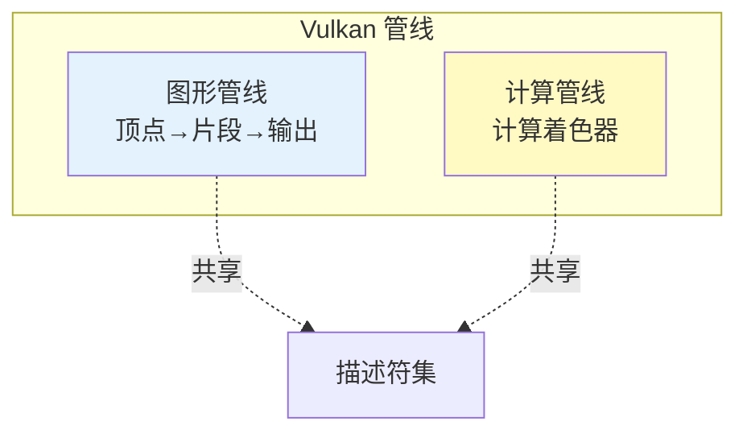
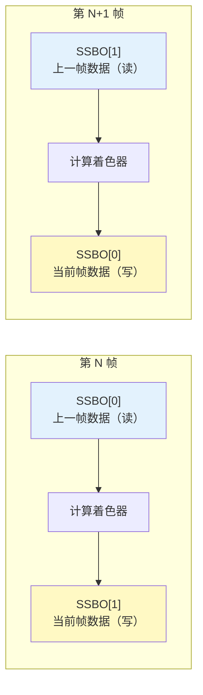
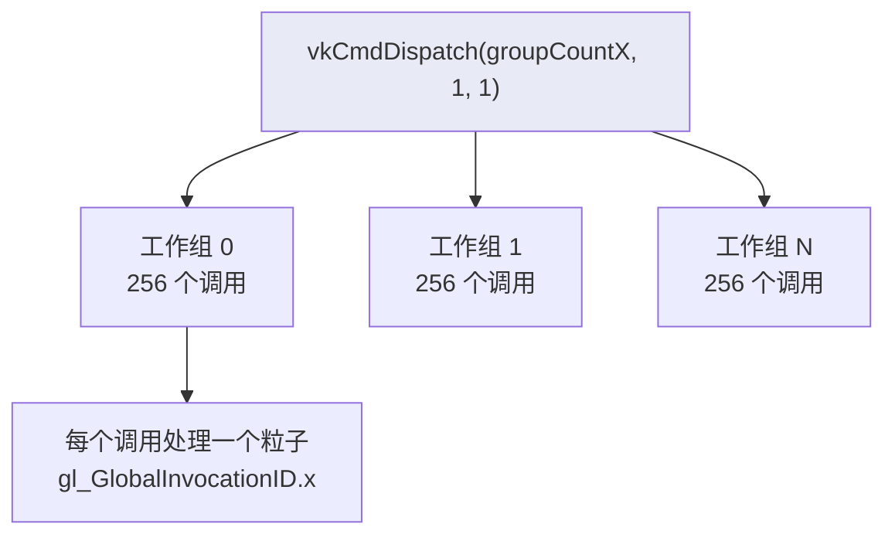
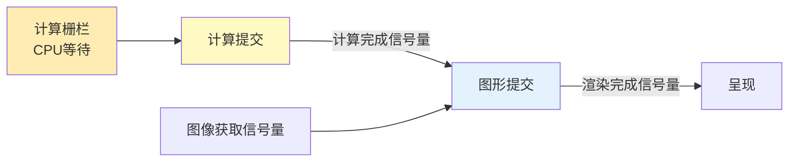
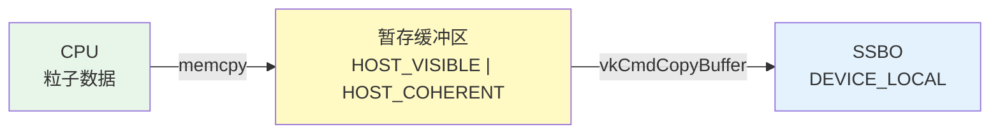

# 计算着色器（Compute Shader）

## 📍 本章在教程中的位置


> 📍 **依赖与影响** — 本章是教程的最后一章，但复用了大量前面的基础设施：
>
> ```mermaid
> graph TD
>     subgraph "复用之前章节的基础设施"
>         CB[createBuffer（）]:::done
>         DSL[描述符集布局]:::done
>         DP[描述符池]:::done
>         SM[着色器模块加载]:::done
>         SYNC[信号量+栅栏]:::done
>     end
>     
>     subgraph "回溯修改"
>         QF[物理设备<br>添加计算队列族]:::mod
>         LD[逻辑设备<br>请求计算队列]:::mod
>         DF[drawFrame（）<br>添加计算提交]:::mod
>     end
>     
>     CB --> COMP[计算着色器<br>本章]:::current
>     DSL --> COMP
>     DP --> COMP
>     SM --> COMP
>     SYNC --> COMP
>     QF --> COMP
>     LD --> COMP
>     DF --> COMP
>     
>     classDef done fill:#c8e6c9
>     classDef mod fill:#fff9c4
>     classDef current fill:#ff9800,color:#fff
> ```

## 概述

计算着色器独立于图形管线，可用于 GPU 通用计算（GPGPU）。Vulkan **强制支持**计算着色器。



### 应用场景

- 粒子系统（本章示例）
- 图像后处理
- 物理模拟
- AI 推理
- 无图形输出的纯计算（Headless Compute）

## 核心概念

### 着色器存储缓冲区（SSBO）

SSBO 允许着色器**读写**数据（Uniform Buffer 只读），且大小可变。

```c++
// 创建缓冲区时指定多种用途
createBuffer(bufferSize,
    VK_BUFFER_USAGE_STORAGE_BUFFER_BIT |    // 计算着色器读写
    VK_BUFFER_USAGE_VERTEX_BUFFER_BIT |     // 顶点着色器读取
    VK_BUFFER_USAGE_TRANSFER_DST_BIT,       // 从主机传输
    VK_MEMORY_PROPERTY_DEVICE_LOCAL_BIT,
    shaderStorageBuffers[i], shaderStorageBuffersMemory[i]);
```

GLSL 中声明：

```glsl
struct Particle {
    vec2 position;
    vec2 velocity;
    vec4 color;
};

layout(std140, binding = 1) readonly buffer ParticleSSBOIn {
    Particle particlesIn[];   // 上一帧粒子数据（只读）
};

layout(std140, binding = 2) buffer ParticleSSBOOut {
    Particle particlesOut[];  // 当前帧粒子数据（读写）
};
```

> 📌 SSBO 与 UBO 的区别：
> | 特性 | UBO | SSBO |
> |------|-----|------|
> | 访问方式 | 只读 | 读写 |
> | 大小限制 | 通常 16-64KB | 可达数 GB |
> | 性能 | 更快（缓存优化） | 较慢 |

### 计算队列

计算使用 `VK_QUEUE_COMPUTE_BIT` 队列。本教程使用同时支持图形和计算的队列：

```c++
if ((queueFamily.queueFlags & VK_QUEUE_GRAPHICS_BIT) &&
    (queueFamily.queueFlags & VK_QUEUE_COMPUTE_BIT)) {
    indices.graphicsAndComputeFamily = i;
}

// 从同一个队列族获取图形队列和计算队列
vkGetDeviceQueue(device, indices.graphicsAndComputeFamily.value(), 0, &graphicsQueue);
vkGetDeviceQueue(device, indices.graphicsAndComputeFamily.value(), 0, &computeQueue);
```

> 📌 **QueueFamilyIndices 的变化**：本章将之前分开的 `graphicsFamily` 和独立的计算队列族合并为 `graphicsAndComputeFamily`。这意味着 `graphicsQueue` 和 `computeQueue` 是**同一个队列句柄**——它们在硬件层面是同一条命令队列，可以同时处理图形和计算命令。这样做的好处是：
> - 不需要在队列之间传输缓冲区所有权（Queue Family Ownership Transfer）
> - 同步更简单（只需信号量串联，无需 Release/Acquire 屏障）
>
> 代价是如果 GPU 有独立的专用计算队列（某些 GPU 的计算队列和图形队列是分离的硬件单元），就无法利用其并行执行能力。但对于本教程的粒子系统来说，这已经足够。

### 双缓冲 SSBO（Ping-Pong 模式）

粒子每帧需要更新位置：读取上一帧的粒子数据，计算新位置，写入当前帧。如果只用一个 SSBO 同时读写，会出现**数据竞争**——某些线程可能读到其他线程刚写入的值。

解决方法是 **双缓冲（Ping-Pong）**：分配 2 个 SSBO（对应 `MAX_FRAMES_IN_FLIGHT = 2`），交替作为"读"和"写"：



在描述符集中实现这个环形读写：

```c++
for (size_t i = 0; i < MAX_FRAMES_IN_FLIGHT; i++) {
    // binding 1（只读）：指向"上一帧"的缓冲区
    storageBufferInfoLastFrame.buffer = shaderStorageBuffers[(i - 1) % MAX_FRAMES_IN_FLIGHT];

    // binding 2（读写）：指向"当前帧"的缓冲区
    storageBufferInfoCurrentFrame.buffer = shaderStorageBuffers[i];

    vkUpdateDescriptorSets(...);
}
```

这样第 0 帧读 SSBO[1] 写 SSBO[0]，第 1 帧读 SSBO[0] 写 SSBO[1]，交替进行，永远不会有读写冲突。

### 计算描述符集布局设计

计算着色器需要三种资源，对应描述符集的 3 个 binding：

| Binding | 类型 | 描述符类型 | 着色器访问 | 说明 |
|---------|------|-----------|-----------|------|
| 0 | Uniform Buffer | `VK_DESCRIPTOR_TYPE_UNIFORM_BUFFER` | 只读 | 每帧更新的 `deltaTime` |
| 1 | SSBO（上一帧） | `VK_DESCRIPTOR_TYPE_STORAGE_BUFFER` | `readonly` | 读取上一帧粒子状态 |
| 2 | SSBO（当前帧） | `VK_DESCRIPTOR_TYPE_STORAGE_BUFFER` | 读写 | 写入当前帧粒子状态 |

```c++
std::array<VkDescriptorSetLayoutBinding, 3> layoutBindings{};

// binding 0: Uniform Buffer —— deltaTime
layoutBindings[0].binding = 0;
layoutBindings[0].descriptorType = VK_DESCRIPTOR_TYPE_UNIFORM_BUFFER;
layoutBindings[0].descriptorCount = 1;
layoutBindings[0].stageFlags = VK_SHADER_STAGE_COMPUTE_BIT;

// binding 1: SSBO（只读）—— 上一帧粒子数据
layoutBindings[1].binding = 1;
layoutBindings[1].descriptorType = VK_DESCRIPTOR_TYPE_STORAGE_BUFFER;
layoutBindings[1].descriptorCount = 1;
layoutBindings[1].stageFlags = VK_SHADER_STAGE_COMPUTE_BIT;

// binding 2: SSBO（读写）—— 当前帧粒子数据
layoutBindings[2].binding = 2;
layoutBindings[2].descriptorType = VK_DESCRIPTOR_TYPE_STORAGE_BUFFER;
layoutBindings[2].descriptorCount = 1;
layoutBindings[2].stageFlags = VK_SHADER_STAGE_COMPUTE_BIT;
```

> 📌 注意：所有 binding 的 `stageFlags` 都是 `VK_SHADER_STAGE_COMPUTE_BIT`——这些描述符**仅供计算着色器使用**。图形管线不使用任何描述符集（它的 `pipelineLayout` 中 `setLayoutCount = 0`），而是直接通过顶点缓冲区绑定来读取粒子数据。

## 计算管线

计算管线比图形管线简单得多——只需一个着色器阶段：

```c++
VkPipelineShaderStageCreateInfo computeShaderStageInfo{};
computeShaderStageInfo.sType = VK_STRUCTURE_TYPE_PIPELINE_SHADER_STAGE_CREATE_INFO;
computeShaderStageInfo.stage = VK_SHADER_STAGE_COMPUTE_BIT;
computeShaderStageInfo.module = computeShaderModule;
computeShaderStageInfo.pName = "main";

VkComputePipelineCreateInfo pipelineInfo{};
pipelineInfo.sType = VK_STRUCTURE_TYPE_COMPUTE_PIPELINE_CREATE_INFO;
pipelineInfo.layout = computePipelineLayout;
pipelineInfo.stage = computeShaderStageInfo;

vkCreateComputePipelines(device, VK_NULL_HANDLE, 1, &pipelineInfo, nullptr, &computePipeline);
```

## 计算着色器（GLSL）

完整源码 (`31_shader_compute.comp`)：

```glsl
#version 450

struct Particle {
    vec2 position;
    vec2 velocity;
    vec4 color;
};

layout (binding = 0) uniform ParameterUBO {
    float deltaTime;
} ubo;

layout(std140, binding = 1) readonly buffer ParticleSSBOIn {
   Particle particlesIn[];
};

layout(std140, binding = 2) buffer ParticleSSBOOut {
   Particle particlesOut[];
};

layout (local_size_x = 256, local_size_y = 1, local_size_z = 1) in;

void main() 
{
    uint index = gl_GlobalInvocationID.x;   // 全局调用 ID

    Particle particleIn = particlesIn[index];

    // 位置 = 原位置 + 速度 × 时间
    particlesOut[index].position = particleIn.position + particleIn.velocity.xy * ubo.deltaTime;
    particlesOut[index].velocity = particleIn.velocity;

    // 边界反弹 —— 粒子到达窗口边缘时翻转速度方向
    if ((particlesOut[index].position.x <= -1.0) || (particlesOut[index].position.x >= 1.0)) {
        particlesOut[index].velocity.x = -particlesOut[index].velocity.x;
    }
    if ((particlesOut[index].position.y <= -1.0) || (particlesOut[index].position.y >= 1.0)) {
        particlesOut[index].velocity.y = -particlesOut[index].velocity.y;
    }
}
```

关键点说明：

- **`readonly` vs 读写 SSBO**：binding 1 声明为 `readonly`，GPU 可以对此进行缓存优化；binding 2 不加修饰符，默认可读写，用于写入新位置。
- **`std140` 布局**：`vec2 position` (8B) → `vec2 velocity` (8B) → `vec4 color` (16B)，总大小 32B。C++ 端的 `glm::vec2` 是 8 字节对齐的，`glm::vec4` 是 16 字节对齐的——与 GLSL 的 `std140` 布局恰好匹配（因为 `vec2`+`vec2`=16B 刚好填满一个 `vec4` 的对齐边界，`vec4 color` 自然在 16 字节对齐位置开始）。
- **位置坐标范围为 [-1, 1]**：粒子位置是在 NDC（标准化设备坐标）空间中，顶点着色器直接将其传递给 `gl_Position`。

### 工作组（Work Group）



- `local_size_x = 256`：每个工作组包含 256 个调用
- 总工作组数 = `ceil(粒子数 / 256)`

## 计算命令提交

```c++
void recordComputeCommandBuffer(VkCommandBuffer commandBuffer) {
    VkCommandBufferBeginInfo beginInfo{};
    beginInfo.sType = VK_STRUCTURE_TYPE_COMMAND_BUFFER_BEGIN_INFO;
    vkBeginCommandBuffer(commandBuffer, &beginInfo);

    vkCmdBindPipeline(commandBuffer, VK_PIPELINE_BIND_POINT_COMPUTE, computePipeline);
    vkCmdBindDescriptorSets(commandBuffer, VK_PIPELINE_BIND_POINT_COMPUTE,
        computePipelineLayout, 0, 1, &computeDescriptorSets[currentFrame], 0, nullptr);

    // 调度计算——每组 256 个调用
    vkCmdDispatch(commandBuffer, PARTICLE_COUNT / 256, 1, 1);

    vkEndCommandBuffer(commandBuffer);
}
```

## 图形管线：粒子渲染

虽然粒子位置由计算着色器更新，但**渲染仍然需要图形管线**。本章的图形管线有以下特殊之处。

### 绘制图元：Point List

图形管线使用 `VK_PRIMITIVE_TOPOLOGY_POINT_LIST`——每个顶点渲染为一个独立的**点**（而非三角形或线段）：

```c++
VkPipelineInputAssemblyStateCreateInfo inputAssembly{};
inputAssembly.topology = VK_PRIMITIVE_TOPOLOGY_POINT_LIST;
```

> 📌 点的像素大小由顶点着色器中的 `gl_PointSize` 控制（见下文），而不是由光栅化器设置。

### 顶点着色器

```glsl
#version 450

layout(location = 0) in vec2 inPosition;   // 来自 SSBO 的粒子位置
layout(location = 1) in vec4 inColor;      // 来自 SSBO 的粒子颜色

layout(location = 0) out vec3 fragColor;

void main() {
    gl_PointSize = 14.0;                   // 每个点的像素直径
    gl_Position = vec4(inPosition.xy, 1.0, 1.0);
    fragColor = inColor.rgb;
}
```

- `inPosition` 已经在 NDC 空间 [-1, 1]，所以直接赋值给 `gl_Position`
- `gl_PointSize` 设置了 GPU 光栅化每个点的大小（像素）

### 片段着色器：圆形粒子

```glsl
#version 450

layout(location = 0) in vec3 fragColor;

layout(location = 0) out vec4 outColor;

void main() {
    vec2 coord = gl_PointCoord - vec2(0.5);
    outColor = vec4(fragColor, 0.5 - length(coord));
}
```

关键技巧：`gl_PointCoord` 是 GLSL 内置变量，在点光栅化时提供当前片段在点内的归一化坐标 [0,1]×[0,1]。通过 `gl_PointCoord - vec2(0.5)` 平移到中心，再计算 `length()` 得到到中心的距离：

- 中心处 `length=0`，alpha 最大（0.5）
- 边缘处 `length=0.5`，alpha=0（完全透明）
- 超出半径的部分 alpha<0（被裁剪）

这样就实现了**圆形软边粒子**效果。

### Alpha 混合

为了让半透明的粒子正确叠加，启用了 Alpha 混合：

```c++
VkPipelineColorBlendAttachmentState colorBlendAttachment{};
colorBlendAttachment.blendEnable = VK_TRUE;
colorBlendAttachment.srcColorBlendFactor = VK_BLEND_FACTOR_SRC_ALPHA;
colorBlendAttachment.dstColorBlendFactor = VK_BLEND_FACTOR_ONE_MINUS_SRC_ALPHA;
colorBlendAttachment.colorBlendOp = VK_BLEND_OP_ADD;
```

混合公式：`finalColor = srcColor * srcAlpha + dstColor * (1 - srcAlpha)`

### 图形管线不使用描述符集

图形管线的 pipeline layout 设置为 `setLayoutCount = 0`：

```c++
VkPipelineLayoutCreateInfo pipelineLayoutInfo{};
pipelineLayoutInfo.setLayoutCount = 0;
pipelineLayoutInfo.pSetLayouts = nullptr;
```

粒子数据不是通过描述符集传递，而是通过**顶点缓冲区绑定**——同一个 SSBO 既作为计算着色器的输出目标，又作为图形管线的顶点数据源：

```c++
// 在 recordCommandBuffer 中直接绑定 SSBO 作为顶点缓冲区
vkCmdBindVertexBuffers(commandBuffer, 0, 1, &shaderStorageBuffers[currentFrame], offsets);
vkCmdDraw(commandBuffer, PARTICLE_COUNT, 1, 0, 0);
```

这是一种高效的零拷贝设计：计算着色器写完后，图形管线直接从同一块 GPU 内存读取。

### 顶点输入布局

C++ 端的 `Particle` 结构体需要告诉 Vulkan 如何解析其中的顶点数据：

```c++
struct Particle {
    glm::vec2 position;   // offset 0,  VK_FORMAT_R32G32_SFLOAT    → location 0
    glm::vec2 velocity;   // offset 8,  不被顶点着色器使用（跳过）
    glm::vec4 color;      // offset 16, VK_FORMAT_R32G32B32A32_SFLOAT → location 1
};

// 顶点绑定描述：每个粒子占 sizeof(Particle) = 32 字节
static VkVertexInputBindingDescription getBindingDescription() {
    VkVertexInputBindingDescription bindingDescription{};
    bindingDescription.binding = 0;
    bindingDescription.stride = sizeof(Particle);   // 跨步 = 32 字节
    bindingDescription.inputRate = VK_VERTEX_INPUT_RATE_VERTEX;
    return bindingDescription;
}

// 顶点属性描述：只使用了 position 和 color，velocity 被跳过
static std::array<VkVertexInputAttributeDescription, 2> getAttributeDescriptions() {
    std::array<VkVertexInputAttributeDescription, 2> attributeDescriptions{};

    attributeDescriptions[0].binding = 0;
    attributeDescriptions[0].location = 0;
    attributeDescriptions[0].format = VK_FORMAT_R32G32_SFLOAT;   // vec2
    attributeDescriptions[0].offset = offsetof(Particle, position);

    attributeDescriptions[1].binding = 0;
    attributeDescriptions[1].location = 1;
    attributeDescriptions[1].format = VK_FORMAT_R32G32B32A32_SFLOAT;  // vec4
    attributeDescriptions[1].offset = offsetof(Particle, color);

    return attributeDescriptions;
}
```

内存布局示意图：

```
Particle 结构体 (32 字节):
┌─────────────────┬─────────────────┬──────────────────────────────┐
│ position (vec2) │ velocity (vec2) │        color (vec4)          │
│  8 字节          │  8 字节          │        16 字节                │
│  offset 0       │  offset 8       │        offset 16              │
│  location 0 ✅   │  (跳过)          │        location 1 ✅           │
└─────────────────┴─────────────────┴──────────────────────────────┘
```

> 📌 注意：`velocity` 在顶点着色器中不需要（它只在计算着色器中用于更新位置），但由于整个 `Particle` 结构体存在 SSBO 中，Vulkan 顶点输入会以 `stride = 32` 的步长跳过它。

## 同步：计算与图形

计算和图形使用同一队列时，需要通过信号量和栅栏同步：

```c++
// 先提交计算
VkSubmitInfo computeSubmitInfo{};
computeSubmitInfo.commandBufferCount = 1;
computeSubmitInfo.pCommandBuffers = &computeCommandBuffers[currentFrame];
computeSubmitInfo.signalSemaphoreCount = 1;
computeSubmitInfo.pSignalSemaphores = &computeFinishedSemaphores[currentFrame];

vkQueueSubmit(computeQueue, 1, &computeSubmitInfo, computeInFlightFences[currentFrame]);

// 图形提交等待计算完成
VkSemaphore waitSemaphores[] = {computeFinishedSemaphores[currentFrame],
                                 imageAvailableSemaphores[currentFrame]};
VkPipelineStageFlags waitStages[] = {VK_PIPELINE_STAGE_VERTEX_INPUT_BIT,
                                      VK_PIPELINE_STAGE_COLOR_ATTACHMENT_OUTPUT_BIT};
```



## 初始化粒子数据

### 粒子生成算法

初始粒子分布在一个圆形区域内，使用极坐标随机生成：

```c++
std::default_random_engine rndEngine((unsigned)time(nullptr));
std::uniform_real_distribution<float> rndDist(0.0f, 1.0f);

std::vector<Particle> particles(PARTICLE_COUNT);
for (auto& particle : particles) {
    float r = 0.25f * sqrt(rndDist(rndEngine));    // sqrt 使粒子均匀分布在圆内
    float theta = rndDist(rndEngine) * 2.0f * 3.14159265358979323846f;
    float x = r * cos(theta) * HEIGHT / WIDTH;      // 宽高比校正
    float y = r * sin(theta);
    particle.position = glm::vec2(x, y);
    particle.velocity = glm::normalize(glm::vec2(x, y)) * 0.00025f;  // 从圆心向外
    particle.color = glm::vec4(rndDist(rndEngine), rndDist(rndEngine), rndDist(rndEngine), 1.0f);
}
```

> 📌 注意 `sqrt(rndDist(...))`：如果不取平方根，粒子会集中在圆心附近（半径均匀分布导致面积密度不均）。对随机数取平方根后，粒子在圆面积上均匀分布。同时 `x` 坐标乘以 `HEIGHT/WIDTH` 以补偿非正方形窗口的宽高比。

### 暂存缓冲区（Staging Buffer）上传模式

SSBO 使用 `VK_MEMORY_PROPERTY_DEVICE_LOCAL_BIT`（GPU 本地内存，CPU 无法直接访问），因此需要暂存缓冲区中转：



具体步骤：

```c++
VkDeviceSize bufferSize = sizeof(Particle) * PARTICLE_COUNT;

// 步骤 1：创建 CPU 可写的暂存缓冲区
VkBuffer stagingBuffer;
VkDeviceMemory stagingBufferMemory;
createBuffer(bufferSize,
    VK_BUFFER_USAGE_TRANSFER_SRC_BIT,                          // 传输源
    VK_MEMORY_PROPERTY_HOST_VISIBLE_BIT | VK_MEMORY_PROPERTY_HOST_COHERENT_BIT,
    stagingBuffer, stagingBufferMemory);

// 步骤 2：映射内存，写入粒子数据
void* data;
vkMapMemory(device, stagingBufferMemory, 0, bufferSize, 0, &data);
memcpy(data, particles.data(), (size_t)bufferSize);
vkUnmapMemory(device, stagingBufferMemory);

// 步骤 3：为每帧创建 GPU 本地 SSBO，并从暂存缓冲区拷贝
shaderStorageBuffers.resize(MAX_FRAMES_IN_FLIGHT);
shaderStorageBuffersMemory.resize(MAX_FRAMES_IN_FLIGHT);
for (size_t i = 0; i < MAX_FRAMES_IN_FLIGHT; i++) {
    createBuffer(bufferSize,
        VK_BUFFER_USAGE_STORAGE_BUFFER_BIT |                   // 计算着色器读写
        VK_BUFFER_USAGE_VERTEX_BUFFER_BIT |                    // 顶点着色器读取
        VK_BUFFER_USAGE_TRANSFER_DST_BIT,                      // 传输目标
        VK_MEMORY_PROPERTY_DEVICE_LOCAL_BIT,
        shaderStorageBuffers[i], shaderStorageBuffersMemory[i]);
    copyBuffer(stagingBuffer, shaderStorageBuffers[i], bufferSize);
}

// 步骤 4：销毁暂存缓冲区（不再需要）
vkDestroyBuffer(device, stagingBuffer, nullptr);
vkFreeMemory(device, stagingBufferMemory, nullptr);
```

`copyBuffer` 内部使用一个临时命令缓冲区执行 `vkCmdCopyBuffer`，完成后立即提交并等待，确保数据在后续使用前已传输完毕。

## drawFrame 流程

### 完整帧循环

```c++
void mainLoop() {
    while (!glfwWindowShouldClose(window)) {
        glfwPollEvents();
        drawFrame();
        // 计算帧间隔时间，用于帧率无关的动画
        double currentTime = glfwGetTime();
        lastFrameTime = (currentTime - lastTime) * 1000.0;  // 毫秒
        lastTime = currentTime;
    }
    vkDeviceWaitIdle(device);
}
```

### 帧时间与 UBO 更新

`lastFrameTime` 存储上一帧耗时（毫秒），在 `updateUniformBuffer` 中转换为秒并缩放后写入 UBO：

```c++
void updateUniformBuffer(uint32_t currentImage) {
    UniformBufferObject ubo{};
    ubo.deltaTime = lastFrameTime * 2.0f;   // 毫秒 × 2 → 速度系数

    memcpy(uniformBuffersMapped[currentImage], &ubo, sizeof(ubo));
}
```

> 📌 注意：Uniform Buffer 使用了 `VK_MEMORY_PROPERTY_HOST_VISIBLE_BIT | VK_MEMORY_PROPERTY_HOST_COHERENT_BIT`，并且通过 `vkMapMemory` 持久映射——每帧只需 `memcpy` 即可更新，无需反复 map/unmap。`HOST_COHERENT` 确保 CPU 写入后 GPU 立即可见，不需要手动 flush。

### drawFrame 完整步骤

```c++
void drawFrame() {
    VkSubmitInfo submitInfo{};
    submitInfo.sType = VK_STRUCTURE_TYPE_SUBMIT_INFO;

    // ============ 步骤 1-3：计算提交 ============

    // 1. 等待上一帧的计算完成（CPU-GPU 同步）
    vkWaitForFences(device, 1, &computeInFlightFences[currentFrame], VK_TRUE, UINT64_MAX);

    // 2. 更新 UBO（deltaTime）
    updateUniformBuffer(currentFrame);

    // 3. 重置栅栏、重置命令缓冲区、录制并提交计算命令
    vkResetFences(device, 1, &computeInFlightFences[currentFrame]);
    vkResetCommandBuffer(computeCommandBuffers[currentFrame], 0);
    recordComputeCommandBuffer(computeCommandBuffers[currentFrame]);

    submitInfo.commandBufferCount = 1;
    submitInfo.pCommandBuffers = &computeCommandBuffers[currentFrame];
    submitInfo.signalSemaphoreCount = 1;
    submitInfo.pSignalSemaphores = &computeFinishedSemaphores[currentFrame];
    // 信号 computeFinishedSemaphore —— 通知图形管线"计算完成"

    vkQueueSubmit(computeQueue, 1, &submitInfo, computeInFlightFences[currentFrame]);

    // ============ 步骤 4-6：图形提交 ============

    // 4. 等待上一帧的图形渲染完成
    vkWaitForFences(device, 1, &inFlightFences[currentFrame], VK_TRUE, UINT64_MAX);

    // 5. 获取交换链图像
    uint32_t imageIndex;
    vkAcquireNextImageKHR(device, swapChain, UINT64_MAX,
        imageAvailableSemaphores[currentFrame], VK_NULL_HANDLE, &imageIndex);

    // 6. 录制并提交图形命令（等待两个信号量）
    vkResetFences(device, 1, &inFlightFences[currentFrame]);
    vkResetCommandBuffer(commandBuffers[currentFrame], 0);
    recordCommandBuffer(commandBuffers[currentFrame], imageIndex);

    VkSemaphore waitSemaphores[] = {
        computeFinishedSemaphores[currentFrame],   // 等待计算完成
        imageAvailableSemaphores[currentFrame]      // 等待交换链图像就绪
    };
    VkPipelineStageFlags waitStages[] = {
        VK_PIPELINE_STAGE_VERTEX_INPUT_BIT,         // 计算完成后才能读顶点数据
        VK_PIPELINE_STAGE_COLOR_ATTACHMENT_OUTPUT_BIT  // 图像就绪后才能写入
    };

    submitInfo.waitSemaphoreCount = 2;
    submitInfo.pWaitSemaphores = waitSemaphores;
    submitInfo.pWaitDstStageMask = waitStages;
    submitInfo.commandBufferCount = 1;
    submitInfo.pCommandBuffers = &commandBuffers[currentFrame];
    submitInfo.signalSemaphoreCount = 1;
    submitInfo.pSignalSemaphores = &renderFinishedSemaphores[currentFrame];

    vkQueueSubmit(graphicsQueue, 1, &submitInfo, inFlightFences[currentFrame]);

    // ============ 步骤 7：呈现 ============

    VkPresentInfoKHR presentInfo{};
    presentInfo.sType = VK_STRUCTURE_TYPE_PRESENT_INFO_KHR;
    presentInfo.waitSemaphoreCount = 1;
    presentInfo.pWaitSemaphores = &renderFinishedSemaphores[currentFrame];
    presentInfo.swapchainCount = 1;
    presentInfo.pSwapchains = &swapChain;
    presentInfo.pImageIndices = &imageIndex;

    vkQueuePresentKHR(presentQueue, &presentInfo);

    // 推进帧索引（环形：0 → 1 → 0 → 1 → ...）
    currentFrame = (currentFrame + 1) % MAX_FRAMES_IN_FLIGHT;
}
```

## 知识点总结

| 概念 | 说明 |
|------|------|
| 计算着色器 | 独立于图形管线，执行通用 GPU 计算 |
| SSBO | 着色器存储缓冲区，支持读写，大小可变 |
| 工作组 | `local_size` 定义每组调用数，`vkCmdDispatch` 定义组数 |
| 计算管线 | 只需一个计算着色器阶段 |
| 同步 | 信号量协调计算与图形管线的执行顺序 |
| 双缓冲 SSBO | 读上一帧、写当前帧，避免读写冲突 |

> ⚠️ **常见错误**：
> - 忘记在 `createLogicalDevice` 中请求计算队列
> - SSBO 绑定点与着色器不匹配
> - 工作组大小不能被粒子数整除时未处理边界
> - 计算和图形提交之间缺少同步

### 🔴 计算着色器详细错误指南

#### 错误 1：工作组越界——`PARTICLE_COUNT % local_size != 0`

```glsl
// 着色器中 local_size_x = 256
// 粒子数 = 1000
// dispatch(1000 / 256 = 3, ...) → 只处理 768 个粒子！
// dispatch(4, ...) → 处理 1024 个调用，但粒子只有 1000 → 越界访问！
```

```c++
// ❌ 整数除法截断
vkCmdDispatch(commandBuffer, PARTICLE_COUNT / 256, 1, 1);

// ✅ 向上取整 + 着色器中做边界检查
uint32_t groupCount = (PARTICLE_COUNT + 255) / 256;
vkCmdDispatch(commandBuffer, groupCount, 1, 1);
```

```glsl
// ✅ 着色器中添加边界保护
void main() {
    uint index = gl_GlobalInvocationID.x;
    if (index >= PARTICLE_COUNT) return;  // ← 防止越界！
    // ...
}
```

#### 错误 2：SSBO 中使用 `std140` 的对齐陷阱

```glsl
// ❌ std140 中 vec2 后面跟 vec4 会有隐式 padding
struct Particle {
    vec2 position;   // offset 0,  大小 8
    // 8 字节 padding（vec4 需要 16 字节对齐）
    vec4 color;      // offset 16, 大小 16
};
// C++ 的 Particle 结构体大小如果是 24 字节 → 与 GPU 的 32 字节不匹配！

// ✅ 方案 1：C++ 中使用 alignas
struct Particle {
    glm::vec2 position;
    alignas(16) glm::vec4 color;  // 强制 16 字节对齐
};

// ✅ 方案 2：改用 std430（SSBO 支持，UBO 不支持）
// std430 取消了 vec2 到 vec4 之间的额外 padding
layout(std430, binding = 1) readonly buffer ParticleSSBOIn { ... };
```

#### 错误 3：计算与图形同步遗漏

```c++
// ❌ 提交计算后直接提交图形 → 数据竞争
vkQueueSubmit(computeQueue, 1, &computeSubmit, VK_NULL_HANDLE);
vkQueueSubmit(graphicsQueue, 1, &graphicsSubmit, VK_NULL_HANDLE);
// 图形管线可能读到计算的中间状态！

// ✅ 使用信号量链接（本教程方案）
computeSubmit.signalSemaphoreCount = 1;
computeSubmit.pSignalSemaphores = &computeFinished;

graphicsSubmit.waitSemaphoreCount = 1;     // 等待计算完成
graphicsSubmit.pWaitSemaphores = &computeFinished;
```

#### 错误 4：忘记 `vkCmdBindPipeline` 指定 `COMPUTE` 绑定点

```c++
// ❌ 使用了 GRAPHICS 绑定点
vkCmdBindPipeline(cmd, VK_PIPELINE_BIND_POINT_GRAPHICS, computePipeline);  // 错！

// ✅ 计算管线必须用 COMPUTE 绑定点
vkCmdBindPipeline(cmd, VK_PIPELINE_BIND_POINT_COMPUTE, computePipeline);
vkCmdBindDescriptorSets(cmd, VK_PIPELINE_BIND_POINT_COMPUTE, ...);  // 也是 COMPUTE！
```

#### 错误 5：`maxComputeWorkGroupCount` 限制

```c++
// ❌ dispatch 的组数超过硬件限制
// 大多数 GPU 每维最大 65535 个工作组
vkCmdDispatch(cmd, 100000, 1, 1);  // 可能超限！

// ✅ 检查设备限制
VkPhysicalDeviceProperties props;
vkGetPhysicalDeviceProperties(physicalDevice, &props);
uint32_t maxX = props.limits.maxComputeWorkGroupCount[0];  // 通常 65535
uint32_t maxLocal = props.limits.maxComputeWorkGroupInvocations;  // 通常 1024
```

[C++ 代码](/code/31_compute_shader.cpp) | [计算着色器](/code/31_shader_compute.comp) | [顶点着色器](/code/31_shader_compute.vert) | [片段着色器](/code/31_shader_compute.frag)
