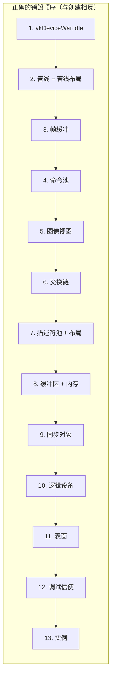
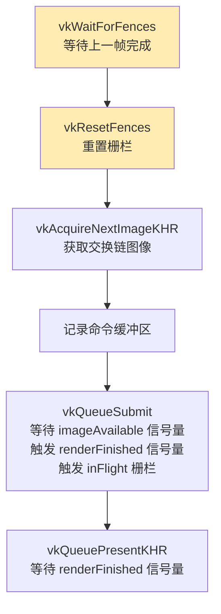

# 常见问题与易错大全（FAQ）

本页汇总了 Vulkan 开发中**最常见的错误、陷阱和调试方法**，按主题分类。

---

## 一、环境与驱动问题

### 核心验证层报访问冲突错误

确保 **MSI Afterburner / RivaTuner Statistics Server** 没有运行——它与 Vulkan 存在兼容性问题。

### 看不到验证层消息 / 验证层不可用

1. 确保程序退出后终端保持打开（Visual Studio 用 `Ctrl+F5` 运行）
2. 确认 Vulkan SDK 正确安装（运行 SDK 的 Verify Installation）
3. SDK 版本至少 **1.1.106.0** 才支持 `VK_LAYER_KHRONOS_validation`
4. 检查环境变量 `VK_LAYER_PATH` 是否指向 SDK 的 `Bin` 目录

### `vkCreateSwapchainKHR` 在 SteamOverlayVulkanLayer64.dll 中报错

Steam 客户端 Beta 兼容性问题。解决方案：

- 退出 Steam Beta 计划
- 设置环境变量 `DISABLE_VK_LAYER_VALVE_steam_overlay_1=1`
- 删除注册表中 Steam overlay Vulkan 层：  
  `HKEY_LOCAL_MACHINE\SOFTWARE\Khronos\Vulkan\ImplicitLayers`

### macOS 上 `vkCreateInstance` 返回 `VK_ERROR_INCOMPATIBLE_DRIVER`

Vulkan SDK 1.3.216+ 要求启用 MoltenVK 可移植性扩展：

```c++
requiredExtensions.emplace_back(VK_KHR_PORTABILITY_ENUMERATION_EXTENSION_NAME);
createInfo.flags |= VK_INSTANCE_CREATE_ENUMERATE_PORTABILITY_BIT_KHR;
```

### NVIDIA vs AMD 驱动差异

| 问题 | NVIDIA | AMD |
|------|--------|-----|
| 未初始化的 `sType` | 可能偶然正常 | 直接崩溃 |
| 内存类型选择 | 通常有 `HOST_VISIBLE` + `DEVICE_LOCAL` | 独立显卡通常没有 |
| `vkDeviceWaitIdle` 位置不对 | 可能不崩溃 | 可能立即报错 |
| 验证层错误但无崩溃 | 常见 | 常见 |

> ⚠️ **不要因为在一个 GPU 上跑通就认为代码正确**——始终依赖验证层。

---

## 二、最常见编程错误（按频率排序）

### ❶ 忘记设置 `sType`（出现频率：极高）

```c++
// ❌ 结构体没设 sType → 未定义行为
VkBufferCreateInfo bufferInfo;   // 未初始化！
bufferInfo.size = 1024;
bufferInfo.usage = VK_BUFFER_USAGE_VERTEX_BUFFER_BIT;
// sType 是随机值 → 可能崩溃、可能静默失败

// ✅ 始终用 {} 初始化 + 设置 sType
VkBufferCreateInfo bufferInfo{};  // 全部清零
bufferInfo.sType = VK_STRUCTURE_TYPE_BUFFER_CREATE_INFO;
```

> 💡 **规则**：Vulkan 的每个 `*CreateInfo`、`*AllocateInfo`、`*BeginInfo` 结构体**第一件事就是设 sType**。

### ❷ 资源销毁顺序错误（出现频率：极高）



```c++
// ❌ 典型错误：还有命令在 GPU 执行就销毁资源
vkDestroyBuffer(device, buffer, nullptr);  // GPU 正在用！→ 崩溃

// ✅ 先等 GPU 完成
vkDeviceWaitIdle(device);
// 然后按反序销毁
```

**完整销毁顺序参考表**：

| 顺序 | 资源 | 说明 |
|------|------|------|
| 0 | `vkDeviceWaitIdle` | 确保 GPU 空闲 |
| 1 | 同步对象 | 信号量、栅栏 |
| 2 | 命令池 | 包含命令缓冲区 |
| 3 | 帧缓冲 | 依赖图像视图 |
| 4 | 管线 + 管线布局 | 依赖渲染通道 |
| 5 | 渲染通道 | |
| 6 | 图像视图 | 依赖图像 |
| 7 | 交换链 | 包含交换链图像 |
| 8 | 纹理资源 | 采样器→视图→图像→内存 |
| 9 | 描述符池 + 布局 | |
| 10 | 缓冲区 + 内存 | `vkDestroyBuffer` → `vkFreeMemory` |
| 11 | 逻辑设备 | |
| 12 | 窗口表面 | |
| 13 | 调试信使 | |
| 14 | 实例 | 最后销毁 |

### ❸ `VK_ERROR_DEVICE_LOST`（GPU 崩溃）

最可怕的错误——GPU 挂起，整个设备不可用。

**常见原因**：
1. 着色器中死循环或无限递归
2. 访问了越界的缓冲区/图像（SSBO 索引错误）
3. 同步缺失导致读写冲突
4. 驱动 bug（罕见但存在）

```c++
VkResult result = vkQueueSubmit(graphicsQueue, 1, &submitInfo, fence);
if (result == VK_ERROR_DEVICE_LOST) {
    // GPU 已不可恢复——只能重新创建逻辑设备
    // 实际应用中通常弹出错误对话框并退出
    std::cerr << "GPU device lost! Possible causes:\n"
              << "- Shader infinite loop\n"
              << "- Buffer out-of-bounds access\n"
              << "- Missing synchronization\n";
}
```

### ❹ 验证层报 "access to resource not bound"

- 确认描述符集已正确绑定（`vkCmdBindDescriptorSets`）
- 确认缓冲区/图像在使用前已创建和分配内存
- 确认描述符集写入（`vkUpdateDescriptorSets`）的 binding 编号正确

### ❺ 屏幕全黑但无验证层错误

**系统化排查清单**：

```
□ 1. 着色器编译成功？（glslc 无错误，.spv 文件存在且非空）
□ 2. 着色器入口点是 "main"？（pName = "main"）
□ 3. vkCmdDraw / vkCmdDrawIndexed 参数正确？
      - vertexCount / indexCount > 0？
      - instanceCount = 1？
□ 4. 视口和裁剪矩形已设置？（动态状态需要 vkCmdSetViewport/Scissor）
□ 5. 渲染通道的 clearValues 正确？（深度清除为 1.0f）
□ 6. 帧缓冲附件包含正确的图像视图？
□ 7. 管线的 renderPass 与 vkCmdBeginRenderPass 中的一致？
□ 8. 描述符集布局与着色器 binding 匹配？
□ 9. 顶点数据实际上传到了 GPU？（vkMapMemory + memcpy）
□ 10. Uniform 数据正确？（矩阵是否为全零？proj 是否翻转 Y？）
□ 11. 背面剔除方向正确？（尝试 VK_CULL_MODE_NONE 排除）
□ 12. 深度测试的 compareOp 正确？（VK_COMPARE_OP_LESS）
```

### ❻ 图像上下颠倒

| 情况 | 原因 | 修复 |
|------|------|------|
| 整个画面倒置 | Vulkan Y 轴与 OpenGL 相反 | `proj[1][1] *= -1` |
| 纹理倒置 | OBJ 的 UV 原点在左下角 | `1.0f - texcoord.v` |
| 只有某些模型倒置 | winding order 不同 | 检查 `frontFace` 设置 |

---

## 三、同步错误（最难调试的类别）

### 信号量与栅栏使用错误

```c++
// ❌ 错误 1：忘记 Reset 栅栏
vkWaitForFences(device, 1, &fence, VK_TRUE, UINT64_MAX);
// 漏掉了 vkResetFences！→ 下一帧 Wait 立即返回 → 多帧同时渲染 → 数据竞争
vkResetFences(device, 1, &fence);  // ← 别忘了！

// ❌ 错误 2：信号量重复等待
// 一个信号量只能被 Wait 一次。两个 Submit 等同一个信号量 → 未定义行为

// ❌ 错误 3：vkAcquireNextImageKHR 在 WaitForFences 之前
// 可能在 GPU 还在使用那帧的资源时就获取了下一帧图像
```



### 管线屏障遗漏

```c++
// ❌ 纹理上传后没有布局转换就采样
// 图像还在 VK_IMAGE_LAYOUT_TRANSFER_DST_OPTIMAL 状态
// 着色器期望 VK_IMAGE_LAYOUT_SHADER_READ_ONLY_OPTIMAL → 渲染异常

// ✅ 每次用途变更都需要正确的布局转换 + access mask + stage mask
```

---

## 四、内存管理错误

### `vkAllocateMemory` 次数超限

```c++
// ❌ 每个缓冲区单独分配内存
for (int i = 0; i < 10000; i++) {
    vkAllocateMemory(device, &allocInfo, nullptr, &memory[i]);  // 可能超过 4096 次限制！
}
// maxMemoryAllocationCount 通常只有 4096（某些驱动更少）

// ✅ 使用 VMA（Vulkan Memory Allocator）或手动子分配
// VMA 示例：
// VmaAllocationCreateInfo allocInfo{};
// allocInfo.usage = VMA_MEMORY_USAGE_GPU_ONLY;
// vmaCreateBuffer(allocator, &bufferInfo, &allocInfo, &buffer, &allocation, nullptr);
```

### 内存泄漏检测

程序退出时验证层会报告未销毁的资源：

```
// 验证层消息示例：
// OBJ ERROR: VkBuffer 0x42 has not been destroyed.
// OBJ ERROR: VkDeviceMemory 0x43 has not been destroyed.
```

> 💡 **调试方法**：使用 `VK_EXT_debug_utils` 为每个资源命名：
> ```c++
> VkDebugUtilsObjectNameInfoEXT nameInfo{};
> nameInfo.sType = VK_STRUCTURE_TYPE_DEBUG_UTILS_OBJECT_NAME_INFO_EXT;
> nameInfo.objectType = VK_OBJECT_TYPE_BUFFER;
> nameInfo.objectHandle = (uint64_t)myBuffer;
> nameInfo.pObjectName = "Vertex Buffer - Main Model";
> vkSetDebugUtilsObjectNameEXT(device, &nameInfo);
> ```

### `vkBindBufferMemory` offset 对齐

```c++
// ❌ offset 不满足对齐要求
vkBindBufferMemory(device, buffer, memory, 17);  // 对齐要求可能是 256

// ✅ 使用 memRequirements.alignment 对齐 offset
VkDeviceSize alignedOffset = (offset + alignment - 1) & ~(alignment - 1);
vkBindBufferMemory(device, buffer, memory, alignedOffset);
```

---

## 五、着色器编译与 SPIR-V 错误

### glslc 编译常见错误

| 错误消息 | 原因 | 修复 |
|----------|------|------|
| `"main" not found` | 入口函数不叫 main | 检查着色器文件 |
| `location X already used` | 两个变量用了相同的 location | 修改 location 编号 |
| `binding X already used` | 两个描述符用了相同的 binding | 修改 binding 编号 |
| `type mismatch for location X` | 顶点着色器输出类型与片段着色器输入不匹配 | 确保类型一致 |
| `undeclared identifier` | GLSL 版本不支持该函数 | 检查 `#version` 声明 |

### 着色器与 C++ 端不匹配

```c++
// ❌ C++ 端 Vertex 结构体的字段顺序和着色器 location 不匹配
struct Vertex {
    glm::vec3 color;    // C++ 端先 color
    glm::vec2 pos;      // 再 pos
};
// 但着色器中：
// layout(location = 0) in vec2 inPosition;  ← 期望 pos 在前！

// ✅ 使用 offsetof 确保正确：
attributeDescriptions[0].offset = offsetof(Vertex, pos);    // 位置偏移
attributeDescriptions[1].offset = offsetof(Vertex, color);  // 颜色偏移
```

---

## 六、std140 / std430 内存对齐陷阱

这是 **UBO 和 SSBO 中最隐蔽的错误来源**：

```c++
// ❌ 致命陷阱：vec3 在 std140 中占 16 字节，不是 12 字节！
struct UBO_Wrong {
    glm::vec3 lightPos;   // 占 16 字节（std140 规则）
    float intensity;      // 被填充到 lightPos 后面的第 4 个分量位置
    glm::mat4 mvp;        // 从偏移 16 开始——正确
};

// ✅ 安全做法：始终使用 alignas 或 vec4 替代 vec3
struct UBO_Correct {
    alignas(16) glm::vec3 lightPos;  // 显式 16 字节对齐
    float intensity;                  // 紧跟在 pad 后
    alignas(16) glm::mat4 mvp;
};

// ✅ 更安全：直接用 vec4
struct UBO_Safest {
    glm::vec4 lightPosAndIntensity;  // xyz = pos, w = intensity
    glm::mat4 mvp;
};
```

**std140 对齐规则快速参考**：

| GLSL 类型 | 对齐 | 大小 | C++ 对应 |
|-----------|------|------|----------|
| `float` | 4 | 4 | `float` |
| `vec2` | 8 | 8 | `glm::vec2` |
| `vec3` | **16** | 12 | `alignas(16) glm::vec3` |
| `vec4` | 16 | 16 | `glm::vec4` |
| `mat4` | 16 | 64 | `alignas(16) glm::mat4` |
| `int` | 4 | 4 | `int32_t` |
| `ivec2` | 8 | 8 | `glm::ivec2` |
| `bool` | 4 | 4 | `VkBool32` 或 `int32_t`（**不是 C++ bool！**） |

> ⚠️ **最大陷阱**：`vec3` 的对齐是 16 而不是 12。在 `vec3` 后面紧跟 `float` 会被吃掉！

---

## 七、性能陷阱

### 帧率低的排查

| 检查项 | 影响 |
|--------|------|
| Debug 构建模式 | 可能慢 10-50 倍 |
| 验证层开启 | 降低 30-50% 性能 |
| 每帧创建/销毁资源 | 极慢 |
| 每帧重建管线 | 极慢 |
| `HOST_VISIBLE` 内存渲染 | 比 `DEVICE_LOCAL` 慢很多 |
| 过多 `vkAllocateMemory` | 分配器开销 |
| 未使用 staging buffer | CPU↔GPU 传输瓶颈 |
| `VK_PRESENT_MODE_IMMEDIATE_KHR` | 无 V-Sync |
| `VK_PRESENT_MODE_FIFO_KHR` | V-Sync，锁定刷新率 |
| `VK_PRESENT_MODE_MAILBOX_KHR` | 最低延迟，但更耗电 |

### 内存使用过高

- 使用暂存缓冲区上传后及时清理
- 纹理使用合适的分辨率和格式（BC/ASTC 压缩纹理）
- 考虑使用 [VMA（Vulkan Memory Allocator）](https://github.com/GPUOpen-LibrariesAndSDKs/VulkanMemoryAllocator) 管理内存

---

## 八、调试工具使用指南

### 验证层消息解读

```
// 示例验证层消息：
// Validation Error: [ VUID-vkCmdDraw-None-02699 ]
// Object 0: handle = 0x1234, type = VK_OBJECT_TYPE_COMMAND_BUFFER
// | MessageID = 0xabcdef | vkCmdDraw(): ...
```

| 字段 | 含义 |
|------|------|
| `VUID-xxx` | Vulkan 规范中的唯一验证 ID，可搜索 |
| `Object` | 触发错误的 Vulkan 对象 |
| `MessageID` | 错误的哈希 ID |
| 消息正文 | 具体错误描述 |

> 💡 在 [Vulkan 规范](https://registry.khronos.org/vulkan/specs/1.3/html/) 中搜索 VUID 可获取详细说明。

### RenderDoc 基础使用

1. 打开 RenderDoc → Launch Application → 选择你的可执行文件
2. 运行后按 `F12` 或 `Print Screen` 捕获一帧
3. 在 Texture Viewer 中查看每个附件的输出
4. 在 Pipeline State 中验证所有管线状态
5. 在 Mesh Viewer 中查看实际的顶点数据
6. 在 Resource Inspector 中检查缓冲区内容

### `VK_EXT_debug_utils` 为对象命名

```c++
// 为每个重要对象命名，验证层报错时显示名称而非地址
void setDebugName(VkDevice device, uint64_t object, VkObjectType type, const char* name) {
    VkDebugUtilsObjectNameInfoEXT nameInfo{};
    nameInfo.sType = VK_STRUCTURE_TYPE_DEBUG_UTILS_OBJECT_NAME_INFO_EXT;
    nameInfo.objectType = type;
    nameInfo.objectHandle = object;
    nameInfo.pObjectName = name;
    vkSetDebugUtilsObjectNameEXT(device, &nameInfo);
}

// 使用示例
setDebugName(device, (uint64_t)vertexBuffer, VK_OBJECT_TYPE_BUFFER, "Main Vertex Buffer");
setDebugName(device, (uint64_t)graphicsPipeline, VK_OBJECT_TYPE_PIPELINE, "Solid Pipeline");
```

### 调试工具对照表

| 工具 | 用途 | 平台 |
|------|------|------|
| Vulkan 验证层 | API 使用错误检测 | 全平台 |
| RenderDoc | GPU 帧分析、着色器调试 | Windows/Linux |
| NVIDIA Nsight Graphics | 性能分析、帧调试 | NVIDIA GPU |
| AMD Radeon GPU Profiler | 性能分析 | AMD GPU |
| Intel GPA | 帧分析 | Intel GPU |
| `VK_EXT_debug_utils` | 对象命名、标记 | 全平台 |
| GPU-assisted validation | 检测越界访问等运行时错误 | 全平台 |

> 💡 开发时**始终启用验证层**。很多隐蔽的错误只有验证层才能发现。发布前禁用以获得最佳性能。
